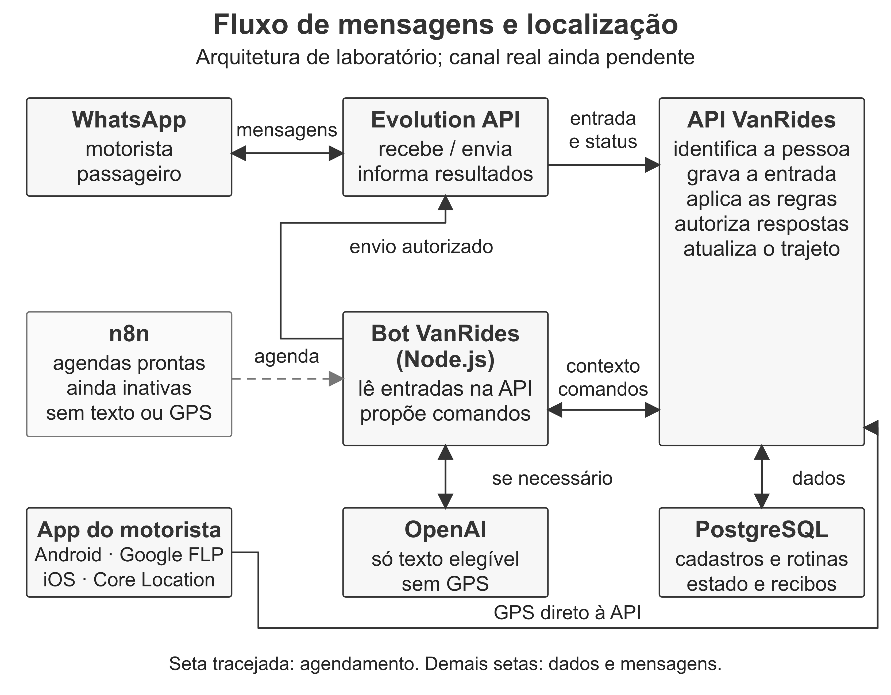
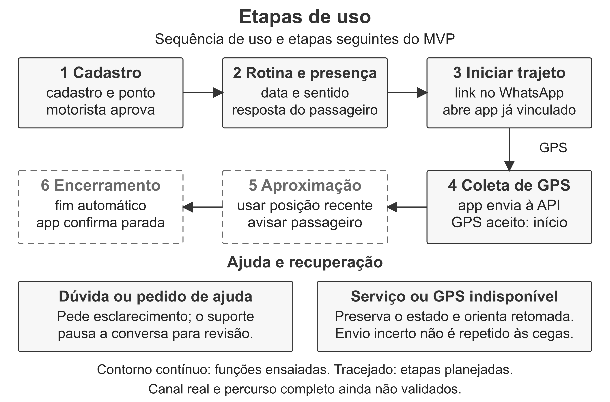

# Arquitetura e decisões

O VanRides combina conversa pelo WhatsApp, uma API que mantém as regras e um
aplicativo do motorista que coleta a localização. Os desenhos separam a troca
de mensagens da sequência de uso, com aproximação e fim automático identificados
como etapas planejadas.

## Componentes e trocas

[Abrir o desenho em SVG editável](assets/arquitetura-fluxo.svg)

1. O WhatsApp entrega a mensagem à Evolution API. A Evolution envia a entrada
   e as atualizações de entrega à API do VanRides, que registra os eventos.
2. O n8n agenda e aciona o **Bot VanRides (Node.js)**, programa que processa
   conversas e envios. A seta tracejada no desenho representa esse controle;
   as demais setas representam dados e mensagens. O n8n recebe apenas resultados
   de controle, sem texto das conversas ou GPS.
3. O Bot VanRides lê a mensagem e o contexto na API. As regras conhecidas são
   tratadas diretamente; a OpenAI pode interpretar somente texto elegível.
   A API confere a pessoa, a ação e a autorização antes de alterar dados.
4. A API registra a resposta e autoriza o envio. O bot a envia pela
   Evolution ao WhatsApp e devolve o resultado à API. Uma atualização de entrega
   recebida depois também volta à API.
5. O aplicativo do motorista coleta a localização com **Google FLP no Android**
   e **Core Location da Apple no iPhone** e envia as posições diretamente à API.
   O link abre a confirmação da coleta nesse aplicativo. Navegação externa
   não faz parte do MVP.
   O PostgreSQL guarda cadastros, rotinas e o estado das operações.

O aplicativo é o coletor de localização e controla o início e a parada da coleta.
Google FLP e Core Location são os recursos usados para obter a posição do aparelho.
O MVP usa esses dados para acompanhar a van e preparar os avisos de aproximação.
A integração com aplicativos de navegação foi retirada do recorte em 02/11/2026.

## Jornada de cadastro e transporte

[Abrir a jornada em SVG editável](assets/jornada-fluxo.svg)

| Momento | Como funciona | Situação |
|---|---|---|
| Cadastro e ponto | O passageiro usa o convite, informa o ponto e aguarda a aprovação do motorista. | Implementado e ensaiado em laboratório |
| Rotina e presença | O motorista organiza dias e horários; o passageiro responde por data e sentido. O silêncio mantém a presença pendente. | Implementado e ensaiado em laboratório |
| Início | A API prepara o link enviado pelo WhatsApp. Ele abre o aplicativo já vinculado; o motorista confirma a coleta. | Implementado e ensaiado em laboratório |
| GPS | O aplicativo coleta a localização com Google FLP no Android ou Core Location no iPhone e a envia à API. A confirmação de início depende de posição válida recebida, não apenas da abertura do link. | Integração ensaiada no Android; percurso completo pendente |
| Aproximação | A API avalia posição recente, ponto, ordem e sentido para avisar o passageiro elegível. | Regra testada em PostgreSQL; aceite de utilidade em percurso pendente |
| Encerramento | A API deverá reconhecer o fim e coordenar a parada do aplicativo; a finalização manual será contingência. | Fim automático planejado; parada técnica tem ensaio próprio |

## Dúvidas e indisponibilidade

Uma mensagem ambígua pede esclarecimento. O pedido explícito de atendimento humano
pausa a conversa e registra a necessidade de suporte. A IA não escolhe outra pessoa
nem concede permissão para alterar seus dados.

Se o serviço estiver indisponível, o estado já registrado é preservado para
retomada. Um envio cujo resultado é incerto não deve ser repetido sem verificar
o que aconteceu. GPS ausente ou antigo não autoriza a confirmação de início;
a API revalida a posição e a elegibilidade antes de enviar o aviso.

## Decisões principais

| Decisão | Motivo |
|---|---|
| WhatsApp para cadastro e presença | Aproveitar um canal já utilizado pelos usuários |
| Aplicativo do motorista para GPS | Coletar em segundo plano e controlar início e parada |
| Entrada e regras concentradas na API | Preservar estado e autorização mesmo quando uma integração falha |
| Bot VanRides separado do agendamento n8n | Processar conversas e envios sem expor esses dados nas execuções do agendador |
| IA limitada à interpretação | Apoiar a conversa sem transferir a autorização das operações |
| Coleta dedicada no app | Acompanhar a van sem depender de um aplicativo de navegação |

Separar o bot do n8n evita que o texto das conversas circule nos itens de execução
do agendador e permite controlar cada tentativa de envio. Essa escolha também
exige manter outro serviço. Receber o webhook pelo n8n é uma alternativa a avaliar,
ainda não aprovada: seria preciso verificar a retenção de dados de execução e
preservar a confirmação após gravação na API, a deduplicação e o tratamento de
envio incerto. Acrescentar essa ponte mantendo o bot aumenta uma etapa; substituir
o bot exigiria transferir e testar sua lógica. A comparação deve considerar
o esforço de operação e o valor dos fluxos visuais para a equipe.

As versões estão na STACK e os resultados no [relatório de testes](03-testes-e-resultados.md).
Os fluxos desenhados representam implementação e planejamento, com ensaios de
laboratório. As oito automações do n8n estão preparadas e permanecem inativas
no ambiente conferido. O canal real, o percurso completo e o fim automático ainda não
constituem uma operação validada com usuários.
