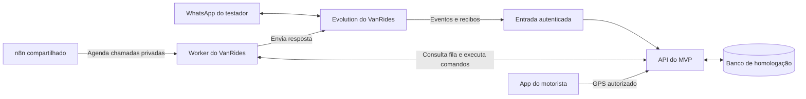

# Como colocar o MVP à disposição da equipe

O primeiro marco é uma API do MVP acessível por HTTPS, com versão identificada, dados de teste isolados e uma instrução que outro integrante consiga seguir. O segundo marco é testar uma conversa de WhatsApp com o número dedicado. A equipe já pode desenvolver e enviar PRs enquanto preparamos esses marcos.

## O que já existe

Em 03/11/2026, a VPS mostrou n8n 2.45.4 (editor, webhook e execução em fila), Evolution 2.3.7, Traefik, duas APIs VanRides com PostgreSQL e o receptor do experimento de GPS. A API de desenvolvimento usa a imagem dev-b438e2f e respondeu 200 a HEAD /motoristas. A API de produção usa prod-7231574. O healthz do n8n e a entrada HTTPS da Evolution responderam 200. Esses endereços servem as versões existentes.

O repositório acadêmico tem três colaboradores com permissão de escrita, além do proprietário. A equipe pode usar branches por issue, PRs e CI sem acesso administrativo à VPS. Os workflows atuais de contribuição constroem e testam imagens no runner. O laboratório temporário tem duração máxima de 30 minutos e não serve como ambiente compartilhado permanente.

## Entregas e critérios para começar

| Entrega | O que fazer | Como o grupo confere |
| --- | --- | --- |
| Versão da aplicação (#86 e issues do card 130) | A revisão dd12cf0 passou na suíte completa e nas seis jornadas no mesmo JAR. O próximo passo é a revisão do PR pelo grupo. | Registrar SHA, resultados e versão aprovada. |
| API de homologação (#89–90) | Preparar stack separada, API da revisão aprovada, PostgreSQL com volume próprio, segredos por ambiente, HTTPS, acesso restrito e dados de exemplo. Publicar imagens por digest. | Um colega consulta a versão implantada e reproduz uma operação autenticada em sua massa de teste. Uma atualização preserva os dados. O retorno à versão anterior foi ensaiado. |
| Atendimento integrado (#81–82 e #91) | Publicar o worker do VanRides. O n8n agenda chamadas privadas ao worker. A API recebe os eventos da Evolution. Remapear URLs, credenciais, IDs e referências dos workflows no n8n de destino. | Provar a execução com o worker real a partir da fila do n8n, conferir uma operação de negócio e um envio. Para ensaio sem bot usar o provedor simulado do CI ou preparar um simulador isolado se o time precisar dele sempre ligado. |
| WhatsApp real (#91) | Usar o serviço Evolution exclusivo previsto na decisão RD41 para a primeira prova real, com sessão, armazenamento e credenciais próprios. A Evolution compartilhada ainda guarda contatos e etiquetas. Parear o WhatsApp Business do Redmi e cadastrar apenas contatos de teste consentidos. | Começar com um contato. Enviar, receber a resposta no celular e correlacionar a confirmação da Evolution ao envio. Depois repetir com um segundo integrante. |
| Celular do motorista (#87–88) | Compilar o app de motorista para o endereço da API e configurar o mesmo host de links no Android e no Dart. Servir assetlinks.json com o certificado do APK e as páginas de retorno e início. | Usar o Redmi para validar início, atualização, interrupção e revogação. Registrar a validação física do iPhone como pausada. |
| Rotina de contribuição | Identificar versão e estado da homologação no repositório. Separar testes por integrante, documentar recuperação dos dados e designar quem pode promover uma versão. | Cada colega consegue clonar, escolher uma issue e reproduzir um cenário seguindo o guia. Um PR aprovado pode ser promovido e a versão conferida na VPS. |

## Topologia proposta

- O perfil homolog exige os controles de um endereço público. A primeira entrega técnica prevê um modo dedicado que bloqueie e-mail e rotas legadas também na API. Isso ainda requer implementação e testes. A prova para o colega deve usar credencial expirada ou incorreta como caso negativo e credencial própria válida para executar e repetir uma operação sintética.
- Hospedar a API do MVP e seu banco numa stack independente. Manter o worker em rede privada. Expor via Traefik apenas os caminhos necessários, protegendo os caminhos internos. O app do motorista comunica o GPS à API diretamente.
- Reutilizar o executor n8n com uma rota privada até o worker e credencial só de controle. Para a prova temporária do bot, seguir RD41 e usar Evolution própria e loopback conforme o pacote aprovado. Em uma homologação permanente, definir o caminho privado/TLS, banco e cache da sessão e a política de retenção. Em 03/11, as opções de persistência de contatos e etiquetas continuam habilitadas na Evolution compartilhada. Criar uma instância nela não isola essas opções globais. As credenciais de controle, API, instância e eventos têm finalidades diferentes.
- Hoje o worker só aceita o identificador histórico wa070-local. Para um ambiente permanente, implementar um perfil explícito de homologação que mantenha as restrições existentes. Os exports do n8n estão inativos no Git e apontam para o host histórico. A CI usa um controle simulado no teste de n8n. A integração em fila precisa de prova com o worker real.
- O ingresso de laboratório aceita até dois contatos por 30 minutos. Para os colegas testarem continuamente no WhatsApp, preparar admissão de participantes, expiração, retomada após reinício e limpeza próprias da homologação. O primeiro envio deve ter callback correlacionado antes de ampliar os testes.
- O endereço escolhido pela equipe é vanrides-inovacao-api.matheusduarte.dev.br. O proprietário criou o registro A na zona matheusduarte.dev.br. Google DNS e Cloudflare DNS retornaram 187.77.47.96 com TTL de 300 segundos em 03/11/2026. A própria VPS também resolveu o nome. Na mesma rodada o resolvedor do Mac ainda retornou NXDOMAIN. A conexão direta ao IP com o nome escolhido apresentou o certificado padrão do Traefik. Falta configurar a rota, obter o certificado correto e validar a resposta da nova API após a publicação.
- Usar dados sintéticos primeiro. Os testes determinísticos podem ser feitos sem cobrança de modelo. Habilitar participantes reais, avisos de aproximação, serviços pagos e testes de campo somente dentro dos critérios de cada etapa.

O pacote de publicação precisa fixar revisão/imagens, serviços e redes afetados, migração, verificação após o deploy, responsáveis e retorno testado. Uma versão compartilhada para desenvolvimento e a liberação do piloto para passageiros têm critérios próprios.

Os critérios da primeira publicação e do teste com um colega estão no [roteiro de implantação](../runbooks/whatsapp-mvp/homologacao-api.md).
