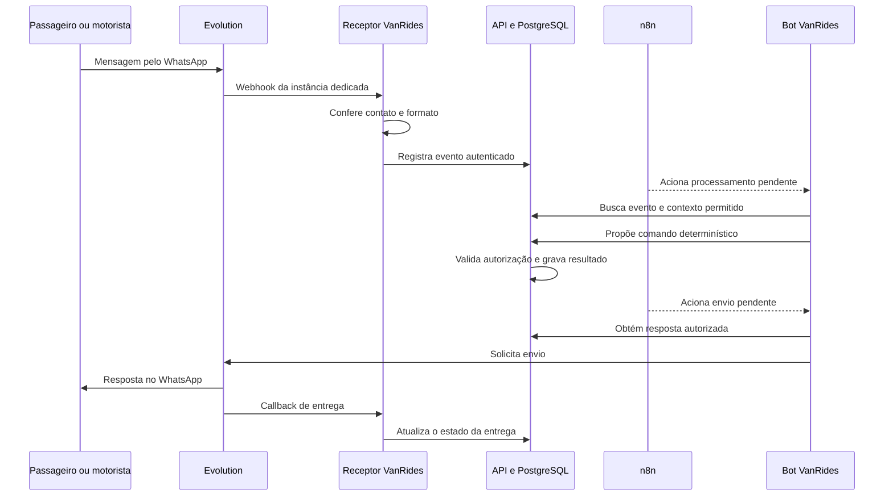

# Desenvolvimento compartilhado do VanRides

**Endereço:** <https://vanrides-inovacao-api.matheusduarte.dev.br>

**Conferência de 09/11/2026:** API respondendo UP e nove serviços com uma réplica em execução. Um passageiro está admitido e um novo motorista recebeu liberação técnica e convite privado; ele ainda precisa concluir o cadastro e criar a rotina. As provas anteriores de cadastro básico do passageiro permanecem registradas; a jornada completa e o percurso ainda precisam de validação.

Usamos um único ambiente de desenvolvimento compartilhado. Os nomes técnicos ainda dizem “hml”; não existe produção real liberada para usuários. Stage e produção separados ficam para a versão 1.0.

**Ativo:** push/merge na `main` constrói a API/imagem e publica automaticamente
neste endereço, sem suítes de testes na esteira. PRs e pushes em `dev` apenas
constroem. A [área da equipe](https://vanrides-inovacao-api.matheusduarte.dev.br/equipe)
permite aos integrantes com escrita no GitHub liberar participantes e preparar
convites sem acesso à VPS. Veja o [passo a passo](area-da-equipe.md) e o
[funcionamento do deploy](../../deploy/homologacao/AUTOMATICO.md).

## O que cada integrante pode acessar

| Acesso | Como usar | Condição atual |
| --- | --- | --- |
| [Saúde da API](https://vanrides-inovacao-api.matheusduarte.dev.br/actuator/health) | Abrir no navegador; esperado HTTP 200 e `{"status":"UP"}`. | Público, disponível para os quatro integrantes. Não testa uma jornada de negócio. |
| [APK do motorista](https://vanrides-inovacao-api.matheusduarte.dev.br/motorista/VanRides.apk) | Baixar no Android e instalar o VanRides Motorista **0.3.0-hml+13**. | Download público; já aponta para a API online. Instalar não habilita automaticamente um motorista. |
| [Área da equipe](https://vanrides-inovacao-api.matheusduarte.dev.br/equipe) | Entrar com GitHub, informar o contato autorizado e escolher passageiro ou motorista. | Login do mantenedor e operações reais validados; confirmar primeiro acesso individual dos colegas. |
| Bot pelo WhatsApp | Obter o contato do bot por canal privado, liberar seu número pela área da equipe e enviar `AJUDA`. | Bot conectado. Passageiro ativo e convite individual do motorista preservados. O cadastro continua no WhatsApp. |
| API de produto | O app e o atendimento usam as credenciais próprias de cada fluxo. | Rotas `/driver-app/v1/` e `/integrations/whatsapp/v1/` exigem autenticação. Receber 401 ao abrir no navegador é esperado. |
| Código e issues | Usar este repositório e o [guia de contribuição](../../CONTRIBUTING.md). | Desenvolvimento e testes sintéticos independem da liberação do número. Veja abaixo a diferença entre `main`, branch e versão publicada. |
| n8n, Evolution, banco e VPS | Operação por Matheus. Alterações são preparadas no Git e revisadas antes da publicação. | Não são painéis de teste abertos para o grupo. O acesso de cada colega a esses painéis não foi provisionado. Não compartilhar senha, SSH ou token de serviço. |

Todos usam a mesma URL e podem testar com identidades distintas. A restrição atual é a admissão do contato, não uma limitação a um colega por vez. O número do bot pertence ao WhatsApp Business do Redmi: ele recebe as mensagens e não serve como identidade de passageiro ou motorista. Para a jornada completa precisamos de um contato pessoal autorizado como motorista, além do passageiro.

A janela e as credenciais técnicas atuais vencem em **01/12/2026 às 00:00 UTC** (30/11 às 21h em Brasília). O operador deve renová-las antes de manter os testes depois desse horário. Contatos e credenciais ficam fora do Git.

## O que está hospedado e o que funciona

| Parte | Hospedagem e função | Prova e limite |
| --- | --- | --- |
| API Spring Boot e PostgreSQL | Regras, cadastros, vínculo, rotinas, presença, aparelho, viagens, GPS e filas de mensagens. Banco próprio da homologação. | API 200/UP e autenticação 401 sem credencial. Perfil do passageiro preservado depois da atualização. |
| Receptor de eventos | Recebe o webhook da Evolution, confere instância/contato/tipo de mensagem e encaminha o evento à API. | Texto e callbacks reais já atravessaram o receptor. Contato não admitido não entra no atendimento. |
| Bot VanRides / worker Node.js | Busca mensagens pendentes, propõe comandos à API e envia as respostas autorizadas pela Evolution. | Cadastro básico e quatro interações de retomada comprovados; 15 respostas entregues acumuladas na rodada documentada. **OpenAI está desabilitada** nessa homologação; os comandos são determinísticos. |
| n8n | Dispara processamento, envios e tarefas agendadas do worker; recebe resultados de controle, sem texto da conversa nem GPS. | Oito fluxos importados. W01/W04/W06/W08 ativos e com execuções recentes bem-sucedidas; W07 publicado para erros. W02/W03/W05 são subfluxos sem agenda própria. |
| Evolution, Redis e banco da sessão | Conexão dedicada do WhatsApp, envio, recebimento e callbacks de entrega. | Instância `vanrides-hml` em OPEN, separada dos outros projetos. |
| APK e páginas de vínculo/início | Arquivos HTTPS e links que abrem o aplicativo do motorista. | APK baixado e hash conferido. Vincular e iniciar pelo canal da equipe ainda requer o motorista participante. |
| Aproximação | Regra implementada na API, dependente de posição recente e passageiro elegível. | Testada em laboratório; **desabilitada no ambiente publicado** (`WA_APPROACH_ENABLED=false`) até calibração em percurso. |
| Encerramento e suporte | Parada técnica do coletor e pedido de suporte existem. | Encerramento automático completo e recuperação operacional pelo suporte permanecem pendentes. Pedir suporte pausa a conversa. |

A conferência encontrou nove serviços da homologação com 1/1 réplica: API, banco da API, servidor do APK e seis serviços do canal. O n8n é um serviço existente compartilhado, com fluxos exclusivos do VanRides. Isso comprova disponibilidade técnica; não substitui testes de percurso, bateria ou utilidade.

## Como a conversa passa pelos serviços

O n8n organiza quando processar e enviar. O worker executa essas operações; a API decide o que a pessoa pode fazer e guarda o estado. Por isso o n8n não aparece como intermediário de toda mensagem. O bot atual não depende de um modelo de IA para esses testes e não terá liberdade para conceder acesso ou inventar cadastros.

O GPS segue outro caminho: **aplicativo do motorista → API → PostgreSQL**. O Android usa Google Fused Location Provider e o iPhone usa Core Location. Nenhum deles depende de compartilhar localização pelo Google Maps, Waze ou WhatsApp. O passageiro fornece um **pin estático** para o ponto de embarque; não precisa transmitir localização contínua.

## Primeiro teste: passageiro sem motorista

1. Combine seu papel e peça a admissão do contato ao operador. Não publique número nem convite na issue.
2. Abra a conversa com o bot e envie `AJUDA`. Se não responder, confira primeiro se o contato já foi liberado; não reinstale o app do motorista para resolver isso.
3. Envie `QUERO ME CADASTRAR` e siga as perguntas. Informe o nome; leia o aviso de dados e responda `ACEITO` apenas se concordar.
4. Envie `AJUDA` ou `CONTINUAR CADASTRO`. Para perfil pronto e sem vínculo, a resposta deve orientar pedir e enviar o convite do motorista.
5. Envie `VOU HOJE`. Sem rotina elegível, o bot deve informar ausência de ocorrência. Isso **não cria uma presença**.
6. Envie `AJUDA` novamente. A conversa deve continuar normalmente, sem exigir `ABANDONAR` para sair de uma lista vazia.

Esse roteiro cobre perfil básico e orientação. Não cobre dias, ponto ou vínculo aprovado. Um passageiro já cadastrado pode seguir a partir do convite sem apagar o perfil.

## Jornada completa: motorista e passageiro

Esta sequência descreve a implementação a validar no ambiente compartilhado; não é uma declaração de que o percurso já passou.

1. **Preparar o motorista.** O operador admite o contato no lote da equipe e no receptor, e fornece convite individual. O novo motorista envia **somente o código recebido**, antes de concluir o aceite do cadastro. Depois usa `AJUDA` e segue nome e `ACEITO`. Escrever `SOU MOTORISTA` sozinho não habilita acesso; um passageiro já ativo não deve ser convertido improvisadamente.
2. **Configurar a rotina.** Usar `ROTINAS → CRIAR`, informar nome, `IDA` ou `VOLTA`, dias numéricos (ex.: `1,2,3,4,5`), horário `HH:mm`, fuso (`BRASÍLIA` ou `MANTER`) e pin estático do destino. Revisar e enviar `CONFIRMAR <marcador recebido>`. Ida e volta são rotinas separadas; para testar hoje, incluir o dia atual.
3. **Convidar o passageiro.** O motorista usa `ROTINAS → CONVIDAR → PADRÃO` e confirma o resumo (um uso, 24 horas) e o passageiro envia somente `PASSAGEIRO <código recebido>` ao bot, sem copiar o texto explicativo ou a validade junto. Confere o motorista apresentado e segue as perguntas de preferências, rotina, dias, pin estático e referência. Use as opções e a confirmação oferecidas na própria conversa; não reutilize códigos de confirmação de outro teste.
4. **Aprovar vínculo e ponto.** O motorista usa `PASSAGEIROS → APROVAR N`, revisa e confirma. Depois usa `ROTINAS → ORDEM N`, informa todos os pontos na ordem desejada e confirma o novo resumo. Ponto inválido precisa de correção; pedido não aprovado não deve produzir presença elegível.
5. **Vincular o aplicativo.** No Android, instalar o APK da equipe. No app, tocar em **Vincular este celular → Mostrar código**; enviar somente as oito letras ao bot pelo WhatsApp do motorista e depois tocar em **Atualizar vínculo** e esperar **Aparelho vinculado**. O código dura cinco minutos. Não preencher o APK com tokens da API ou credenciais administrativas.
6. **Confirmar presença.** Aguardar a agenda W04 criar as ocorrências. Consultar `PRESENÇA`, conferir data/sentido e responder `VOU N` ou `NÃO VOU N` para a opção apresentada. O motorista consulta `PRESENÇAS` e escolhe a ocorrência. `VOU HOJE` e `NÃO VOU HOJE`, com ida/volta quando necessário, devem levar à ocorrência e confirmação corretas. O passageiro habitual que não responde continua previsto, identificado como pendente.
7. **Iniciar e observar o GPS.** O motorista envia `INICIAR SAÍDA`, escolhe o número da ocorrência de hoje, revisa a lista e confirma. Recebe o link individual, válido por cinco minutos. Abre o app (ou toca em **Abrir VanRides Motorista** na página), permite localização precisa/notificações e toca em **Iniciar localização desta saída**. Aguarda **Posição recente recebida** e a confirmação do bot. Abrir o link não prova início: a API precisa aceitar uma posição válida. O passageiro elegível pode consultar `ONDE ESTÁ A VAN`; posição ausente ou antiga não deve ser apresentada como atual.
8. **Terminar o ensaio.** Tocar em **Parar localização** no aplicativo e conferir o estado no receptor/API com o operador. Isso encerra a coleta, **não conclui a viagem**: ela pode ficar degradada ou com início falho. Os comandos de finalização da viagem ainda não estão disponíveis. Não presumir que fechar a tela encerra a coleta. Para repetir a coleta, usar `RETOMAR SAÍDA`, escolher a ocorrência, confirmar e abrir o novo link. O fim automático e o aviso de aproximação ficam para as etapas pendentes.

O pin deve ser enviado pela função de **localização estática do WhatsApp**; texto com coordenadas ou link de mapa não substitui esse formato.

Os testes físicos do aplicativo iPhone continuam pausados. Usar o WhatsApp pessoal de um iPhone como passageiro é independente dessa pausa. Não há distribuição iOS pronta para o grupo pelo link do APK.

## Registrar um teste ou investigar uma falha

Na issue da funcionalidade, anote: versão do APK, revisão da API informada pelo operador, papel usado, cenário, resultado esperado, resultado observado e horário com fuso. O operador correlaciona isso com estados e recibos. Não anexe conversa completa, telefone, pin, coordenadas, QR, convite ou token.

| Sintoma | Conferência inicial |
| --- | --- |
| Saúde responde, mas bot fica em silêncio | Contato admitido, janela válida, conexão do bot e agendas. API saudável sozinha não prova o canal. |
| Cadastro básico pronto, sem avançar para o ponto | Falta convite de passageiro e rotina de motorista. `CONTINUAR CADASTRO` não cria esse vínculo. |
| Presença sem ocorrência | Verificar vínculo aprovado, rotina, dias, sentido, ponto e data. Não tratar a mensagem como confirmação de presença. |
| APK instalado, mas não inicia GPS | Conferir versão online, vínculo do aparelho, papel de motorista e link de início vigente; depois rede e permissões. |
| Nenhum aviso de aproximação | A função está desligada na homologação atual. Não há ETA prometido. |
| Conversa parou após pedir suporte | Pedido de suporte pausa o atendimento; requer recuperação pelo operador. Evite usar esse comando como teste genérico de resposta. |

## Código publicado, main e contribuições

A `main` atualiza automaticamente **a API e sua interface**. O workflow tem
construção/publicação da imagem e deploy por digest com verificação de saúde.
Ele não executa suítes de testes e não publica n8n, Evolution, receptor, worker
ou APK. O primeiro ciclo completo levou **2 min 22 s**; o build do PR levou
33 s no total. [Execução da ativação](https://github.com/mathwidu/Vanrides-Projeto-Inovacao/actions/runs/42643485312).

| Referência | Conteúdo nesta conferência |
| --- | --- |
| Primeira ativação `f433dbf` / PR #108 | Integração preservando PRs #105/#106 e a API anterior, área da equipe e CI/CD simples. |
| API/interface | Publicadas pelo Actions; a imagem efetiva e a revisão ficam no resumo de cada execução. |
| Receptor de mensagens | Admissão pela API habilitada; permite contatos liberados pela equipe e ignora desconhecidos. |
| Migração V39 | Aplicada. Backup anterior restaurado e conteúdo de 74 tabelas conferido em instância isolada. |
| PR #107 | Trabalho incorporado à integração do #108; não usar sua revisão antiga como API hospedada. |

Para desenvolver, siga [CONTRIBUTING.md](../../CONTRIBUTING.md) e abra uma branch a partir da `main` atualizada. Para reproduzir a integração antes de ela entrar na `main`, use a branch do PR correspondente quando estiver publicada. Combine a tarefa na issue para evitar alterações simultâneas no mesmo fluxo. Mudanças locais não aparecem no bot hospedado.

## Referências e versões

- [Evidência do passageiro e das correções publicadas](../runbooks/whatsapp-mvp/cadastro-passageiro-sem-motorista.md).
- [Operação do canal](../runbooks/whatsapp-mvp/homologacao-canal.md) e [receita da API](../runbooks/whatsapp-mvp/homologacao-api.md).
- [Arquitetura](../02-arquitetura-e-decisoes.md) e [especificações das tarefas](../08-especificacoes-mvp.md).
- Issues: [API #89](https://github.com/mathwidu/Vanrides-Projeto-Inovacao/issues/89), [publicação #90](https://github.com/mathwidu/Vanrides-Projeto-Inovacao/issues/90), [canal #91](https://github.com/mathwidu/Vanrides-Projeto-Inovacao/issues/91), [Android #87](https://github.com/mathwidu/Vanrides-Projeto-Inovacao/issues/87), [passageiro #28](https://github.com/mathwidu/Vanrides-Projeto-Inovacao/issues/28).
- APK: 68.903.599 bytes; SHA-256 `c438bb3566f87d3ca836096c2d962963ae5de12edbd6d2c2c67104ff9e0210a9`.
- Os APKs históricos `0.1.0+8` (receptor GPS) e `0.2.0+12` (laboratório por USB/localhost) não substituem o `0.3.0-hml+13` deste ambiente.
