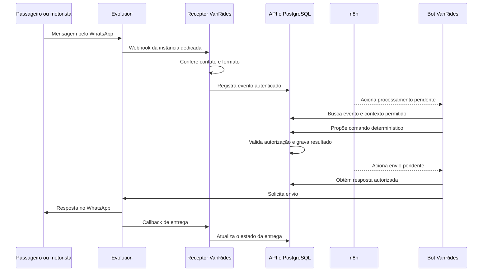

# Desenvolvimento compartilhado do VanRides

**Endereço:** <https://vanrides-inovacao-api.matheusduarte.dev.br>

Em 16/11/2026, a API está na revisão `880ea56`, com banco V43 e HTTPS
saudável. Presença/avisos e retomada do suporte entraram pelo
[PR #122](https://github.com/mathwidu/Vanrides-Projeto-Inovacao/pull/122);
finalização e preparo dos aplicativos pelo
[PR #123](https://github.com/mathwidu/Vanrides-Projeto-Inovacao/pull/123).
O agente atualizado está publicado, e o APK 0.4.0+14 está disponível abaixo.

O cadastro por convite foi validado no WhatsApp em 15/11; o
[guia de cadastro](cadastro-guiado-whatsapp.md) preserva essa evidência.
A jornada com presença, GPS, avisos e finalização na mesma saída ainda precisa
da conferência no WhatsApp/aparelho. Publicação saudável não encerra essa validação.

Usamos um único ambiente de desenvolvimento compartilhado. Os nomes técnicos ainda dizem “hml”; não existe produção real liberada para usuários. Stage e produção separados ficam para a versão 1.0.

**Ativo:** push/merge na `main` constrói a API/imagem e publica automaticamente
neste endereço, sem suítes de testes na esteira. PRs e pushes em `dev` apenas
constroem. A [área da equipe](https://vanrides-inovacao-api.matheusduarte.dev.br/equipe)
permite aos integrantes com escrita no GitHub liberar participantes e preparar
convites sem acesso à VPS. Veja o [passo a passo](area-da-equipe.md) e o
[funcionamento do deploy](../../deploy/homologacao/AUTOMATICO.md).

## Escolher como testar

| Quero verificar | Como começar | O que consigo testar |
| --- | --- | --- |
| Entender o fluxo sozinho | Abra **Simular conversas** na [área da equipe](https://vanrides-inovacao-api.matheusduarte.dev.br/equipe). | Os dois papéis com dados fictícios no navegador. |
| Testar o cadastro com meu WhatsApp | Entre no painel com GitHub, libere seu número como passageiro e escolha [Testar com o WhatsApp](area-da-equipe.md#testar-o-passageiro-com-o-motorista-de-teste). | Convite, ponto, correção e aprovação com um motorista de teste no painel. |
| Testar presença e GPS no ambiente publicado | Combine um número de motorista e outro de passageiro e siga a [jornada com dois papéis](#jornada-completa-motorista-e-passageiro). Para GPS, instale o APK no Android do motorista. | Preparação da rotina, presença na ocorrência certa e início e parada do compartilhamento. |
| Validar uma mudança da minha branch | Use o [guia de contribuição](../../CONTRIBUTING.md) para rodar o componente localmente e abrir o PR. | A alteração do PR, com dados de teste e canal simulado quando necessário. |

## O que cada integrante pode acessar

| Acesso | Como usar | Condição atual |
| --- | --- | --- |
| [Saúde da API](https://vanrides-inovacao-api.matheusduarte.dev.br/actuator/health) | Abrir no navegador; esperado HTTP 200 e `{"status":"UP"}`. | Público, disponível para os quatro integrantes. Não testa uma jornada de negócio. |
| [APK do motorista](https://vanrides-inovacao-api.matheusduarte.dev.br/motorista/VanRides.apk) | Baixar no Android e instalar o VanRides Motorista **0.4.0+14**. | Download público; já aponta para a API online. Instalar não habilita automaticamente um motorista. |
| [Área da equipe](https://vanrides-inovacao-api.matheusduarte.dev.br/equipe) | Entrar com GitHub, informar o contato que aceitou participar e escolher passageiro ou motorista. | Disponível para contas com escrita no repositório. |
| Bot pelo WhatsApp | Abra o convite individual ou use **Abrir conversa com o bot** no painel e envie `AJUDA`. | O cadastro é feito na conversa. O convite por link é o caminho padrão do passageiro. |
| API de produto | O app e o atendimento usam as credenciais próprias de cada fluxo. | Rotas `/driver-app/v1/` e `/integrations/whatsapp/v1/` exigem autenticação. Receber 401 ao abrir no navegador é esperado. |
| Código e issues | Usar este repositório e o [guia de contribuição](../../CONTRIBUTING.md). | Desenvolvimento e testes sintéticos independem da liberação do número. Veja abaixo a diferença entre `main`, branch e versão publicada. |
| n8n, Evolution, banco e VPS | Operação por Matheus. Alterações são preparadas no Git e revisadas antes da publicação. | Não são painéis de teste abertos para o grupo. O acesso de cada colega a esses painéis não foi provisionado. Não compartilhar senha, SSH ou token de serviço. |

Todos usam a mesma URL e podem testar com identidades distintas. O número do
bot recebe as mensagens do WhatsApp. Para a jornada completa, use números
diferentes para motorista e passageiro. O motorista é liberado no painel
antes de enviar seu código. O passageiro pode iniciar pelo link individual.

A janela e as credenciais técnicas atuais vencem em **01/12/2026 às 00:00 UTC** (30/11 às 21h em Brasília). O operador deve renová-las antes de manter os testes depois desse horário. Contatos e credenciais ficam fora do Git.

## O que está hospedado e o que funciona

| Parte | Hospedagem e função | Prova e limite |
| --- | --- | --- |
| API Spring Boot e PostgreSQL | Regras, cadastros, vínculo, rotinas, presença, aparelho, viagens, GPS e filas de mensagens. Banco próprio da homologação. | API 200/UP e autenticação 401 sem credencial. Perfil do passageiro preservado depois da atualização. |
| Receptor de eventos | Recebe o webhook da Evolution, confere instância/contato/tipo de mensagem e encaminha o evento à API. | Texto e confirmações de entrega reais foram verificados. Quem chega pelo link individual passa pela validação do convite. |
| Bot VanRides / worker Node.js | Busca mensagens pendentes, propõe comandos à API e envia as respostas autorizadas pela Evolution. | Convite, vínculo, aprovação e correção de embarque exercitados no WhatsApp. O fluxo usa regras determinísticas. |
| n8n | Dispara processamento, envios e tarefas agendadas do worker; recebe resultados de controle, sem texto da conversa nem GPS. | Oito fluxos importados. W01/W04/W06/W08 ativos e com execuções recentes bem-sucedidas; W07 publicado para erros. W02/W03/W05 são subfluxos sem agenda própria. |
| Evolution, Redis e banco da sessão | Conexão dedicada do WhatsApp, envio, recebimento e callbacks de entrega. | Instância `vanrides-hml` em OPEN, separada dos outros projetos. |
| APK e páginas de vínculo/início | Arquivos HTTPS e links que abrem o aplicativo do motorista. | APK baixado e hash conferido. Vincular e iniciar pelo canal da equipe ainda requer o motorista participante. |
| Aproximação | Regra implementada na API, dependente de posição recente e passageiro elegível. | Testada em laboratório; **desabilitada no ambiente publicado** (`WA_APPROACH_ENABLED=false`) até calibração em percurso. |
| Encerramento e suporte | FINALIZAR/CONFIRMAR encerra a viagem; o coletor deve confirmar STOP. A equipe retoma a conversa pelo painel. | Publicado com testes dirigidos; falta a jornada real. Fim automático permanece desligado por padrão até habilitar o ensaio. Pedir suporte mantém a conversa pausada. |

A conferência encontrou nove serviços da homologação com 1/1 réplica: API, banco da API, servidor do APK e seis serviços do canal. O n8n é um serviço existente compartilhado, com fluxos exclusivos do VanRides. Isso comprova disponibilidade técnica; não substitui testes de percurso, bateria ou utilidade.

## Como a conversa passa pelos serviços

O n8n organiza quando processar e enviar. O worker executa essas operações; a API decide o que a pessoa pode fazer e guarda o estado. Por isso o n8n não aparece como intermediário de toda mensagem. O bot atual não depende de um modelo de IA para esses testes e não terá liberdade para conceder acesso ou inventar cadastros.

O GPS segue outro caminho: **aplicativo do motorista → API → PostgreSQL**. O Android usa Google Fused Location Provider e o iPhone usa Core Location. Nenhum deles depende de compartilhar localização pelo Google Maps, Waze ou WhatsApp. O passageiro fornece um **pin estático** para o ponto de embarque; não precisa transmitir localização contínua.

## Primeiro teste: passageiro sem motorista

1. Combine seu papel e libere o contato na área da equipe. Guarde o número e o convite em um canal privado.
2. Use **Abrir conversa com o bot** ou o contato já compartilhado. Envie `AJUDA` do WhatsApp liberado. Se ficar sem resposta, registre o horário e se a entrega foi confirmada.
3. Envie `QUERO ME CADASTRAR` e siga as perguntas. Informe o nome; leia o aviso de dados e responda `ACEITO` apenas se concordar.
4. Envie `AJUDA` ou `CONTINUAR CADASTRO`. Para perfil pronto e sem vínculo, a resposta deve orientar pedir e enviar o convite do motorista.
5. Envie `VOU HOJE`. Sem rotina elegível, o bot deve informar que não há viagem próxima registrada. Isso **não cria uma presença**.
6. Envie `AJUDA` novamente. A conversa deve continuar normalmente, sem exigir `ABANDONAR` para sair de uma lista vazia.

Esse roteiro cobre perfil básico e orientação. Para testar cadastro e ponto no
mesmo fluxo, libere o número e comece direto pelo convite `PASSAGEIRO <código>`.
O passageiro já cadastrado continua do mesmo convite com seu perfil existente.

## Jornada completa: motorista e passageiro

As etapas de cadastro e vínculo já foram exercitadas no WhatsApp. Use o
mesmo vínculo e uma rotina de teste para passar à presença e ao GPS no Android.

1. **Preparar o motorista.** Libere o novo número como **Motorista** na área da equipe e use **Copiar código do motorista**. Entregue o código em privado. O motorista envia somente o código a partir do WhatsApp liberado e segue as perguntas de nome e aceite. `AJUDA` permite conferir a resposta e retomar a conversa.
2. **Configurar a rotina.** Envie `CRIAR ROTINA`, informe o nome, o sentido, os dias, o horário e o ponto fixo do destino. O bot aceita sentido, dias e horário juntos, por exemplo `IDA, SEGUNDA A SEXTA, 07:30`. Confira o fuso e salve pelo resumo. Ida e volta são rotinas separadas. Para testar hoje, inclua o dia atual.
3. **Convidar o passageiro.** Envie `CONVIDAR` e compartilhe o link individual devolvido pelo bot. Ele tem um uso e vale 24 horas. O passageiro envia a mensagem preenchida no WhatsApp e segue as instruções para conferir a rotina, informar o ponto fixo e enviar o pedido.
4. **Aprovar vínculo e ponto.** Envie `REVISAR PEDIDO` para abrir o resumo. Se houver vários pedidos, escolha o correto na lista. Responda ao resumo com `APROVAR EMBARQUE` ou siga a opção de correção. Depois use `ROTINAS → ORDEM N`, informe todos os pontos na ordem desejada e confirme o novo resumo. A presença só fica disponível depois de aprovar o embarque.
5. **Vincular o aplicativo.** No Android, instalar o APK da equipe. No app, tocar em **Vincular este celular → Mostrar código**; enviar somente as oito letras ao bot pelo WhatsApp do motorista e depois tocar em **Atualizar vínculo** e esperar **Aparelho vinculado**. O código dura cinco minutos. Não preencher o APK com tokens da API ou credenciais administrativas.
6. **Confirmar presença.** Aguardar a agenda W04 criar as ocorrências. Responder ao lembrete (citando a mensagem) com `VOU` ou `NÃO VOU`, ou enviar `VOU`/`NÃO VOU` com `HOJE`, `AMANHÃ`, `IDA` ou `VOLTA`. Sem citação, a resposta vale para a primeira viagem cuja parada ainda não passou; o passageiro não escolhe por menu. O bot confirma com o dia e o sentido da viagem. O motorista consulta `PRESENÇAS` e escolhe a ocorrência. Depois da saída, só quem ainda está na lista pode se ausentar; parada já passada não muda. O passageiro habitual que não responde continua previsto, identificado como pendente.
7. **Iniciar e observar o GPS.** O motorista envia `INICIAR SAÍDA`, escolhe o número da ocorrência de hoje, revisa a lista e confirma. Recebe o link individual, válido por cinco minutos. Abre o app (ou toca em **Abrir VanRides Motorista** na página), permite localização precisa/notificações e toca em **Iniciar localização desta saída**. Aguarda **Posição recente recebida** e a confirmação do bot. Abrir o link não prova início: a API precisa aceitar uma posição válida. O passageiro elegível pode consultar `ONDE ESTÁ A VAN`; posição ausente ou antiga não deve ser apresentada como atual.
8. **Observar a aproximação no ensaio habilitado.** O passageiro previsto recebe um aviso quando as posições válidas e o progresso indicam que a van está chegando ao seu ponto. O aviso inicial não promete minutos. A habilitação é própria do ensaio da equipe; rota ativa, motorista autorizado e aparelho vinculado continuam obrigatórios. A utilidade do aviso será avaliada em percurso.
9. **Encerrar a viagem.** Com o ensaio automático habilitado, a viagem termina após passar pelas paradas e permanecer no destino com GPS válido. Se precisar encerrar manualmente, envie `FINALIZAR`, confira a viagem mostrada e envie `CONFIRMAR` com o código da revisão. `ABANDONAR` mantém a viagem. O aplicativo distingue a viagem encerrada da coleta: enquanto não devolver o ACK, a API informa que aguarda a parada do GPS.
10. **Parar ou recuperar só o GPS.** **Parar localização** interrompe a coleta e apaga a posição atual no receptor; não conclui a viagem. Se ela ainda estiver em andamento, use `RETOMAR SAÍDA`, escolha a ocorrência, confirme e abra o novo link. Fechar a tela não comprova parada. Durante suporte, o motorista ainda pode finalizar a viagem; a conversa continua pausada até a equipe usar a retomada pelo painel.

No computador, envie o ponto fixo com `PONTO` e as coordenadas copiadas do mapa.
No celular, também é possível usar a localização estática do WhatsApp.
Confira o formato no [roteiro do cadastro guiado](cadastro-guiado-whatsapp.md#enviar-um-ponto-fixo-no-mac).

O [roteiro do cadastro guiado](cadastro-guiado-whatsapp.md) mostra os convites
por link e por telefone. A [área da equipe](area-da-equipe.md) tem a simulação
no navegador e o teste com um motorista do painel.

Em 16/11, o proprietário retomou o preparo do iPhone13. O build assinado e a instalação estão pendentes; o link do APK continua sendo apenas para Android. Percurso, bateria e aceite final serão feitos depois que os artefatos estiverem prontos. As etapas 8–10 descrevem código publicado; aproximação e fim automático ainda dependem de habilitação própria, e a jornada no WhatsApp permanece pendente. A preparação iOS passou, mas a assinatura aguarda a conta Apple/Personal Team disponível no Xcode.

## Registrar um teste ou investigar uma falha

Na issue da funcionalidade, anote: versão do APK, revisão da API informada pelo operador, papel usado, cenário, resultado esperado, resultado observado e horário com fuso. O operador correlaciona isso com estados e recibos. Não anexe conversa completa, telefone, pin, coordenadas, QR, convite ou token.

| Sintoma | Conferência inicial |
| --- | --- |
| Saúde responde, mas bot fica em silêncio | Contato admitido, janela válida, conexão do bot e agendas. API saudável sozinha não prova o canal. |
| Cadastro básico pronto, sem avançar para o ponto | Falta convite de passageiro e rotina de motorista. `CONTINUAR CADASTRO` não cria esse vínculo. |
| Presença sem ocorrência | Verificar vínculo aprovado, rotina, dias, sentido, ponto e data. Não tratar a mensagem como confirmação de presença. |
| APK instalado, mas não inicia GPS | Conferir versão online, vínculo do aparelho, papel de motorista e link de início vigente; depois rede e permissões. |
| Nenhum aviso de aproximação | A função está desligada na homologação atual. Não há ETA prometido. |
| Conversa parou após pedir suporte | Pedido de suporte pausa o atendimento; requer recuperação pelo operador. Evite usar esse comando como teste genérico de resposta. |

## Código publicado, main e contribuições

Crie uma branch a partir da `main` atualizada, combine a tarefa na issue,
rode os testes do componente e abra um PR. Para continuar um PR já aberto,
traga as mudanças da `main` para a branch dele e rode os testes da parte
alterada antes de pedir revisão. [Guia de contribuição](../../CONTRIBUTING.md)

O GitHub Actions constrói a API no PR. Um push na `main` publica a API e a
interface da equipe. Confira a revisão e a saúde no resumo do Actions antes
do teste real. Testes de comportamento são feitos localmente e registrados
no PR. Publicação de worker, n8n, receptor e APK é combinada com o mantenedor.
[Procedimento de deploy](../../deploy/homologacao/AUTOMATICO.md)

A simplificação do cadastro entrou nos PRs
[#118](https://github.com/mathwidu/Vanrides-Projeto-Inovacao/pull/118) e
[#119](https://github.com/mathwidu/Vanrides-Projeto-Inovacao/pull/119), sobre
a V41 do banco. A ativação da área da equipe e da publicação automática está
registrada no [PR #108](https://github.com/mathwidu/Vanrides-Projeto-Inovacao/pull/108).

## Referências e versões

- [Evidência do passageiro e das correções publicadas](../runbooks/whatsapp-mvp/cadastro-passageiro-sem-motorista.md).
- [Operação do canal](../runbooks/whatsapp-mvp/homologacao-canal.md) e [receita da API](../runbooks/whatsapp-mvp/homologacao-api.md).
- [Arquitetura](../02-arquitetura-e-decisoes.md) e [especificações das tarefas](../08-especificacoes-mvp.md).
- Issues: [API #89](https://github.com/mathwidu/Vanrides-Projeto-Inovacao/issues/89), [publicação #90](https://github.com/mathwidu/Vanrides-Projeto-Inovacao/issues/90), [canal #91](https://github.com/mathwidu/Vanrides-Projeto-Inovacao/issues/91), [Android #87](https://github.com/mathwidu/Vanrides-Projeto-Inovacao/issues/87), [passageiro #28](https://github.com/mathwidu/Vanrides-Projeto-Inovacao/issues/28).
- APK 0.4.0+14: 56.680.985 bytes; SHA-256 `2b4667111bc39bf4c9dcc687168086c6a9ed5b334a3f7db1cf7e3faf83c996b5`. Download HTTPS conferido byte a byte em 16/11. Instalado no Redmi; a rodada completa do novo build ainda está pendente.
- Os APKs históricos `0.1.0+8` (receptor GPS) e `0.2.0+12` (laboratório por USB/localhost) e `0.3.0-hml+13` não substituem o `0.4.0+14` atual.
