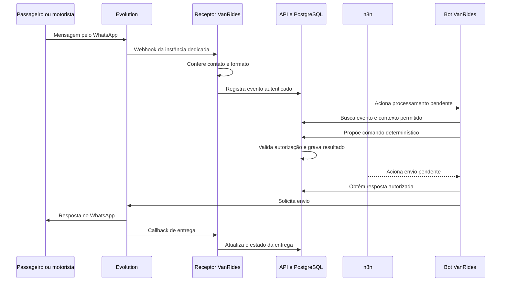

# Desenvolvimento compartilhado do VanRides

**Endereço:** <https://vanrides-inovacao-api.matheusduarte.dev.br>

A API do [PR #133](https://github.com/mathwidu/Vanrides-Projeto-Inovacao/pull/133)
está publicada em `5ef07cb`, com banco V48. O APK **0.5.0+16 já pode ser
baixado e instalado** pelo link abaixo. Worker, receptor e páginas de conexão,
início e fim também foram atualizados. A manutenção foi retirada.

A publicação passou na [execução 44143760375, tentativa 3](https://github.com/mathwidu/Vanrides-Projeto-Inovacao/actions/runs/44143760375/attempts/3).
Foram conferidos banco sem migrações falhas, serviços disponíveis, páginas HTTPS,
recusa das rotas sem prova do aparelho e hash do APK baixado. Isso prepara a
instalação e o teste; **o novo fluxo ainda não tem aceite físico**. Conexão,
contagem de ações, retorno ao WhatsApp e parada precisam ser observados nos
aparelhos. Não usar o app anterior para comprovar este fluxo.

A referência anterior era a API V44 e o APK 0.4.0+15, nos quais cadastro,
presença, GPS, pin e encerramento manual tiveram provas reais. O pacote novo
acrescenta conexão sem copiar códigos, links próprios por viagem, finalização
pelo app e pontos por trajeto. Veja o [registro da entrega](entrega-mvp.md) e o
[roteiro do novo fluxo](roteiro-validacao-fluxo-simples.md). Aproximação, bateria
e utilidade do aviso continuam exigindo a rodada final.

Usamos um único ambiente de desenvolvimento compartilhado. Os nomes técnicos ainda dizem “hml”; não existe produção real liberada para usuários. Stage e produção separados ficam para a versão 1.0.

**Ativo:** push/merge na `main` constrói a API/imagem e publica automaticamente
neste endereço, sem suítes de testes na esteira. PRs e pushes em `dev` apenas
constroem. A [área da equipe](https://vanrides-inovacao-api.matheusduarte.dev.br/equipe)
permite aos integrantes com escrita no GitHub liberar participantes e preparar
convites sem acesso à VPS. Veja o [passo a passo](area-da-equipe.md) e o
[funcionamento do deploy](../../deploy/homologacao/AUTOMATICO.md).

## Escolher como testar

| Quero verificar | Como começar | O que consigo testar |
| --- | --- | --- |
| Entender o fluxo sozinho | Abra **Simular conversas** na [área da equipe](https://vanrides-inovacao-api.matheusduarte.dev.br/equipe). | Os dois papéis com dados fictícios no navegador. |
| Testar o cadastro com meu WhatsApp | Entre no painel com GitHub, libere seu número como passageiro e escolha [Testar com o WhatsApp](area-da-equipe.md#testar-o-passageiro-com-o-motorista-de-teste). | Convite, ponto, correção e aprovação com um motorista de teste no painel. |
| Testar presença e GPS no ambiente publicado | Combine um número de motorista e outro de passageiro e siga a [jornada com dois papéis](#jornada-completa-motorista-e-passageiro). Para GPS, use o app compatível no Android ou iPhone do motorista. | Preparação da rotina, presença na ocorrência certa e início e parada do compartilhamento. |
| Validar uma mudança da minha branch | Use o [guia de contribuição](../../CONTRIBUTING.md) para rodar o componente localmente e abrir o PR. | A alteração do PR, com dados de teste e canal simulado quando necessário. |

## O que cada integrante pode acessar

| Acesso | Como usar | Condição atual |
| --- | --- | --- |
| [Saúde da API](https://vanrides-inovacao-api.matheusduarte.dev.br/actuator/health) | Abrir no navegador; esperado HTTP 200 e `{"status":"UP"}`. | Público, disponível para os quatro integrantes. Não testa uma jornada de negócio. |
| [APK do motorista](https://vanrides-inovacao-api.matheusduarte.dev.br/motorista/VanRides.apk) | Baixar no Android e instalar o VanRides Motorista **0.5.0+16**. | Download HTTPS conferido. Instalar não habilita automaticamente o motorista nem liga GPS. O +15 não comprova o novo fluxo. |
| [Área da equipe](https://vanrides-inovacao-api.matheusduarte.dev.br/equipe) | Entrar com GitHub, informar o contato que aceitou participar e escolher passageiro ou motorista. | Disponível para contas com escrita no repositório. |
| Bot pelo WhatsApp | Abra o convite individual ou use **Abrir conversa com o bot** no painel e envie `AJUDA`. | O cadastro é feito na conversa. O convite por link é o caminho padrão do passageiro. |
| API de produto | O app e o atendimento usam as credenciais próprias de cada fluxo. | Rotas `/driver-app/v1/` e `/integrations/whatsapp/v1/` exigem autenticação. Receber 401 ao abrir no navegador é esperado. |
| Código e issues | Usar este repositório e o [guia de contribuição](../../CONTRIBUTING.md). | Desenvolvimento e testes sintéticos independem da liberação do número. Veja abaixo a diferença entre `main`, branch e versão publicada. |
| n8n, Evolution, banco e VPS | Operação por Matheus. Alterações são preparadas no Git e revisadas antes da publicação. | Não são painéis de teste abertos para o grupo. O acesso de cada colega a esses painéis não foi provisionado. Não compartilhar senha, SSH ou token de serviço. |

Todos usam a mesma URL e podem testar com identidades distintas. O número do
bot recebe as mensagens do WhatsApp. Para a jornada completa, use números
diferentes para motorista e passageiro. A equipe prepara a autorização inicial
do motorista no painel. Depois do cadastro, o próprio motorista conecta o app pelo link do bot, sem copiar códigos
de aparelho. O passageiro começa pelo convite individual compartilhado pelo
motorista. São três etapas distintas: liberação do piloto, cadastro e conexão
do celular.

A janela e as credenciais técnicas atuais vencem em **01/12/2026 às 00:00 UTC** (30/11 às 21h em Brasília). O operador deve renová-las antes de manter os testes depois desse horário. Contatos e credenciais ficam fora do Git.

## Serviços publicados e alcance da validação

| Parte | Hospedagem e função | Prova e limite |
| --- | --- | --- |
| API Spring Boot e PostgreSQL | Regras, cadastros, vínculo, rotinas, presença, aparelho, viagens, GPS e filas de mensagens. Banco próprio da homologação. | API `5ef07cb`, banco V48 sem migrações falhas. Ensaio de migração V44→V48 e publicação passaram; a jornada nova nos aparelhos continua pendente. |
| Receptor de eventos | Recebe o webhook da Evolution, confere instância/contato/tipo de mensagem e encaminha o evento à API. | Atualizado junto do pacote, com serviço disponível. Texto e callbacks tiveram prova real na versão anterior; repetir a jornada nova no canal. |
| Bot VanRides / worker Node.js | Busca mensagens pendentes, propõe comandos à API e envia as respostas autorizadas pela Evolution. | Atualizado e disponível. O fluxo usa regras determinísticas. Os novos percursos de conexão, início e fim aguardam prova real conjunta. |
| n8n | Dispara processamento, envios e tarefas agendadas do worker; recebe resultados de controle, sem texto da conversa nem GPS. | Configuração registrada antes desta atualização: oito fluxos importados, W01/W04/W06/W08 ativos e W07 publicado para erros. W02/W03/W05 são subfluxos sem agenda própria. |
| Evolution, Redis e banco da sessão | Conexão dedicada do WhatsApp, envio, recebimento e callbacks de entrega. | Serviços preservados. A instância `vanrides-hml`, separada dos outros projetos, estava em OPEN na referência anterior; conferir o canal na rodada. |
| APK e páginas de conexão/início/fim | Arquivos HTTPS e links de acesso ao aplicativo do motorista. | APK +16 baixado e hash conferido; páginas de conexão, saída e fim respondem 200. Abertura pelo WhatsApp e GPS físicos da versão nova continuam pendentes. |
| Aproximação | Regra implementada na API, dependente de posição recente e passageiro elegível. | Habilitada para as rotinas elegíveis da coorte compartilhada. Calibração, destinatário e utilidade ainda dependem de percurso. Não há ETA prometido. |
| Encerramento e suporte | O caminho normal agora é “Quero finalizar a viagem”, link e confirmação no app. A equipe retoma suporte pelo painel. | Publicação técnica conferida; novo fim/retorno ainda sem prova física. O encerramento antigo teve ACK real nos dois aparelhos. Fim automático depende de campo; pedir suporte pausa a conversa. |

Os serviços conferidos após a publicação estavam com 1/1 réplica. O n8n é um
serviço existente compartilhado, com fluxos exclusivos do VanRides. Isso
comprova disponibilidade técnica; não substitui a jornada no WhatsApp nem os
testes de percurso, bateria e utilidade.

## Como a conversa passa pelos serviços

O n8n organiza quando processar e enviar. O worker executa essas operações; a API decide o que a pessoa pode fazer e guarda o estado. Por isso o n8n não aparece como intermediário de toda mensagem. O bot atual não depende de um modelo de IA para esses testes e não terá liberdade para conceder acesso ou inventar cadastros.

O GPS segue outro caminho: **aplicativo do motorista → API → PostgreSQL**. O Android usa Google Fused Location Provider e o iPhone usa Core Location. Nenhum deles depende de compartilhar localização pelo Google Maps, Waze ou WhatsApp. O passageiro fornece um **pin estático** para o ponto de embarque; não precisa transmitir localização contínua.

## Primeiro teste: passageiro sem motorista

1. Combine seu papel e libere o contato na área da equipe. Guarde o número e o convite em um canal privado.
2. Use **Abrir conversa com o bot** ou o contato já compartilhado. Envie `AJUDA` do WhatsApp liberado. Se ficar sem resposta, registre o horário e se a entrega foi confirmada.
3. Envie `QUERO ME CADASTRAR` e siga as perguntas. Informe o nome; leia o aviso de dados e responda `ACEITO` apenas se concordar.
4. Envie `AJUDA` ou `CONTINUAR CADASTRO`. Para perfil pronto e sem vínculo, a resposta deve orientar pedir e enviar o convite do motorista.
5. Envie `VOU HOJE`. Sem rotina elegível, o bot deve informar que não há viagem próxima registrada. Isso **não cria uma presença**.
6. Envie `AJUDA` novamente. A conversa deve continuar normalmente, sem exigir `ABANDONAR` para sair de uma lista vazia.

Esse roteiro cobre perfil básico e orientação. Para testar cadastro e ponto no
mesmo fluxo, abra e envie a mensagem preenchida pelo link individual do
motorista. Não peça que o passageiro leia ou redigite o conteúdo técnico do
convite. Quem já estiver cadastrado preserva o perfil existente.

## Jornada completa: motorista e passageiro

### Preparar uma vez: cadastro, trajetos e celular

1. **Autorizar o motorista do piloto.** Um integrante libera o número como
   **Motorista** na área da equipe, usa **Copiar link para o motorista** e
   encaminha o convite em privado. O motorista abre pelo próprio WhatsApp,
   envia a mensagem pronta, informa nome e lê/aceita o aviso de dados.
   **Abrir neste WhatsApp** só serve quando a conta atual é a do motorista.
   A área não transforma um passageiro ativo em motorista e não aceita o
   aviso por ele. O código manual fica nos detalhes como contingência; veja o
   [convite por link](area-da-equipe.md#convite-inicial-do-motorista-por-link).
2. **Criar os trajetos.** Envie `CRIAR ROTINA`, informe nome, sentido, dias,
   horário e destino fixo. Pode enviar, por exemplo,
   `IDA, SEGUNDA A SEXTA, 07:30` na mesma mensagem. Confira o fuso e salve pelo
   resumo. Ida e volta são trajetos separados. Dê nomes que ajudem a distinguir
   as opções e inclua o dia atual se for testar hoje.
3. **Convidar o passageiro pelo link.** Envie `CONVIDAR` e compartilhe em privado
   o link individual devolvido. Ele tem um uso e vale 24 horas. O passageiro
   abre e envia a mensagem preenchida; o bot identifica o motorista e pede
   somente os dados e escolhas que faltam.
4. **Escolher trajetos e embarques.** O passageiro pode selecionar mais de um
   trajeto, por exemplo `1,2`, e informar os dias de cada um. Envia um ponto fixo
   por trajeto, sem localização ao vivo. “MESMO PONTO” reutiliza um ponto aprovado
   quando essa for a escolha dele. Confere o resumo e envia o pedido. O convite
   já autoriza a pessoa; a revisão restante confere os pontos e a ordem.
5. **Conferir o embarque.** O motorista envia `REVISAR PEDIDO`, escolhe o pedido
   se houver vários e responde ao resumo com `APROVAR EMBARQUE` ou a correção
   indicada. Cada ponto pertence ao trajeto mostrado: aprovar a ida não aprova
   silenciosamente a volta. Depois, confira a ordem dos pontos em `ROTINAS`.
   A viagem só fica pronta quando os embarques e a ordem estiverem preparados.
6. **Instalar e conectar o celular.** Instale o app da rodada: APK no Android;
   no iPhone, instalação assinada pelo Mac. Pelo WhatsApp do motorista, envie
   “Conectar meu celular”, abra o link e toque em **Conectar este celular**.
   O app volta à conversa. Leia o pedido recebido e envie “Conectar este celular”
   somente se acabou de solicitá-lo. Abra **Concluir no app**, aguarde
   **Aparelho vinculado** e o retorno à conversa. O link vale cinco minutos;
   vencido, peça outro ao bot. Não é preciso copiar oito letras nem informar
   credenciais da API. No iPhone, use o botão intermediário **Abrir VanRides**.
7. **Autorizar o sistema na preparação.** Conceda localização precisa, o acesso
   em segundo plano indicado pelo app e as notificações solicitadas. Confira
   internet e bateria. Conectar o celular e abrir links não ligam a localização.
   Uma troca de aparelho exige **Usar este celular** e é bloqueada enquanto a
   coleta anterior não tiver parada confirmada.

O primeiro cadastro e as permissões têm contagem própria. O caminho diário
abaixo pressupõe motorista cadastrado, trajetos prontos e celular conectado.
Não apagar um cadastro real para repetir o teste: um novo convite do mesmo
motorista permite adicionar trajetos preservando perfil e escolhas anteriores.
O [guia do cadastro](cadastro-guiado-whatsapp.md) detalha esses casos.

### Usar no dia a dia: presença, início e fim

1. **Presença.** Aguarde a agenda criar as saídas. O passageiro responde ao
   lembrete, citando-o, com `VOU` ou `NÃO VOU`; também pode indicar `HOJE`,
   `AMANHÃ`, `IDA` ou `VOLTA`. Confira a data e o sentido na resposta. O motorista
   consulta `PRESENÇAS`. Quem é habitual e não responde continua previsto,
   identificado como pendente. Só mudar a presença não liga ou desliga a
   preferência de avisos.
2. **Começar.** O motorista envia “Começar viagem”. O bot já mostra os trajetos
   prontos de hoje, cada um com nome, sentido, horário, passageiros e link
   próprio. Abra o link da viagem certa e toque em **Começar e compartilhar
   localização** no app. Não há outra escolha por texto nem confirmação com
   código. Com mais opções, o bot envia blocos de até três links; a primeira
   ativação aceita invalida os demais da oferta.
3. **Conferir a localização.** Depois do início, o app retorna à conversa.
   Aguarde **Posição recente recebida** e a confirmação do bot após a primeira
   posição válida. Voltar ao WhatsApp sozinho não prova GPS recebido. O
   passageiro elegível pode enviar `ONDE ESTÁ A VAN`; posição ausente ou antiga
   não deve aparecer como atual.
4. **Acompanhar os avisos.** Em percurso, passageiros previstos, com ponto e
   preferência de chegada habilitados, podem receber a aproximação. O aviso não
   promete minutos. Estar parado junto do ponto não comprova a utilidade dessa
   regra; ela continua na rodada de campo.
5. **Finalizar.** Envie “Quero finalizar a viagem”, abra o link recebido e toque
   em **Finalizar viagem e parar localização**. O sensor para e o app aguarda a
   confirmação daquela parada no servidor antes de retornar à conversa e
   anunciar a conclusão. Abrir o link sozinho não encerra a viagem.
6. **Se houver falha de rede.** A ação **Parar localização** continua desligando
   o sensor; sozinha, não encerra a viagem. Se a finalização ficar pendente,
   mantenha o app parado e tente confirmar novamente quando a rede voltar.
   Não registre conclusão remota antes da confirmação. Para retomar uma viagem
   interrompida, siga a orientação específica do bot; início, retomada e fim
   usam autorizações diferentes.

Para começar uma viagem já preparada, a meta é **três ações no Android**:
enviar a mensagem, abrir o link e confirmar no app. No **iPhone são quatro**,
pois o botão provisório da página intermediária também conta. Pedidos extras
do sistema, falhas e ajuda do facilitador entram no registro. Esse teto precisa
ser observado no WhatsApp e nos aparelhos, não presumido pelo build.

Conexão, início e finalização com códigos continuam como contingências nos
detalhes do app e nos comandos antigos; não são o caminho a ensinar no dia a dia.
Se a viagem estiver parada e confirmada após reconectar o celular, o bot pode
oferecer **Finalizar esta viagem** na conversa. A revisão vale só para aquela
viagem e parada; resposta antiga não pode encerrar uma coleta posterior.

No computador, envie o ponto fixo com `PONTO` e as coordenadas copiadas do mapa.
No celular, também é possível usar a localização estática do WhatsApp.
Confira o formato no [roteiro do cadastro guiado](cadastro-guiado-whatsapp.md#enviar-um-ponto-fixo-no-mac).

O [roteiro do cadastro guiado](cadastro-guiado-whatsapp.md) mostra os convites
por link e por telefone. A [área da equipe](area-da-equipe.md) tem a simulação
no navegador e o teste com um motorista do painel.

Em 16/11, o iPhone 13 recebeu o aplicativo normal 0.4.0+15 assinado. Vínculo,
GPS, pin recebido pelo passageiro, parada e recuperação do recibo terminal
passaram. O perfil gratuito vence em 23/11/2026 às 08:27 (Brasília); depois
desse prazo é necessário renovar a assinatura pelo Mac. O link do APK continua
sendo apenas para Android.

Na rodada do WhatsApp real, passaram vínculo, ponto, presença de ida e volta,
alteração para ausência, lista do motorista e mudança posterior das preferências
de avisos. Após aprovação ou mudança da rotina, aguarde a próxima execução da
agenda, programada a cada minuto, antes de repetir a presença. Isso não dispensa
conferir a data e o sentido indicados na resposta. Percurso, bateria e aceite
final serão feitos na rodada do mantenedor. Aproximação, fim automático e rotinas
de ensaio estão ligados para a coorte; limpeza real de dados e IA continuam
desligadas.

## Registrar um teste ou investigar uma falha

Na issue da funcionalidade, anote: versão do APK, revisão da API informada pelo operador, papel usado, cenário, resultado esperado, resultado observado e horário com fuso. O operador correlaciona isso com estados e recibos. Não anexe conversa completa, telefone, pin, coordenadas, QR, convite ou token.

| Sintoma | Conferência inicial |
| --- | --- |
| Saúde responde, mas bot fica em silêncio | Contato admitido, janela válida, conexão do bot e agendas. API saudável sozinha não prova o canal. |
| Cadastro básico pronto, sem avançar para o ponto | Falta convite de passageiro e rotina de motorista. `CONTINUAR CADASTRO` não cria esse vínculo. |
| Presença sem ocorrência | Verificar vínculo aprovado, rotina, dias, sentido, ponto e data. Não tratar a mensagem como confirmação de presença. |
| APK instalado, mas não inicia GPS | Conferir versão online, vínculo do aparelho, papel de motorista e link de início vigente; depois rede e permissões. |
| Nenhum aviso de aproximação | Conferir preferência do passageiro, presença/lista da partida, ponto aprovado, ordem, sentido, GPS recente e flags da rodada. Estar parado perto do ponto não comprova a regra de aproximação. Não há ETA prometido. |
| Conversa parou após pedir suporte | Pedido de suporte pausa o atendimento; requer recuperação pelo operador. Evite usar esse comando como teste genérico de resposta. |

## Código publicado, main e contribuições

Crie uma branch a partir da `main` atualizada, combine a tarefa na issue,
rode os testes do componente e abra um PR. Para continuar um PR já aberto,
traga as mudanças da `main` para a branch dele e rode os testes da parte
alterada antes de pedir revisão. [Guia de contribuição](../../CONTRIBUTING.md)

O GitHub Actions constrói a API no PR. Um push na `main` publica a API e a
interface da equipe. Confira a revisão e a saúde no resumo do Actions antes
do teste real. Testes de comportamento são feitos localmente e registrados
no PR. Publicação de worker, n8n, receptor e APK é combinada com o mantenedor.
[Procedimento de deploy](../../deploy/homologacao/AUTOMATICO.md)

A simplificação do cadastro entrou nos PRs
[#118](https://github.com/mathwidu/Vanrides-Projeto-Inovacao/pull/118) e
[#119](https://github.com/mathwidu/Vanrides-Projeto-Inovacao/pull/119), sobre
a V41 do banco. A ativação da área da equipe e da publicação automática está
registrada no [PR #108](https://github.com/mathwidu/Vanrides-Projeto-Inovacao/pull/108).

## Referências e versões

- [Evidência do passageiro e das correções publicadas](../runbooks/whatsapp-mvp/cadastro-passageiro-sem-motorista.md).
- [Operação do canal](../runbooks/whatsapp-mvp/homologacao-canal.md) e [receita da API](../runbooks/whatsapp-mvp/homologacao-api.md).
- [Arquitetura](../02-arquitetura-e-decisoes.md) e [especificações das tarefas](../08-especificacoes-mvp.md).
- Issues: [API #89](https://github.com/mathwidu/Vanrides-Projeto-Inovacao/issues/89), [publicação #90](https://github.com/mathwidu/Vanrides-Projeto-Inovacao/issues/90), [canal #91](https://github.com/mathwidu/Vanrides-Projeto-Inovacao/issues/91), [Android #87](https://github.com/mathwidu/Vanrides-Projeto-Inovacao/issues/87), [passageiro #28](https://github.com/mathwidu/Vanrides-Projeto-Inovacao/issues/28).
- APK publicado **0.5.0+16**: SHA-256 `d3a4b3f39b2f4474ad8b3c72a5b9821d5e044b2c08c23e5debe5baac6fc37915`, conferido por download HTTPS. Pronto para instalação; novo fluxo físico pendente.
- APK anterior 0.4.0+15: 56.680.985 bytes; SHA-256 `7f22ebd465f0c2f9947ee8c9639fb0ee63405bc360e618fa97a1955bf6cba946`, conferido em 16/11. Teve GPS/pin/finalização/parada reais no Redmi; essas provas não são do +16.
- Os APKs `0.1.0+8`, `0.2.0+12`, `0.3.0-hml+13` e `0.4.0+14` são históricos. Para o fluxo deste guia, use o pacote +16 compatível com a API publicada.
