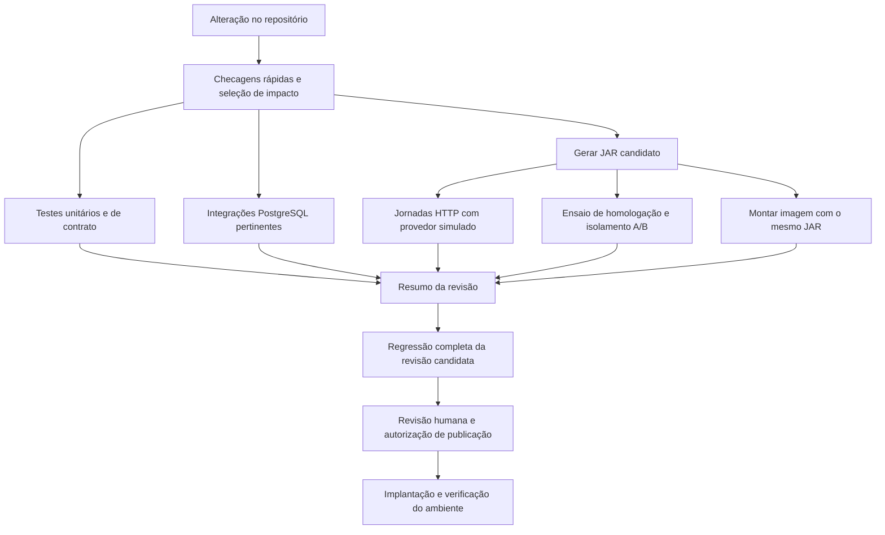

# Revisão da CI e dos testes

**04/11/2026 — primeira etapa implementada e verificada localmente; publicação pendente.**

O objetivo é reduzir o tempo de retorno e o trabalho de manutenção sem perder
as verificações que protegem o MVP. Esta revisão interrompe a continuação do
PR #107 para organizar a validação antes de publicar mais ajustes. Não muda
o ambiente hospedado, os critérios de aceite físico nem as contribuições dos colegas.

## Primeira etapa implementada

Na branch local `codex/ci-verificacoes-rapidas`, derivada de `039aeae`:

- O ratchet executa antes dos testes dos auxiliares, Maven e PostgreSQL.
  O modo `--quick` do gate concentra a lista rápida usada também por `--light`.
- A CI exige essa etapa antes de iniciar PostgreSQL e jornadas HTTP, que
  continuam em paralelo. Um job final resume os três resultados e reprova
  se qualquer etapa falhar, for cancelada ou não for executada.
- A homologação espera os testes do auxiliar Windows/Linux e confere regras
  estáticas e receitas antes de preparar Java e empacotar a API.
- Maven usa `-ntp`, sem modo silencioso e sem esconder saída de falhas. O
  runner WhatsApp usa o reporter nativo `spec` do Node e unittest sem `-v`.
  Não foram retiradas suítes de produto, mudadas contagens obrigatórias,
  quotas ou limites de memória. O teste textual da composição do gate foi
  substituído por execução com processos simulados, verificando a ordem e os erros.

| Verificação local | Resultado |
|---|---|
| Testes do gate e do perfil PostgreSQL com processos simulados | 44 aprovados, em 30,575 s; incluem parada antecipada, propagação de erro e resumo sem aprovação de etapas puladas. |
| `bash scripts/check_backend.sh --light` no checkout real | Reprovou em 0,468 s pelo limite já existente: `WaPassengerSetup.java`, 362 linhas, máximo 350. Não iniciou Maven ou banco. Esse tempo local não é medição de runner GitHub. |
| Fixtures do runner WhatsApp, antes/depois | Mesmos 14 casos Node e 16 Python; sucesso e falhas preservados. Saída aprovada caiu de 133 para 59 linhas e de 2.558 para 1.445 bytes. Medição da fixture, não da suíte completa. |
| Seleção do runner WhatsApp | Mesmos 49 arquivos Node, 9 comandos e concorrência 2. |
| Sintaxe Bash e actionlint dos dois workflows alterados | Aprovados. |
| Auxiliar de homologação e receitas de implantação, somente testes locais | 11 e 20 testes aprovados, respectivamente; sem executar implantação. |

Revisão independente dos scripts e workflows concluída sem achados pendentes.
Antes de publicar/integrar, conferir quais checks a proteção da branch exige:
o novo `Resultado do backend` não foi configurado remotamente como obrigatório
nesta etapa. Não presumir que um job pulado bloqueie sozinho o merge.

A execução real da CI desta branch ainda não ocorreu. O gate completo não
está aprovado: permanece a reprovação estática conhecida. A matriz Java e
as seis jornadas não foram repetidas nesta etapa, que altera apenas a
orquestração e a apresentação. Nenhuma alteração na VPS, push ou merge.

Retorno: reverter a alteração desta etapa restaura os workflows, os gates e
os reporters anteriores; não há migração de banco nem troca do runtime.
Compartilhamento de JAR, cache, esperas, seleção de suítes e redirecionamento
de logs de aplicação continuam nas próximas etapas. A saída detalhada de
Spring/PostgreSQL permanece disponível para diagnóstico.

## O que foi medido

Fontes inspecionadas em `34250b8`. Tempos obtidos de execuções existentes do
GitHub Actions, sem novas compilações no Mac. São amostras, não uma estimativa
de percentil nem uma promessa de desempenho.

| Evidência | Resultado | Consequência |
|---|---|---|
| [Execução aprovada da main](https://github.com/mathwidu/Vanrides-Projeto-Inovacao/actions/runs/41751994368) | Suíte canônica: 25 min 14 s; Maven: 24 min 38 s | O custo principal está na execução Java; os auxiliares em volta não explicam os 25 minutos. |
| [Execução aprovada do PR anterior](https://github.com/mathwidu/Vanrides-Projeto-Inovacao/actions/runs/41743317610) | Suíte canônica: 24 min 52 s | Uma segunda amostra confirma a ordem de grandeza. |
| Integração da primeira amostra | Empacotamento e quatro jornadas: 21 min 03 s; 20 esperas explícitas por quota somaram 10 min 06 s | Cerca de 48% desse passo foi espera deliberada. A versão atual tem seis jornadas; não extrapolar esse tempo para ela. |
| Log da suíte canônica aprovada | 6.967 linhas; 1.051.209 bytes; 71 registros de criação de PostgreSQL | Há ruído de dependências e inicialização repetida. Não são 71 falhas. |
| Workflows atuais para mudança no backend | Quatro compilações independentes e três empacotamentos | A integração testa um JAR; o Docker recompila outro. Falta reaproveitar o candidato testado. |
| [Execução do PR #107](https://github.com/mathwidu/Vanrides-Projeto-Inovacao/actions/runs/41870438506) | 1.769 testes Java passaram, sem falhas, erros ou skips; depois o gate reprovou `WaPassengerSetup.java`, com 362 linhas diante do limite de 350 | A CI não está aprovada. Uma verificação estática barata foi executada depois de quase 27 minutos. |

O inventário de arquivos versionados encontrou 36.262 linhas não vazias em
Java de implementação e 42.182 em testes Java. Comentários entram nessa
contagem. Os scripts de validação/operação do backend somam outras 10.744
linhas, e seus testes, 6.577. Isso indica custo de manutenção a investigar,
mas não define uma quantidade ideal de testes. Não se conclui daí que o
projeto inteiro tenha mais testes que implementação.

## Problemas e decisões propostas

| Problema observado | Mudança proposta | O que precisa continuar comprovado |
|---|---|---|
| Checagens baratas depois do banco e dos testes | Executar sintaxe, configuração e regras estáticas primeiro. Revisar o limite de linhas como indicador de revisão, não como substituto de qualidade. | Erros de configuração continuam bloqueando. A regra de 350 linhas só muda por decisão documentada, não por ajuste oportunista do número. |
| Compilações repetidas | Produzir um JAR candidato e compartilhá-lo entre jornadas, homologação e imagem; cachear dependências Maven. | SHA e checksum do JAR em cada consumidor; a imagem deve conter o JAR ensaiado. Cache não vale como resultado de teste. |
| Esperas reais repetidas em jornadas de negócio | Testar a matriz temporal com relógio controlado e conservar um ensaio real de integração dos limites de envio. | Quotas, expiração, recuperação e prevenção de duplicidade continuam verificadas. Nada de desabilitar quotas na produção. |
| Inicialização repetida de banco e dados | Experimentar um contêiner por processo de testes, com banco isolado por classe e preparação mínima de dados. | Ausência de dependência da ordem; concorrência e migrações ainda usam PostgreSQL real. |
| Contagem manual de testes repetida em scripts | Descobrir testes automaticamente e usar relatórios nativos, mantendo uma única definição das suítes obrigatórias. | Confrontar o plano de execução com os relatórios: detectar suíte ausente, execução parcial de seus métodos e skips indevidos. Considerar testes parametrizados. |
| Testes acoplados a texto de código e sequência SQL | Substituir gradualmente por comportamento observável; manter poucas verificações exatas para mensagens que sejam contrato. | Remover um teste somente depois de identificar qual comportamento fica protegido e onde. |
| Laboratórios antigos executados em toda mudança do bot | Selecionar por dependência e caminho alterado, com execução completa para mudanças transversais ou não classificadas. | Limpeza, limites de credenciais e partes de laboratório ainda usadas pelo runtime continuam cobertas. |
| Logs extensos e pouco resumo | Resumo curto por job, falha destacada e relatórios sanitizados como artefatos. | Código de saída, diagnóstico útil e resultado de cada suíte preservados. |

Referências de implementação: [workflow backend](../../.github/workflows/backend.yml),
[homologação](../../.github/workflows/homologacao-api.yml),
[gate canônico](../../src/backend/scripts/ci_quality_gate.sh),
[perfil PostgreSQL](../../src/backend/scripts/qa_integration_profile.sh),
[Dockerfile](../../src/backend/Dockerfile),
[seleção WhatsApp](../../scripts/check_whatsapp.py) e
[esperas por quota](../../src/whatsapp/scripts/academic-dispatch-pacing.mjs).

## Execução pretendida

Esse desenho é o destino completo, não a configuração já instalada. No início, a
suíte completa permanece obrigatória. A seleção parcial só entra após
comparação com a completa e revisão das dependências. Contratos compartilhados,
banco, autenticação e seleção desconhecida exigem a cobertura completa pertinente.

A regressão completa deve ocorrer antes de integrar/publicar a revisão
candidata. Uma execução periódica ajuda a detectar problemas de ambiente,
mas não substitui a validação da revisão que será entregue. Um resultado só
é reutilizável se corresponder à revisão avaliada; mudanças na base do PR
também precisam ser consideradas.

Não encadear 25 minutos de testes antes de iniciar outros 20 de jornadas:
preservar o paralelismo. Na primeira melhoria, aceitar duas compilações
(suíte e candidato) é mais simples que distribuir classes compiladas entre
jobs. O objetivo é um único binário candidato, não criar outra infraestrutura
de validação para eliminar toda invocação de compilador.

Os workflows acadêmicos inspecionados não fazem deploy automático. A
publicação segue separada, identificando imagem, configuração, migrações,
verificação e retorno. Não é necessário automatizar deploy para corrigir a CI.

## Ordem de implementação e aceite

1. **Retorno rápido e diagnóstico — primeira fatia local acima.** Antecipar checagens estáticas e reduzir
   saída de dependências e casos aprovados. Acrescentar resumo com revisão,
   duração, suítes, falhas e links para relatórios. Aceite: uma falha estática
   termina antes do Maven; uma falha real de teste continua bloqueando e
   aparece no resumo. Não ocultar erros com `|| true` ou `continue-on-error`.
2. **Candidato compartilhado e cache.** Reutilizar o JAR nas jornadas,
   homologação e imagem. Aceite: mesmos checksums, rejeição de artefato
   incorreto, execução com cache vazio e preenchido, sem segredos nos artefatos.
3. **Tempo e preparação dos testes.** Refatorar primeiro duas classes
   representativas de banco e uma jornada com esperas. Aceite: mesmas regras
   exercitadas, execução isolada e em ordem invertida sem contaminação;
   comportamento de quota/expiração comprovado antes de retirar esperas.
4. **Redundância e manutenção.** Eliminar contagens duplicadas, reduzir testes
   de detalhes internos e retirar laboratórios sem dependência do caminho
   padrão. Cada remoção deve indicar o teste substituto ou o motivo de o
   comportamento ter deixado de existir. Não apagar apenas por tamanho.
5. **Seleção e documentação da rotina.** Definir comandos claros para teste
   rápido, integração e regressão completa, usando os runners existentes.
   Comparar seleção e suíte completa em mudanças representativas de backend,
   bot, contratos e documentação. Aceite: impacto desconhecido usa a completa;
   mudança documental não recompila o backend; verificações de referências
   continuam detectando arquivos removidos ou renomeados.

Cada etapa deve ter um diff pequeno, medição antes/depois e revisão. Não
misturar uma reescrita de CI com os ajustes funcionais dos colegas no PR #107.
As mudanças entram em uma frente separada e são integradas na ordem de suas
dependências. Preservar os dois ajustes locais já preparados (`055a1d9` e
`34250b8`), sem tratá-los como enviados ou suficientes para deixar o PR verde.

Comparar tempo total até a resposta, minutos somados de runners, tamanho dos
logs, compilações, inicializações de banco e falhas intermitentes. Reduzir
tempo de parede aumentando muito os runners não é uma melhoria automática.
Fazer uma comparação controlada antes/depois e aproveitar as execuções normais
seguintes para confirmar a tendência, sem disparar repetições só para produzir
estatística. Números alvo de duração serão definidos a partir desses resultados.

## Rotina de validação e uso dos agentes

- Durante a implementação, executar o teste que corresponde à mudança;
  ampliar para a suíte afetada e executar a regressão completa no fechamento.
  Não repetir a completa após alteração somente documental.
  A evidência conserva seu SHA original: a dispensa exige conferir que fontes,
  build e configuração não mudaram. Não declarar PASS de outra revisão; se a
  equivalência não puder ser demonstrada, executar as verificações aplicáveis.
- Consultar primeiro o status e o resumo da CI. Em falha, ler o job e o trecho
  relevante; não transferir todos os logs aprovados para o contexto do agente.
- Guardar relatórios completos sanitizados em artefatos com retenção limitada;
  documentação guarda conclusão, revisão e link, sem copiar milhares de linhas.
- Mostrar duração e falhas no console. Usar relatórios nativos Maven/Node/Python
  e recursos do GitHub antes de criar validadores, contadores ou formatos próprios.
- Uma nova falha exige diagnóstico; repetir a mesma execução até passar não
  conta como correção. Uma execução sintética não comprova WhatsApp real,
  GPS físico ou aceite do usuário.

Permanecem essenciais: isolamento entre usuários, autorização, consentimento,
idempotência, entrega incerta e recuperação, frescor e vínculo do GPS,
migrações, limpeza e identidade do artefato. Não são duplicações simplesmente
porque aparecem em níveis diferentes; cada nível deve ter uma finalidade clara.

## Fontes oficiais consultadas

- [GitHub: compartilhar artefatos entre jobs](https://docs.github.com/en/actions/tutorials/store-and-share-data).
- [GitHub: cache de dependências](https://docs.github.com/en/actions/reference/workflows-and-actions/dependency-caching).
- [Maven Surefire: configuração de logs](https://maven.apache.org/surefire/maven-surefire-plugin/examples/logging.html).
- [Maven 3.9.9: opção `-ntp`](https://maven.apache.org/ref/3.9.9/maven-embedder/cli.html).
- [Node 22.23.2: reporters nativos de testes](https://nodejs.org/download/release/v22.23.2/docs/api/test.html#test-reporters).
- [Testcontainers: controle de ciclo de vida](https://java.testcontainers.org/test_framework_integration/manual_lifecycle_control/).

As opções exatas devem respeitar as versões usadas no projeto. O experimento
de banco compartilhado não implica habilitar reutilização global de contêineres
nem usar dados de homologação nos testes.
