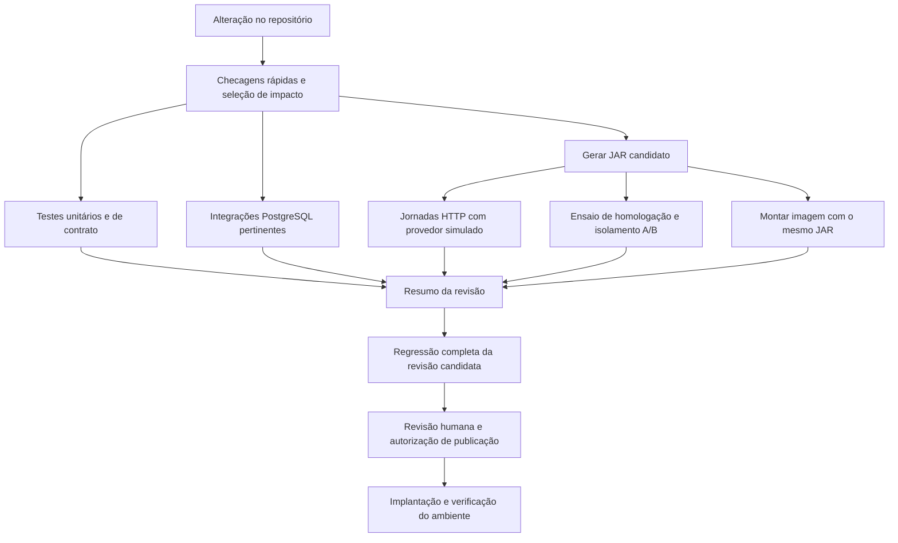

# Revisão da CI e dos testes

**04/11/2026 — candidato compartilhado aprovado no GitHub; pilotos de preparação do PostgreSQL e do operador implementados e validados localmente.**

O objetivo é reduzir o tempo de retorno e o trabalho de manutenção sem perder
as verificações que protegem o MVP. Esta revisão interrompe a continuação do
PR #107 para organizar a validação antes de publicar mais ajustes. Não muda
o ambiente hospedado, os critérios de aceite físico nem as contribuições dos colegas.

## Primeira etapa implementada

Na branch local `codex/ci-verificacoes-rapidas`, derivada de `039aeae`:

- O ratchet executa antes dos testes dos auxiliares, Maven e PostgreSQL.
  O modo `--quick` do gate concentra a lista rápida usada também por `--light`.
- A CI exige essa etapa antes de iniciar PostgreSQL e jornadas HTTP, que
  continuam em paralelo. Um job final resume os três resultados e reprova
  se qualquer etapa falhar, for cancelada ou não for executada.
- A homologação espera os testes do auxiliar Windows/Linux e confere regras
  estáticas e receitas antes de preparar Java e empacotar a API.
- Maven usa `-ntp`, sem modo silencioso e sem esconder saída de falhas. O
  runner WhatsApp usa o reporter nativo `spec` do Node e unittest sem `-v`.
  Não foram retiradas suítes de produto, mudadas contagens obrigatórias,
  quotas ou limites de memória. O teste textual da composição do gate foi
  substituído por execução com processos simulados, verificando a ordem e os erros.

| Verificação local | Resultado |
|---|---|
| Testes do gate e do perfil PostgreSQL com processos simulados | 44 aprovados, em 30,575 s; incluem parada antecipada, propagação de erro e resumo sem aprovação de etapas puladas. |
| `bash scripts/check_backend.sh --light` no checkout real | Reprovou em 0,468 s pelo limite já existente: `WaPassengerSetup.java`, 362 linhas, máximo 350. Não iniciou Maven ou banco. Esse tempo local não é medição de runner GitHub. |
| Fixtures do runner WhatsApp, antes/depois | Mesmos 14 casos Node e 16 Python; sucesso e falhas preservados. Saída aprovada caiu de 133 para 59 linhas e de 2.558 para 1.445 bytes. Medição da fixture, não da suíte completa. |
| Seleção do runner WhatsApp | Mesmos 49 arquivos Node, 9 comandos e concorrência 2. |
| Sintaxe Bash e actionlint dos dois workflows alterados | Aprovados. |
| Auxiliar de homologação e receitas de implantação, somente testes locais | 11 e 20 testes aprovados, respectivamente; sem executar implantação. |

Revisão independente dos scripts e workflows concluída sem achados pendentes.
Antes de publicar/integrar, conferir quais checks a proteção da branch exige:
o novo `Resultado do backend` não foi configurado remotamente como obrigatório
nesta etapa. Não presumir que um job pulado bloqueie sozinho o merge.

Na conclusão da primeira etapa, a CI remota ainda não havia ocorrido e
permanecia a reprovação estática de 362 linhas, tratada abaixo. A matriz Java e
as seis jornadas não foram repetidas naquela etapa, que alterou apenas a
orquestração e a apresentação. Nenhuma alteração na VPS, push ou merge.

Retorno: reverter a alteração desta etapa restaura os workflows, os gates e
os reporters anteriores; não há migração de banco nem troca do runtime.
Esperas, seleção de suítes e redirecionamento de logs de aplicação continuam
nas próximas etapas. A saída detalhada de
Spring/PostgreSQL permanece disponível para diagnóstico.

## Continuação: cadastro e imagem da CI

A refatoração extraiu a montagem do resumo de confirmação para
`WaPassengerReview`, com 75 linhas. `WaPassengerSetup` passou de 362 para 303
linhas físicas. O limite de 350 não foi alterado. SQL, ordem das operações e
alterações no rascunho foram mantidos; o tratamento `Step.draft()/understood()`
do colega, a mensagem de resposta não entendida e a orientação de convite/AJUDA
continuam presentes. Não foi necessário criar outra suíte para essa extração.

Na CI, o job de integração passa a construir a imagem pelo target `tested-jar`
do mesmo Dockerfile. Ele reutiliza o JAR das seis jornadas. O auxiliar
`check_backend_image.py` recusa recibo de outra revisão/árvore, limpeza incompleta,
binário alterado, mais de um JAR ou link simbólico. O Docker valida o checksum
do arquivo copiado. A base, o entrypoint e o build padrão por fontes permanecem.

Também foi configurado cache de dependências nos três passos `setup-java`
dos workflows backend e homologação, ligado ao `src/backend/pom.xml`. Não se
reutilizam resultados de testes nem `target`. O isolamento do Maven e os locks
não mudaram. O efeito do cache e o tempo economizado no GitHub ainda precisam
ser medidos em execução remota.

Esta fatia reduz quatro compilações para três e três empacotamentos para dois
nos workflows automáticos de uma alteração do backend. Ainda não é um único
JAR entre integração e homologação: isso depende de reorganizar os workflows
e o transporte do artefato. Não foi incluída essa mudança maior nesta fatia.

Verificação local: os cinco testes de classe existentes selecionados para o
cadastro totalizaram **39 casos aprovados**, sendo 29 com PostgreSQL real e
10 unitários, sem falhas, erros ou skips. Compilação e empacotamento terminaram
em 1 min 26 s, com Maven limitado a 512 MiB e dois processadores. O gate rápido
completo também passou, incluindo a regra de tamanho. Isso não equivale à
matriz Java completa, às seis jornadas ou à aprovação remota do PR.

O teste local de montagem Docker passou em 31,187 s: o JAR extraído da imagem
é idêntico ao empacotado, o entrypoint foi preservado, um checksum incorreto
foi rejeitado e a etapa Maven não apareceu no build. O teste não iniciou a API
nem substituiu as seis jornadas. Contêiner de inspeção e tag temporária foram
removidos. A revisão independente da extração e da CI terminou sem achados.

## Compartilhamento do candidato e execução sem duplicação

A etapa seguinte reúne o empacotamento em um job do workflow backend. Ele
publica somente `backend.jar` como artefato de CI, por um dia, e fornece ID
imutável e SHA-256 aos consumidores. Integração e homologação recebem esse ID
na mesma execução; não procuram artefatos recentes de outras branches.
A ação local `receive-backend` confere ID único, revisão e checksum e rejeita
arquivos extras, ausência de JAR e links simbólicos.

`homologacao-api.yml` passa a ser um workflow reutilizável chamado pelo backend.
O disparo manual fica no caller, e os paths anteriores foram incorporados nele.
Os testes Windows/Linux do auxiliar e o isolamento com duas credenciais são
preservados. O resumo final exige também candidato e homologação aprovados.
Antes do merge, conferir a proteção de branch: nomes dos checks de homologação
mudam quando o workflow é chamado. Não houve alteração remota dessas regras.

São duas compilações (suíte PostgreSQL e candidato) e **um empacotamento**.
Integração, homologação e imagem usam esse mesmo JAR. Compilar uma vez sem
testes não o torna uma release: todos os gates continuam obrigatórios.

Para reduzir esperas, removemos uma repetição comprovada: a execução 130 já
chama integralmente a jornada 110 antes de acrescentar as verificações de
localização. Agora ela roda uma vez. O recibo V2 registra cinco execuções e
seis conjuntos lógicos; os seis checks 110 apontam para a execução 130. O
validador exige cada um deles e os cinco checks de localização. Uma indicação
`covers` sozinha não comprova aprovação. O formato V1 histórico continua aceito
com suas exigências originais de seis execuções independentes.

Nenhuma quota foi aumentada ou desabilitada. Mantivemos o relógio real, a espera
que comprova atualização do GPS e as viradas de minuto do calendário. Evitamos
paralelizar jornadas no mesmo processo: há porta TLS compartilhada e operações
sincrônicas que poderiam interferir nos prazos de ACK/GPS. Não introduzimos
outro endpoint de teste ou controle de relógio na API de produção.

Validação local em `657f343`, em 04/11/2026:

| Verificação | Resultado |
|---|---|
| Contratos e casos negativos | Composição, identidade do artefato, checksum, cobertura V2 e compatibilidade V1 aprovados; actionlint e consistência documental aprovados. |
| Integração JAR/PostgreSQL | 42 checks aprovados nos seis conjuntos, em cinco execuções; API, banco e recursos temporários removidos. Duração local: 18 min 7 s; 19 esperas de quota somaram 10 min 0 s. |
| Homologação local com duas credenciais | Aprovada com o mesmo JAR, em 81 s; isolamento e limpeza preservados. |
| Imagem Docker | Construída sem recompilar; JAR extraído da imagem idêntico ao aprovado, revisão e checksum conferidos; contêiner e tag temporários removidos. |

O JAR teve SHA-256
`2a256b6808c89b71bb42bf9683f1b2b031013b5aa49f5ebbf81899842e45ad1b`.
Esses tempos são uma amostra no Mac; não permitem calcular ganho percentual
contra a execução histórica do GitHub, que tinha outro conjunto de jornadas.
O recibo local registra macOS/ARM64 e não substitui a evidência Linux/x64 exigida
para o pacote de laboratório. O transporte via GitHub, o cache e a suíte canônica
completa nesta composição ainda dependem de CI remota autorizada. Não houve push,
merge, alteração de regras de branch ou acesso à VPS. Evidência detalhada fica no
checkpoint privado `ci-audit-20261104/phase3`; fontes e procedimentos estão no Git.

## Pilotos de preparação do PostgreSQL e do operador

A [CI de `6006b1c`](https://github.com/mathwidu/Vanrides-Projeto-Inovacao/actions/runs/41894412562)
aprovou a composição anterior em 25 min 40 s. O gate canônico levou 22 min 40 s;
integração/imagem, 23 min 51 s. Passaram 1.769 testes Java, incluindo 584 com
PostgreSQL. Integração e homologação receberam o mesmo artefato. Esse é o ponto
de partida remoto; os pilotos abaixo ainda não foram enviados ao GitHub.

**Banco.** As quatro classes `WaDriverRoutinesIntegrationTest`,
`WaPassengerWizardIntegrationTest`, `WaPassengerFencingIntegrationTest` e
`WaInboxTransportIntegrationTest` passam a migrar o banco uma vez por classe.
Entre cenários, o suporte trunca explicitamente as tabelas `public`/`wa`,
reinicia sequências, restaura a empresa padrão e cria um novo relógio e serviços.
O contêiner continua exclusivo de cada classe. Não há compartilhamento global,
paralelismo novo nem alteração das migrations ou do runtime da aplicação.

O reset preserva e confere histórico Flyway, tabelas e triggers; recusa sementes
desconhecidas e mudanças no inventário. Usa `RESTRICT`, com limites de espera,
em vez de apagar dependências inesperadas. Os testes de migração e concorrência
mantêm sua preparação original. O primeiro ensaio encontrou um trigger de falha
que um teste deixava instalado: ele agora remove esse trigger e sua função em
`finally`, mantendo todas as assertivas. Dois testes adicionais cobrem limpeza,
sequências, sementes, relógio, preservação de triggers e recusa antes de apagar dados.

| Medição local das mesmas quatro classes / 56 casos | Antes | Depois |
|---|---:|---:|
| Tempo total da invocação Surefire, sem recompilar | 103,449 s | 78,130 s |
| Soma dos tempos das classes | 100,641 s | 76,145 s |
| Falhas, erros e casos pulados | 0 | 0 |

A redução foi de **24,5% no tempo total desse recorte**. A execução adicional
com as classes em ordem inversa passou em 89,259 s; ela verifica independência,
não é outra amostra controlada da comparação. Também passaram os mesmos 56
casos com a ordem dos métodos embaralhada (semente `20261104`), em 80,900 s;
os XML confirmam ordem diferente nas quatro classes. Máquina e limites Java
foram mantidos; não há garantia de ganho equivalente nos runners do GitHub.
As tentativas iniciais com disco da VM Docker cheio e o ensaio que encontrou
o trigger residual foram descartados da comparação. Foram removidos apenas
dois registros antigos e regeneráveis do cache de build local, sem apagar
volumes, bancos ou imagens nem fechar aplicativos do usuário.

**Operador.** Somente o ensaio acadêmico usa o lote da CLI privada NON-WEB.
Cada jornada agrupa criação de coorte e quatro credenciais em um processo Java,
e reset/revogação em outro. O conjunto passa de 55 para 15 inicializações de
JVM: 10 lotes e cinco operações independentes já existentes. Os laboratórios
históricos continuam com chamadas individuais. Não existe endpoint HTTP novo.

Um lote admite até 16 operações e 16 KiB, no mesmo ambiente, credencial e
coorte. Reserva todos os arquivos de saída antes do primeiro efeito e mantém
autorização, transação, auditoria e recibo **por operação**. Uma falha para o
restante do lote. Um cancelamento permite terminar a transação em andamento,
mas impede a próxima; a limpeza ainda pode executar. Recibos `COMMITTED`
anteriores são aproveitados para limpar credenciais, nunca para aprovar um lote
incompleto. `PREPARED`, saída ausente e falha de processo continuam reprovando.

Não mudaram quotas, expiração, esperas de GPS, conteúdo das jornadas, checksums
ou exigências do recibo integrado. A matriz PostgreSQL passa de 584 para 592
casos pelos oito novos testes de proteção; nenhum caso anterior foi removido.
O benchmark comparou o mesmo JAR em quatro rodadas (individual, lote, lote,
individual), com migração inicial fora do cronômetro. Cada rodada executou dez
operações: criar a coorte, quatro credenciais, reset e quatro revogações.
Asserções SQL e inserção de uma identidade sintética ficaram fora da medição.
Todos os 40 recibos foram confirmados, com 40 auditorias, exclusão das quatro
identidades e revogação das 16 credenciais. O banco temporário foi removido.

| Operador — preparação + limpeza por rodada | Chamadas individuais | Dois lotes |
|---|---:|---:|
| Primeira amostra | 43,276 s | 10,256 s |
| Segunda amostra | 57,068 s | 8,465 s |
| Média | **50,172 s** | **9,361 s** |
| Processos Java por rodada | 10 | 2 |

Redução local de **81,3% nessa preparação/limpeza**, com variação entre amostras.
O JAR comum teve SHA-256
`f10e8a5b76c4ceb17641464407ac67ca6130f152051ccf71a375ee60207e2ebc`.
Isso não significa reduzir a CI inteira em 81,3%: as esperas de quota e os
outros testes permanecem.

Validação final do commit local `aa4cd5e`:

| Verificação | Resultado |
|---|---|
| Gate rápido (`bash scripts/check_backend.sh --light`) | Ratchet e 207 testes aprovados. |
| Matriz canônica completa (`./scripts/qa_integration_profile.sh --all-tests`, executado em `src/backend`, com checkout limpo) | **1.787 testes Java**, incluindo **592 PostgreSQL em 77 classes**, sem falhas, erros ou skips. Perfil completo em 11 min 28 s; Maven em 11 min 25 s. |
| WhatsApp offline (`python3 scripts/check_whatsapp.py`) | **709 Node e 303 Python** aprovados. Executados antes do commit; os arquivos pertinentes permaneceram idênticos. |
| Integração acadêmica com JAR empacotado e revisão congelada | **42 checks**, cinco execuções/seis conjuntos, em **15 min 22,130 s**. Recibo V2 confirma o SHA/árvore, todas as verificações e remoção dos recursos. |
| Casos negativos do lote e do reset | Autorização, transação, saída parcial, cancelamento, sementes e sequência preservados. A revisão independente terminou sem achados pendentes. |
| Organização | Links e referências do backlog, controle do programa e `git diff --check` aprovados. |

A integração usou o JAR SHA-256
`9fe068bb94f1245a8c2a8ae94f47b861a49b3e006a1a706ab9ea3ead8c78c07a`,
reempacotado após a compilação limpa. As 20 pausas por quota somaram 9 min 49 s;
nenhum modelo pago, WhatsApp real ou dispositivo físico foi usado. A porta da
API ficou fechada e não restou contêiner dos dois ensaios após a conclusão.

A jornada local anterior, em `657f343`, levou 18 min 7 s com os mesmos 42 checks.
A diferença observada foi de 2 min 45 s; não é uma repetição controlada nem
uma medição do GitHub. A nova duração da CI remota ainda precisa ser comprovada.
O piloto de banco permanece restrito a quatro classes: o ganho observado não
foi extrapolado automaticamente para o restante da matriz.

A documentação posterior registra a evidência de `aa4cd5e`; não apresenta uma
nova execução após mudanças somente documentais. Fontes, testes e comandos
ficam no repositório; XML e logs locais ficam no checkpoint privado `ci-pilots-20261104`.

Retorno: reverter os commits desses pilotos restaura a preparação integral de
fixtures e as chamadas individuais do ensaio. Não há migração de dados,
publicação, alteração de VPS nem mudança no ambiente do time nesta etapa.

## O que foi medido

Fontes inspecionadas em `34250b8`. Tempos obtidos de execuções existentes do
GitHub Actions, sem novas compilações no Mac. São amostras, não uma estimativa
de percentil nem uma promessa de desempenho.

| Evidência | Resultado | Consequência |
|---|---|---|
| [Execução aprovada da main](https://github.com/mathwidu/Vanrides-Projeto-Inovacao/actions/runs/41751994368) | Suíte canônica: 25 min 14 s; Maven: 24 min 38 s | O custo principal está na execução Java; os auxiliares em volta não explicam os 25 minutos. |
| [Execução aprovada do PR anterior](https://github.com/mathwidu/Vanrides-Projeto-Inovacao/actions/runs/41743317610) | Suíte canônica: 24 min 52 s | Uma segunda amostra confirma a ordem de grandeza. |
| Integração da primeira amostra | Empacotamento e quatro jornadas: 21 min 03 s; 20 esperas explícitas por quota somaram 10 min 06 s | Cerca de 48% desse passo foi espera deliberada. A versão atual tem seis jornadas; não extrapolar esse tempo para ela. |
| Log da suíte canônica aprovada | 6.967 linhas; 1.051.209 bytes; 71 registros de criação de PostgreSQL | Há ruído de dependências e inicialização repetida. Não são 71 falhas. |
| Workflows na auditoria inicial para mudança no backend | Quatro compilações independentes e três empacotamentos | A integração testava um JAR; o Docker recompilava outro. |
| [Execução do PR #107](https://github.com/mathwidu/Vanrides-Projeto-Inovacao/actions/runs/41870438506) | 1.769 testes Java passaram, sem falhas, erros ou skips; depois o gate reprovou `WaPassengerSetup.java`, com 362 linhas diante do limite de 350 | A CI não está aprovada. Uma verificação estática barata foi executada depois de quase 27 minutos. |

O inventário de arquivos versionados encontrou 36.262 linhas não vazias em
Java de implementação e 42.182 em testes Java. Comentários entram nessa
contagem. Os scripts de validação/operação do backend somam outras 10.744
linhas, e seus testes, 6.577. Isso indica custo de manutenção a investigar,
mas não define uma quantidade ideal de testes. Não se conclui daí que o
projeto inteiro tenha mais testes que implementação.

## Problemas e decisões propostas

| Problema observado | Mudança proposta | O que precisa continuar comprovado |
|---|---|---|
| Checagens baratas depois do banco e dos testes | Executar sintaxe, configuração e regras estáticas primeiro. Revisar o limite de linhas como indicador de revisão, não como substituto de qualidade. | Erros de configuração continuam bloqueando. A regra de 350 linhas só muda por decisão documentada, não por ajuste oportunista do número. |
| Compilações repetidas | Produzir um JAR candidato e compartilhá-lo entre jornadas, homologação e imagem; cachear dependências Maven. | SHA e checksum do JAR em cada consumidor; a imagem deve conter o JAR ensaiado. Cache não vale como resultado de teste. |
| Esperas reais repetidas em jornadas de negócio | Testar a matriz temporal com relógio controlado e conservar um ensaio real de integração dos limites de envio. | Quotas, expiração, recuperação e prevenção de duplicidade continuam verificadas. Nada de desabilitar quotas na produção. |
| Inicialização repetida de banco e dados | Experimentar um contêiner por processo de testes, com banco isolado por classe e preparação mínima de dados. | Ausência de dependência da ordem; concorrência e migrações ainda usam PostgreSQL real. |
| Contagem manual de testes repetida em scripts | Descobrir testes automaticamente e usar relatórios nativos, mantendo uma única definição das suítes obrigatórias. | Confrontar o plano de execução com os relatórios: detectar suíte ausente, execução parcial de seus métodos e skips indevidos. Considerar testes parametrizados. |
| Testes acoplados a texto de código e sequência SQL | Substituir gradualmente por comportamento observável; manter poucas verificações exatas para mensagens que sejam contrato. | Remover um teste somente depois de identificar qual comportamento fica protegido e onde. |
| Laboratórios antigos executados em toda mudança do bot | Selecionar por dependência e caminho alterado, com execução completa para mudanças transversais ou não classificadas. | Limpeza, limites de credenciais e partes de laboratório ainda usadas pelo runtime continuam cobertas. |
| Logs extensos e pouco resumo | Resumo curto por job, falha destacada e relatórios sanitizados como artefatos. | Código de saída, diagnóstico útil e resultado de cada suíte preservados. |

Referências de implementação: [workflow backend](../../.github/workflows/backend.yml),
[homologação](../../.github/workflows/homologacao-api.yml),
[gate canônico](../../src/backend/scripts/ci_quality_gate.sh),
[perfil PostgreSQL](../../src/backend/scripts/qa_integration_profile.sh),
[Dockerfile](../../src/backend/Dockerfile),
[seleção WhatsApp](../../scripts/check_whatsapp.py) e
[esperas por quota](../../src/whatsapp/scripts/academic-dispatch-pacing.mjs).

## Execução pretendida

Esse desenho é o destino completo, não a configuração já instalada. No início, a
suíte completa permanece obrigatória. A seleção parcial só entra após
comparação com a completa e revisão das dependências. Contratos compartilhados,
banco, autenticação e seleção desconhecida exigem a cobertura completa pertinente.

A regressão completa deve ocorrer antes de integrar/publicar a revisão
candidata. Uma execução periódica ajuda a detectar problemas de ambiente,
mas não substitui a validação da revisão que será entregue. Um resultado só
é reutilizável se corresponder à revisão avaliada; mudanças na base do PR
também precisam ser consideradas.

Não encadear 25 minutos de testes antes de iniciar outros 20 de jornadas:
preservar o paralelismo. Na primeira melhoria, aceitar duas compilações
(suíte e candidato) é mais simples que distribuir classes compiladas entre
jobs. O objetivo é um único binário candidato, não criar outra infraestrutura
de validação para eliminar toda invocação de compilador.

Os workflows acadêmicos inspecionados não fazem deploy automático. A
publicação segue separada, identificando imagem, configuração, migrações,
verificação e retorno. Não é necessário automatizar deploy para corrigir a CI.

## Ordem de implementação e aceite

1. **Retorno rápido e diagnóstico — primeira fatia local acima.** Antecipar checagens estáticas e reduzir
   saída de dependências e casos aprovados. Acrescentar resumo com revisão,
   duração, suítes, falhas e links para relatórios. Aceite: uma falha estática
   termina antes do Maven; uma falha real de teste continua bloqueando e
   aparece no resumo. Não ocultar erros com `|| true` ou `continue-on-error`.
2. **Candidato compartilhado e cache.** Reutilizar o JAR nas jornadas,
   homologação e imagem. Aceite: mesmos checksums, rejeição de artefato
   incorreto, execução com cache vazio e preenchido, sem segredos nos artefatos.
3. **Tempo e preparação dos testes.** Refatorar primeiro duas classes
   representativas de banco e uma jornada com esperas. Aceite: mesmas regras
   exercitadas, execução isolada e em ordem invertida sem contaminação;
   comportamento de quota/expiração comprovado antes de retirar esperas.
4. **Redundância e manutenção.** Eliminar contagens duplicadas, reduzir testes
   de detalhes internos e retirar laboratórios sem dependência do caminho
   padrão. Cada remoção deve indicar o teste substituto ou o motivo de o
   comportamento ter deixado de existir. Não apagar apenas por tamanho.
5. **Seleção e documentação da rotina.** Definir comandos claros para teste
   rápido, integração e regressão completa, usando os runners existentes.
   Comparar seleção e suíte completa em mudanças representativas de backend,
   bot, contratos e documentação. Aceite: impacto desconhecido usa a completa;
   mudança documental não recompila o backend; verificações de referências
   continuam detectando arquivos removidos ou renomeados.

Cada etapa deve ter um diff pequeno, medição antes/depois e revisão. Não
misturar uma reescrita de CI com os ajustes funcionais dos colegas no PR #107.
As mudanças entram em uma frente separada e são integradas na ordem de suas
dependências. Preservar os dois ajustes locais já preparados (`055a1d9` e
`34250b8`), sem tratá-los como enviados ou suficientes para deixar o PR verde.

Comparar tempo total até a resposta, minutos somados de runners, tamanho dos
logs, compilações, inicializações de banco e falhas intermitentes. Reduzir
tempo de parede aumentando muito os runners não é uma melhoria automática.
Fazer uma comparação controlada antes/depois e aproveitar as execuções normais
seguintes para confirmar a tendência, sem disparar repetições só para produzir
estatística. Números alvo de duração serão definidos a partir desses resultados.

## Rotina de validação e uso dos agentes

- Durante a implementação, executar o teste que corresponde à mudança;
  ampliar para a suíte afetada e executar a regressão completa no fechamento.
  Não repetir a completa após alteração somente documental.
  A evidência conserva seu SHA original: a dispensa exige conferir que fontes,
  build e configuração não mudaram. Não declarar PASS de outra revisão; se a
  equivalência não puder ser demonstrada, executar as verificações aplicáveis.
- Consultar primeiro o status e o resumo da CI. Em falha, ler o job e o trecho
  relevante; não transferir todos os logs aprovados para o contexto do agente.
- Guardar relatórios completos sanitizados em artefatos com retenção limitada;
  documentação guarda conclusão, revisão e link, sem copiar milhares de linhas.
- Mostrar duração e falhas no console. Usar relatórios nativos Maven/Node/Python
  e recursos do GitHub antes de criar validadores, contadores ou formatos próprios.
- Uma nova falha exige diagnóstico; repetir a mesma execução até passar não
  conta como correção. Uma execução sintética não comprova WhatsApp real,
  GPS físico ou aceite do usuário.

Permanecem essenciais: isolamento entre usuários, autorização, consentimento,
idempotência, entrega incerta e recuperação, frescor e vínculo do GPS,
migrações, limpeza e identidade do artefato. Não são duplicações simplesmente
porque aparecem em níveis diferentes; cada nível deve ter uma finalidade clara.

## Fontes oficiais consultadas

- [GitHub: compartilhar artefatos entre jobs](https://docs.github.com/en/actions/tutorials/store-and-share-data).
- [GitHub: workflows reutilizáveis](https://docs.github.com/en/actions/how-tos/reuse-automations/reuse-workflows).
- [download-artifact v8: identificação e integridade](https://github.com/actions/download-artifact).
- [GitHub: cache de dependências](https://docs.github.com/en/actions/reference/workflows-and-actions/dependency-caching).
- [setup-java: cache de dependências](https://github.com/actions/setup-java#caching-packages-dependencies).
- [Docker: estágios e seleção de target no BuildKit](https://docs.docker.com/build/building/multi-stage/).
- [Maven Surefire: configuração de logs](https://maven.apache.org/surefire/maven-surefire-plugin/examples/logging.html).
- [Maven 3.9.9: opção `-ntp`](https://maven.apache.org/ref/3.9.9/maven-embedder/cli.html).
- [Node 22.23.2: reporters nativos de testes](https://nodejs.org/download/release/v22.23.2/docs/api/test.html#test-reporters).
- [Testcontainers: controle de ciclo de vida](https://java.testcontainers.org/test_framework_integration/manual_lifecycle_control/).

As opções exatas devem respeitar as versões usadas no projeto. O experimento
de banco compartilhado não implica habilitar reutilização global de contêineres
nem usar dados de homologação nos testes.

## Oito grupos PostgreSQL e expansão do reset — 05/11/2026

O pedido desta etapa é implementar a divisão e preservar as validações, sem
alterar a VPS. A referência remota é a execução
[41918379045](https://github.com/mathwidu/Vanrides-Projeto-Inovacao/actions/runs/41918379045),
fonte `d471624`, merge avaliado `b1b8baf`: 1.787 testes Java, incluindo 592
PostgreSQL em 77 classes, sem falhas, erros ou skips. A etapa Java/PostgreSQL
levou 23min55s e o workflow 24min41s. As 42 verificações de integração levaram,
junto à imagem, 18min07s; essa frente não muda nesta implementação.

### Organização e cobertura

Oito grupos PostgreSQL executam em runners separados, sequencialmente dentro
de cada grupo. O manifest conserva as 77 classes, suas contagens e pesos de
duração obtidos da execução remota. Os pesos servem apenas ao balanceamento;
não dispensam testes nem aprovam a meta de desempenho. A distribuição histórica
estima 169–172 segundos de testes por grupo, sem preparação, compilação ou fila.

O job dos demais testes usa a descoberta padrão do Surefire e exclui somente
as classes PostgreSQL do manifest. Não se mantém uma lista manual adicional de
testes unitários. A agregação confere os oito grupos, os demais testes Java,
revisão, origem e cobertura antes de aprovar o backend. Os artefatos contêm
somente resultados compactos; não incluem XML bruto, variáveis de ambiente,
credenciais ou saída da aplicação. O JAR candidato e seus consumidores não mudam.

O gate local completo permanece sequencial. Para validar os grupos no Mac,
executá-los um por vez; somar essas durações não simula o paralelismo do GitHub.
Cada runner compila seus testes, opção mais simples que transportar diretórios
de classes compiladas. Isso pode elevar o trabalho somado dos runners; comparar
esse custo junto ao tempo até o último resultado obrigatório.

### Preparação do banco

As dez classes adotadas são DriverWizard, DriverInvites, DriverFencing,
PassengerBusiness, PassengerIsolation, PassengerSnapshots, AttendanceOwnership,
ConversationCommands, ConversationFencing e OutboxTransport. São 97 casos.
Cada classe conserva seu contêiner próprio e migra uma vez; o helper existente
limpa dados, restaura a semente e recria serviços/relógios entre cenários.
Os corpos dos testes, asserções e concorrência permanecem idênticos.

Não ampliar o opt-in automaticamente: testes de migrations, DDL e mudanças de
configuração exigem revisão própria. Nenhuma configuração de produção, regra de
quota, relógio da API ou política de entrega é alterada. Reverter esta etapa
restaura a suíte sequencial e os dez construtores anteriores.

### Verificação e limites

Medição local antes/depois com Java 17, mesma seleção de 97 casos e ordem
alfabética, um Maven/Docker por vez; repetir em ordem alternativa para detectar
dependência entre cenários. A validação completa deve exercitar os novos grupos
e conferir sua união contra os 246 relatórios/1.787 casos da referência, sem
transformar essa contagem histórica em um segundo cadastro manual de testes.
Resultados desta etapa registrados abaixo; execução remota ainda pendente.

Primeiro recorte local concluído, com os mesmos 97 casos e zero falhas, erros ou
skips:

| Execução | Soma das classes | Maven completo |
|---|---:|---:|
| Antes, ordem alfabética | 154,127 s | 158,534 s |
| Depois, ordem alfabética | 109,184 s | 118,461 s |
| Depois, classes invertidas e métodos embaralhados | 111,595 s | 114,824 s |

O recorte das classes caiu 44,943 s (29,16%). O tempo Maven inclui compilação;
a primeira rodada reutilizou classes compiladas e a segunda precisou recompilar
os fontes alterados. Por isso a soma das classes é a comparação principal.
Uma rodada por condição não isola toda a variação da máquina. A terceira rodada
é prova de isolamento com outra ordem, não repetição para selecionar um tempo
melhor. Semente dos métodos: `20261105`.

A revisão `d424c68` passou nos nove grupos reais, executados sequencialmente
no Mac com checkout limpo, Java 17 e Docker local. Cada grupo foi finalizado
após a liberação do lock. A agregação conferiu a origem e comparou exatamente
as classes e contagens com o manifesto completo anterior: **246 classes e
1.787 casos, incluindo 77 classes/592 casos PostgreSQL**, sem falhas, erros,
skips, duplicações ou ausências.

| Grupo | Classes | Casos | Tempo local incluindo preparação |
|---|---:|---:|---:|
| Java sem PostgreSQL | 169 | 1.195 | 30,336 s |
| PostgreSQL 1 | 10 | 73 | 94,642 s |
| PostgreSQL 2 | 10 | 57 | 95,196 s |
| PostgreSQL 3 | 10 | 70 | 95,444 s |
| PostgreSQL 4 | 10 | 74 | 96,588 s |
| PostgreSQL 5 | 9 | 78 | 96,324 s |
| PostgreSQL 6 | 9 | 74 | 89,055 s |
| PostgreSQL 7 | 9 | 72 | 115,438 s |
| PostgreSQL 8 | 10 | 94 | 115,210 s |

O maior grupo levou 1min55s. A rodada **sequencial** completa levou 13min48s,
incluindo preparação repetida e agregação; isso não é tempo paralelo da CI.
Não comparar diretamente esses tempos do Mac com os 23min55s do runner Linux.
A próxima medição remota deve registrar duração até a aprovação da suíte,
tempo do workflow inteiro, soma dos jobs, cache e filas.

As 220 verificações rápidas, actionlint, sintaxe Bash e consistência do
repositório/programa passaram. A revisão independente dos opt-ins e da divisão
não encontrou bloqueios. Preservados os testes de comportamento, as validações
do gate anterior e o caminho local `--all-tests`; não repetimos a suíte
monolítica após comprovar a união exata dos grupos. Runtime, candidato, jornadas
HTTP e aplicativo não mudaram e não foram reensaiados nesta etapa.

Limitação operacional documentada: os artefatos precisam pertencer à mesma
tentativa. Usar **Re-run all jobs** em retentativas no GitHub; reexecutar só um
grupo/agregador é rejeitado por cobertura incompleta da tentativa corrente.
Não há push, merge, nova execução GitHub ou alteração da VPS nesta etapa local.

A meta de cinco minutos para toda a CI não está demonstrada por esse desenho:
a integração e os builds do aplicativo também precisam de trabalho próprio.
Não confundir previsão por grupo, teste local e tempo remoto observado.

## Redesenho para contribuição e publicação — decisão de 09/11/2026

**Direção aprovada; implantação da nova esteira ainda pendente.** O proprietário
rejeitou publicação manual recorrente e aprovou explicitamente que a `main`
publique automaticamente após os testes. Branches de trabalho, inclusive `dev`
se usada, validam alterações e não sobrescrevem o ambiente compartilhado.
A aprovação desse modelo elimina confirmação do proprietário a cada deploy
normal feito pelo time. A instalação inicial deve ser preparada e verificada;
não confundir a decisão com automação já ativa.

Existe um único ambiente de desenvolvimento compartilhado na VPS, aproveitando
a homologação atual. Não há produção real com usuários operando nem necessidade
de criar agora outro banco, bot ou domínio. Manter os identificadores técnicos
`vanrides-mvp-hml` e stacks existentes por compatibilidade; apresentá-lo ao time
como “Desenvolvimento compartilhado”. Stage e produção separados ficam para v1.0.
Os oito grupos PostgreSQL permanecem apenas na branch local, sem medição remota.
A revisão da CI não autoriza eliminar validações de comportamento sem equivalência.

### Conferência e referências

- Checkout `codex/ci-pilotos-preparacao`, base local `8b2e6b9`, inicialmente limpo.
- `main` remota em `33e6d9f` já incorporou o PR #106: dias nomeados, SIM/NÃO,
  mensagens com quebras de linha e confirmação do resumo. O PR #107 continua
  aberto em `d471624`, com conflito indicado pelo GitHub. Integrar essas
  melhorias antes da substituição; a documentação anterior de PR separado ficou
  desatualizada. Nenhum merge ou push foi executado nesta análise.
- A leitura da VPS confirmou nove serviços VanRides com 1/1 réplica e HTTPS
  `/actuator/health` com `UP`. A imagem nominal da API ainda identifica
  `passenger-acc572f-df9c642ba993`; não é a versão da main atual.
- Os sete workflows do checkout não publicam a VPS. O nome “Homologação técnica
  da API” representa um ensaio no runner, não uma implantação.
- Referências locais da Testing Company: Ponto API `origin/main` em `cc0c243`
  usa GHCR/Swarm, staging em develop e promoção manual por digest para produção;
  website API `a65a6f5` e frontend `7f3ad93` usam gate, imagem GHCR e rollout.
  São refs locais inspecionados, não uma nova verificação dos remotos da empresa.
  Ponto MVC usa FTP/cPanel; não existe um único YAML da TC aplicável a todo projeto.
  Não copiar contas, credenciais, nomes de serviço ou configuração empresarial.

### Organização proposta

Entradas legíveis no Actions, com jobs nomeados por componente; validação e publicação podem ser fases do mesmo workflow:

| Entrada | Disparo proposto | Resultado |
|---|---|---|
| Validar alterações | PR; main; execução completa manual/agendada | Backend, canal, documentação e contratos aplicáveis; nenhuma escrita na VPS |
| Publicar desenvolvimento | Automático no push/merge na `main`, após os testes | Publica o candidato no GHCR, atualiza os componentes alterados e verifica a URL |
| Gerar aplicativo | Alteração do app ou execução manual | APK com versão/URL conhecidas e artefato para download; iOS conforme assinatura; não altera a API |

Na implementação, distinguir build de candidato de publicação: compilar uma
vez, testar esse candidato e identificar sua imagem por digest. Uma publicação
reutiliza o candidato validado; não recompila um conteúdo diferente após os testes.
Mostrar no resumo: componente, revisão, digest, serviço, URL, resultado e versão
anterior. Logs detalhados ficam como artefato quando necessários, sem dados reais.

Cada componente deve ter um comando de validação compreensível. A matriz
PostgreSQL só deve permanecer se reduzir o tempo de forma comprovada e sua
manutenção ficar simples. Rever a necessidade de recibos e orquestração próprios
quando o status dos jobs e relatórios padrão do Maven forem suficientes.
Não retirar a comprovação de cobertura, isolamento, autorização ou idempotência
sem substituição demonstrada. Não duplicar uma jornada já coberta integralmente.

A proposta admite retorno rápido no PR e regressão completa em momento separado,
mas exige a regressão do candidato antes de publicá-lo. **Essa mudança de cadência
precisa ser alinhada:** não equivale a executar todas as etapas em cinco minutos.
A meta total de cinco minutos permanece não demonstrada, inclusive para APK,
filas de runners, testes com tempo real e publicação.

### O que uma publicação altera

| Componente selecionado | Destino da atualização |
|---|---|
| API | `vanrides-hml-api_api`; migrações precisam de análise e cópia recuperável próprias |
| Canal | `vanrides-hml-canal_worker` e/ou `vanrides-hml-canal_ingress`, conforme mudança |
| Automações | Somente os fluxos VanRides do n8n, quando o pacote de fluxos mudar |
| Aplicativo | APK e páginas da distribuição `vanrides-hml-android_links` |

Banco/volumes, sessão da Evolution, Redis, Traefik e n8n compartilhado permanecem
infraestrutura existente. A atualização de código não deve recriá-los. A receita
precisa declarar o componente alterado e manter configuração compatível. Retornar
a imagem anterior não desfaz uma migração de banco.

### Cadastro e liberação de motorista

A consulta SQL, em transação somente leitura, confirmou um CHANNEL válido na
instância `vanrides-hml`, um grupo autorizado e zero convites de motorista.
Nenhum contato ou convite foi criado nesta rodada.

O procedimento solicitado pelo colega é compatível com `operador.py`, mas
`admit-participant` e `driver-bootstrap` não são o cadastro completo. Além deles:

1. Reutilizar o grupo autorizado e confirmar a identidade canônica WhatsApp do
   contato, sem presumir que remover ou acrescentar dígito ao telefone é seguro.
2. Reconciliar admissão existente antes de gerar nova identidade; manter UUIDs
   estáveis e prazo UTC fixo de até 24 horas para o convite.
3. Incluir o contato no receptor: `policy.mjs` rejeita contatos ausentes da
   lista privada antes de encaminhar o evento à API. Preservar os já admitidos.
4. Entregar o convite de forma privada; o motorista usa-o antes de concluir o
   cadastro, informa nome e aceita o aviso. Criar rotina para permitir o vínculo
   do passageiro. Não preencher aceite ou perfil em nome dele.
5. Validar recebimento/resposta, consumo do convite, perfil, rotina e vínculo.
   Convite COMMITTED não comprova jornada funcional.

Para a experiência futura, propor uma única ação administrativa “Liberar
motorista de teste”, que encapsule as operações e gere um convite. Idempotência,
reconciliação de falhas e entrega privada continuam necessárias. A interface
inicial pode ser um comando guiado, sem exigir painel novo nem acesso à VPS
para todos. A lista estática atual tem limite de quatro contatos: atende ao
grupo inicial, mas precisa ser substituída por uma política de admissão adequada
antes de ampliar os usuários. Não abrir o bot irrestritamente como atalho.

Passageiro: convite do motorista → identificação/aceite → rotina e dias → pin
estático e referência → resumo/CONFIRMAR → aprovação do motorista. Aproveitar o
PR #106. Motorista: convite autorizado → cadastro → rotina → vínculo do app →
convite aos passageiros. Os IDs técnicos não aparecem nessas conversas.

### Ordem sugerida e critérios de conclusão

1. Liberar o motorista em operação separada, autorizada pelo proprietário em
   09/11, sem aguardar a migração de CI. O operador cria serviço temporário e grava dados;
   a atualização da lista reinicia somente o receptor. Preservar recibos e
   reconciliar resultado incerto; não apagar cadastro como rollback automático.
2. Integrar a main atual e resolver o PR #107 preservando os comportamentos dos
   dois lados. Rever as issues existentes, sem encerrar critérios ainda pendentes.
3. Substituir a orquestração em PR próprio com mapa de equivalência das validações,
   verificação dos checks exigidos e documentação curta de desenvolvimento.
4. Preparar publicação automática da `main`, credenciais dedicadas, digest,
   verificação e retorno; testar a instalação inicial antes de ativar. Serializar
   atualizações do ambiente e impedir que uma execução antiga publique depois
   de uma mais recente. Teste falhou: a versão online permanece anterior.
5. Medir no GitHub e pedir a um colega que valide o fluxo pelo guia: identificar a
   revisão publicada, localizar o APK, testar cadastro e explicar o que será
   atualizado no próximo deploy. Comparar tempos sem confundir suíte rápida,
   regressão completa e implantação.

Fontes: `.github/workflows/`, `deploy/homologacao/canal/OPERADOR.md`,
`src/whatsapp/lab/live-ingress/hml-config.mjs` e `policy.mjs`,
`WaOperatorAdmission.java`, guia de homologação e inspeção remota somente leitura.
Referências de mecanismo: [eventos automáticos do GitHub Actions](https://docs.github.com/en/actions/how-tos/write-workflows/choose-when-workflows-run/trigger-a-workflow)
e [atualização de serviço Swarm](https://docs.docker.com/engine/swarm/swarm-tutorial/rolling-update/).

### Autonomia da equipe aprovada

A consulta autenticada da conta proprietária confirmou os quatro integrantes:
o proprietário com admin e os três colegas com write. Isso já permite trabalhar
no repositório; não concede acesso administrativo ao produto. Não compartilhar
conta, senha, chave SSH ou token pessoal para igualar as capacidades do time.

Proposta de experiência: uma área da equipe no mesmo ambiente, com login
individual pelo GitHub e autorização verificada para os integrantes do
repositório. Todos os quatro terão as mesmas funções de teste do produto:
liberar participante, gerar/renovar convite de motorista, consultar o estado do
cadastro e acessar versões/links de teste. Ações registram o autor; retirar
permissão precisa retirar também o acesso operacional. Essa interface ainda
não existe. O mecanismo de autenticação/consulta de permissão precisa ser
implementado e testado, sem confiar em login ou papel enviados pelo navegador.

O usuário informa telefone e papel, não UUID, coorte, principal ou segredo.
A área coordena admissão na API e receptor e só mostra concluído após ambos.
Repetir a ação deve reconciliar o resultado anterior, não criar identidades
ou convites conflitantes. O motorista/passageiro continua responsável pelo
próprio cadastro e consentimento. A área administrativa não se transforma em
SQL, shell remoto ou executor arbitrário. Nenhuma edição manual de secret e
reinício do receptor deve ser necessária na experiência final de admissão.

O repositório é público. Não usar campos de workflow, issues ou artifacts
públicos para telefone, convite e outros dados pessoais. A área autenticada é
preferível a um workflow de administração que exponha essas informações.

### Dependências técnicas verificadas para a primeira publicação automática

- A `main` atual não reúne a API publicada e não contém a V38; integrar o PR #107
  e as melhorias do #106 antes de torná-la origem do deploy. Preservar histórico
  de migração e conferir o Flyway do ambiente; não alterar migrations já aplicadas.
- A API atual usa entrypoint montado e checksum do JAR na especificação do
  serviço. Atualizar imagem e checksum juntos. O operador também deve reconhecer
  a versão instalada após cada release, sem continuar preso ao manifest antigo.
- Worker/receptor usam código montado por bind; trocar só a imagem Node não
  publica o JavaScript. Preparar distribuição versionada e retorno por componente.
- O helper n8n atual importa fluxos novos. Preparar atualização idempotente dos
  IDs VanRides para alterações futuras, preservando fluxos alheios e a sessão do bot.
- Actions Secrets e Variables estavam vazios na consulta autenticada pessoal.
  Configurar identidade de deploy dedicada e restrita e host key validada;
  credenciais de aplicação continuam no Swarm. Não copiar a chave pessoal do Mac.
- A assinatura Android deve permanecer compatível com os APKs instalados.
  Publicar o APK quando o app mudar; não exigir recompilar mobile para mudar
  somente mensagens do backend.

Essas dependências pertencem à preparação inicial. Depois de resolvidas, o
fluxo diário esperado é issue → branch → PR → main → testes → publicação
automática → teste do colega na mesma URL. A separação futura dos ambientes
não é pré-requisito para começar esse fluxo.

### Execução da liberação inicial — 09/11/2026

O proprietário autorizou priorizar o motorista solicitado pelo colega. O número
foi confirmado pela Evolution, com identificador canônico diferente da digitação;
nenhuma regra genérica de alteração de números foi usada. `admit-participant`
e `driver-bootstrap` retornaram COMMITTED, na mesma identidade e grupo autorizado,
e os dois serviços temporários foram removidos. O receptor passou de um para dois
contatos, preservando o passageiro. O convite foi entregue ao proprietário em
arquivo privado, fora do Git; não houve mensagem enviada ao colega nem aceite ou
cadastro preenchido em nome dele.

A primeira aplicação da lista não confirmou a checagem posterior e solicitou
retorno à versão anterior. Esse retorno foi conferido (receptor READY e um
contato). A repetição com diagnóstico confirmou a lista nova, receptor READY,
API UP e nove serviços com 1/1 réplica. A causa da primeira checagem não foi
isolada; não atribuir o episódio a falha do WhatsApp ou a perda de dados.
A API e o bot não foram atualizados nesta operação. Convite pronto não comprova
cadastro de motorista, vínculo com passageiro, presença ou percurso.

A integração local `a8df3c7` preserva a API publicada e incorpora `33e6d9f`,
resolvendo os quatro conflitos. O manifesto incorpora os testes do colega:
78 classes PostgreSQL/600 casos; total projetado 247 classes/1.801 casos.
Essas contagens são inventário até prova da suíte completa. As verificações
leves de backend (220), WhatsApp offline (709 Node e suítes Python), sintaxe
Bash e actionlint passaram. Sem push, merge remoto ou ativação da nova CI.

Validação focalizada do merge `a8df3c7`: 54 testes Java em seis classes de cadastro,
isolamento, entrega e concorrência passaram, sem falhas, erros ou skips, em
88,5 segundos. Uma única JVM/Maven foi executada, sem fechar aplicativos do usuário.
O auxiliar privado falhou ao finalizar por falta de import de `sys`, depois de
salvar os resultados; a correção e a releitura dos seis XMLs confirmaram a saída
Maven zero. Não repetimos os testes apenas por essa falha de relatório. Essa
rodada é focalizada e não substitui a suíte completa antes da publicação.
