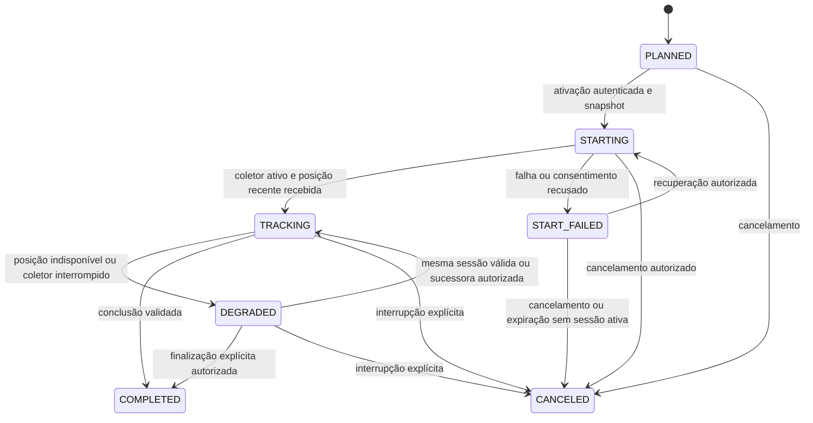

> Registro técnico anterior à centralização. Caminhos pessoais e endereços operacionais foram omitidos. Para executar a versão atual, use os guias em `docs/desenvolvimento/`; este histórico não autoriza deploy nem comprova a nova revisão.

# Arquitetura, dados e contratos propostos

Parte da [proposta do MVP](README.md). Nomes de tabelas, endpoints e estados abaixo são contratos a implementar, não capacidades disponíveis. As diferenças em relação ao código atual estão em [fontes e baseline](05-fontes-e-baseline.md).

## 1. Responsabilidades

| Componente | Responsabilidade | Limite |
|---|---|---|
| Evolution | Receber/enviar mensagens e informar resultados do canal | Não é fonte automática de GPS contínuo comprovada |
| n8n | Conduzir conversa, chamar ferramentas tipadas, formatar e enviar mensagens, executar lembretes | Não decide permissões, presença, geofence ou conclusão; não acessa tabelas diretamente |
| Modelo de linguagem | Interpretar intenção e dados fornecidos, perguntar o que falta, redigir resposta | Não inventa coordenadas, ETA, confirmação de gravação ou autoridade do interlocutor |
| API Spring Boot | Identidade, autorização, regras, execução, posição, aproximação, inbox/outbox e auditoria | Fonte de verdade operacional |
| PostgreSQL | Estado durável, unicidade, concorrência e histórico mínimo | Não usar memória do chat como cadastro |
| App mínimo Flutter/Android/iOS | Instalação, pareamento, coleta nativa em segundo plano, envio, parada e recuperação | Um código de produto compartilhado; ciclo de vida específico por sistema; sem formulários repetidos |

Começar no backend existente com um contexto isolado `whatsapp`/`operations`, interfaces pequenas e migrations aditivas. Não criar um microsserviço para cada responsabilidade. GPS entra diretamente na API; o n8n recebe eventos de negócio, sem sequência de coordenadas.

## 2. Reaproveitamento do legado

| Aproveitar mediante verificação | Construir/adaptar para o MVP |
|---|---|
| Spring Boot, PostgreSQL, migrations, tratamento de erro, correlação e gates | Perfis sem email/senha; autorização por motorista e passageiro |
| Referências de presença por data e snapshot de operação | Vínculo direto, rotina sem empresa, snapshot também dos pins/ordem |
| Componentes geográficos e cliente de rotas, explicitando origem e fallback | Ingestão temporal, progressão de paradas e avisos calibrados |
| Flutter, Geolocator, listener de links e navegação modular | Modo mínimo, App Links/Universal Links, coletor independente da tela e transporte resiliente |
| n8n/Evolution instalados, após inventário | Workflows versionados, credenciais próprias e processamento durável |

Os modelos atuais exigem email/senha e vínculos de empresa; não criar empresa fictícia, email artificial ou senha compartilhada. O ETA atual contém constantes e o despacho atual de notificação é push síncrono: não reutilizá-los como ETA real ou fila confiável de WhatsApp. Autorização nova precisa ser explícita: o filtro legado protege prefixos enumerados, não automaticamente qualquer controller futuro.

## 3. Modelo mínimo de dados

Nomes ilustrativos; números de migration e localização dos pacotes serão definidos no card. Usar UUID interno, timestamps UTC, timezone da rotina para calendário, versão otimista e auditoria mínima. Proposta: schema/tabelas próprios no mesmo PostgreSQL, sem migração automática dos cadastros antigos.

| Entidade | Dados essenciais e invariantes |
|---|---|
| `wa_profile` | Papel, nome, situação, preferências e versão; identidade interna independente de telefone |
| `wa_identity_alias` | Provedor, instância, tipo, identificador opaco, telefone verificado quando disponível; combinação única |
| `driver_passenger_link` | Motorista, passageiro, estado solicitado/aprovado/recusado/encerrado, vigência, aprovador; D02 limita vínculo ativo |
| `driver_invite` | Emissor, hash do código, validade, revogação e limites de uso; convite não concede leitura de passageiros |
| `pickup_point` | Pin, rótulo/referência, versão, aprovação e vigência; não obrigar endereço postal completo |
| `routine`, `routine_member` | Motorista, nome, dias, hora local, timezone, destino; membros, sentido, ponto e ordem aprovados |
| `attendance` | Única por rotina/passageiro/data local; confirmado/não vai/pendente, autor, instante, versão e pergunta relacionada |
| `operation_run`, `run_stop` | Rotina/data, estado, política aplicada, participantes, pin/referência/ordem/presença congelados; um run ativo por motorista |
| `tracking_session`, `tracking_sample_receipt` | Run, aparelho, geração, estado, autorização com prazo, sequência e última amostra válida; deduplicação de lotes e sessão antiga isolada |
| `driver_device`, `pairing_challenge`, `start_intent` | Aparelho revogável, desafio de uso único, hash/expiração, dono e ação autorizada; link não contém credencial permanente |
| `conversation_state`, `integration_inbox` | Etapa, pergunta vigente, contexto mínimo, evento normalizado, deduplicação, lease e resultado de processamento |
| `message_outbox`, `message_attempt` | Destinatário interno, finalidade, chave de negócio, expiração, tentativas, lease, ID externo e resultado conhecido/desconhecido |
| `audit_event`, `support_case` | Ação, autor, motivo, correlação, instante e atendimento; sem transcrição integral por padrão |

Constraints principais: alias único; membro único por rotina; presença única por data; run único por ocorrência; índice parcial bloqueando dois runs ativos do motorista; sessão/generation ativa única e sequência de amostra única por sessão. Mensagem recebida usa chave de instância/messageId; callbacks de status têm deduplicação separada por ID do evento ou status/versão comprovados no payload, preservando mudanças entregue/lido. Aproximação é única por run/parada/destinatário/finalidade; respostas e pins são únicos por comando idempotente/destinatário/parte, e lembretes por ocorrência/destinatário/janela; a versão da política fica congelada como metadado, sem habilitar reenvio ao mudar a configuração. Duas pessoas podem usar o mesmo ponto: alertas têm destinatários separados, mas o progresso físico agrupa a parada compartilhada.

Não armazenar GPS bruto em evidências, logs ou exportações. Estado operacional pode guardar a posição mínima necessária em banco restrito, com retenção definida. Histórico completo de trajetos não é pré-requisito do MVP.

## 4. Identidade e autoridade

- Resolver o ator a partir do evento autenticado do canal. O LLM não escolhe o usuário afetado.
- Preservar JID/LID como identificadores opacos; não converter LID em telefone por suposição. Mapeamento para número depende do provedor/versão; consultar alias comprovado ou conduzir recuperação explícita. Referência: [migração Baileys v7](https://github.com/WhiskeySockets/docs/blob/main/migration/v7.mdx).
- Validar telefone, quando necessário, com [libphonenumber](https://github.com/google/libphonenumber). Não inserir/remover nono dígito silenciosamente nem fundir contas apenas por nome ou telefone digitado.
- Passageiro altera somente seu cadastro/presença; motorista aprova somente vínculos próprios e opera suas rotinas. Acesso a posição depende de vínculo, ocorrência, janela de operação e preferência aplicável.
- Serviço n8n recebe credenciais separadas para conversa, envio e SYSTEM_JOB. Comando humano usa `inboxEventId`; jobs têm envelope próprio, sem evento humano fictício. API deriva ator e verifica permissão/versão.
- Primeiro pareamento começa pelo app aberto diretamente pelo ícone: pedido/chave/PKCE ficam vinculados antes de mostrar o código que será confirmado no WhatsApp do motorista. Scheme só retorna ao pedido existente e não pode iniciar/substituir esse vínculo. Novo aparelho revoga o anterior conforme D02. Tokens do app usam armazenamento seguro, não `SharedPreferences` em texto.
- Suporte tem acesso restrito, auditável e temporário quando necessário; não usa credencial administrativa geral nos workflows.

## 5. Contratos HTTP a especificar em OpenAPI

Prefixos são propostas. Não alterar endpoints legados nesta primeira fatia.

| Operação proposta | Consumidor / proteção | Resultado |
|---|---|---|
| `POST /integrations/whatsapp/v1/events` | Adaptador Evolution autenticado e limitado à instância | Valida envelope, normaliza e grava inbox antes de `202` |
| `POST /integrations/whatsapp/v1/inbox/claim` | n8n, escopo de conversa | Eventos pendentes com lease; concorrência serializada por conversa |
| `GET /integrations/whatsapp/v1/context?eventId=…` | n8n, evento elegível | Estado mínimo e ações permitidas, sem lista geral de usuários |
| `POST /integrations/whatsapp/v1/commands` | n8n; ator derivado do evento | Comando tipado, versão, resultado persistido e resposta permitida |
| `POST /integrations/whatsapp/v1/inbox/{id}/result` | n8n, token da tentativa | Conclui/reagenda processamento sem ACK de execução antiga |
| `POST /driver-app/v1/pairings/redeem` | Desafio curto, limitado por tentativas | Sessão revogável do aparelho; uso único |
| `POST /driver-app/v1/session/refresh` | Sessão válida e rotação | Renovação sem senha; replay/revogação tratados |
| `GET /driver-app/v1/status` | Aparelho autenticado | Identidade, preparo, run próprio e ação pendente |
| `POST /driver-app/v1/start-intents/{id}/activate` | Aparelho do dono, intenção válida | Snapshot + run `STARTING`; cria/recupera sessão de coleta e autorização temporária |
| `POST /driver-app/v1/runs/{id}/resume` | Dono e versão vigente | Retoma sessão permitida ou apresenta recuperação |
| `POST /driver-app/v1/runs/{id}/finish` | Dono; mesma regra do comando WhatsApp | Finalização idempotente com motivo e tratamento de inconsistências |
| `POST /driver-app/v1/tracking-sessions/{id}/samples` | Aparelho dono, geração e autorização vigentes | Recebe lote limitado; valida/deduplica; devolve ACK, relógio do servidor e comando continuar/parar |
| `POST /driver-app/v1/tracking-sessions/{id}/state` | Mesmo aparelho autenticado | Estado do coletor, falha de permissão ou confirmação de parada; não transforma heartbeat em posição |
| `POST /integrations/whatsapp/v1/outbox/claim` | n8n, escopo de entrega | Reserva lote pequeno com validade e token de tentativa |
| `POST /integrations/whatsapp/v1/outbox/{id}/result` | n8n e token da tentativa | Registra ID/status de envio ou resultado desconhecido |
| Endpoints restritos de operação | Operador autorizado | Saúde, falhas, replay elegível, interrupção e atendimento; nunca listagem pública |

Detalhamento executável, bootstrap de desconhecidos, principals SYSTEM, schemas e pareamento estão em [contratos/configuração](08-contratos-configuracao-e-workflows.md).

Catálogo de comandos: iniciar/continuar cadastro; corrigir perfil; criar/revogar convite; solicitar/aprovar/encerrar vínculo; propor/aprovar ponto; configurar rotina/ordem; responder presença; consultar resumo; preparar início; retomar/finalizar; alterar preferência; abrir suporte. Cada comando tem schema fechado e autorização própria.

Envelope conceitual: `commandType`, `inboxEventId`, `expectedVersion`, `payload`. Usar `Idempotency-Key` vinculada ao ator + hash da operação: mesma chave e corpo devolvem o resultado anterior; corpo diferente gera `409`. Definir validade da chave por operação. Referências de usuário no texto não substituem o ator autenticado.

Erros estáveis: `400` formato; `401` credencial; `403` papel; `404` inexistente/fora do escopo; `409` concorrência/transição; `422` regra de negócio; `429` limite. Retornar código de produto e correlação, sem stack trace, GPS ou credenciais.

## 6. Estado e concorrência

Snapshot ocorre na transação de ativação, antes de liberar a autorização de coleta. Respostas concorrentes de presença/ponto precisam ter um resultado determinístico: ou entram antes do snapshot, ou recebem o tratamento tardio. Um run em `STARTING`, `TRACKING`, `DEGRADED` ou `START_FAILED` reserva o motorista. Proposta: falha retoma o mesmo run; cancelamento explícito ou expiração reconciliada sem sessão ativa libera a reserva. Não permitir duas retomadas concorrentes. Estados terminais não reabrem por evento atrasado.

Mudança tardia de “não vou” grava cancelamento individual e inibe avisos futuros; não altera silenciosamente o snapshot físico. Mudança de ponto/ordem vale para próxima ocorrência. Em caso excepcional, suporte orienta o passageiro e motorista sem prometer desvio automático.

Run e coletor têm estados distintos. O backend pode concluir o run antes de receber o ACK de parada do aparelho; manter `stopRequestedAt`/`stoppedAt` separados. Falta de GPS, expiração da autorização de coleta ou app encerrado não significam conclusão do transporte. A retomada reconcilia estado da API antes de reativar o serviço; run terminal nunca reabre por posição tardia.

## 7. Links, instalação e app mínimo

Implementar um entrypoint no repositório Flutter separado da jornada empresarial legada. Um app compartilhado atende Android e iPhone; adapters nativos cuidam de permissões, serviço de localização e ciclo de vida. Não construir uma interface de navegação própria.

1. Definir flavor, applicationId Android e bundleId iOS estáveis, assinatura do APK de teste e provisionamento iOS Personal Team. Não usar `com.example…` nem confundir APK debug com artefato final assinado. A assinatura de desenvolvimento iOS e sua renovação em sete dias ficam explícitas; Team ID em arquivo não comprova acesso.
2. Configurar Android App Links/`assetlinks.json` associados à assinatura efetiva. No iOS verificar Associated Domains com a conta gratuita; se indisponível, landing HTTPS com botão → custom scheme, com pareamento por confirmação cruzada. Validar abertura a frio/quente pelo WhatsApp, preview e app ausente. DNS novo fica com o proprietário.
3. Exibir somente vínculo, configuração de permissão, preparando, acompanhamento ativo/indisponível e parar/retomar. Oferecer retorno ao WhatsApp; navegação externa está fora do MVP; não prometer retorno automático irrestrito entre apps.
4. Link leva intenção opaca temporária. `GET` nunca resgata pareamento nem inicia a coleta: previews/scanners não executam ações. A ativação exige aparelho autenticado, intenção válida e app em primeiro plano.
5. Guardar credenciais revogáveis no armazenamento seguro; não usar SharedPreferences para segredo. Troca de aparelho revoga o anterior; sessão de coleta pertence a run + device + generation.
6. Onboarding explica a finalidade antes do prompt nativo. Solicitar localização precisa e permissões necessárias ao modo testado, em etapas compatíveis com o sistema. Não pedir localização permanente indiscriminadamente; registrar o que foi autorizado e detectar revogação.
7. Android: iniciar o serviço de localização com o app em primeiro plano, usando foreground service do tipo correto, permissões aplicáveis e notificação/ação de parada. iOS: configurar Core Location e background mode, indicadores e comportamento de pausa apropriados; o coletor não pode depender do widget de uma tela.
8. Encerramento e botão local interrompem o serviço e limpam amostras pendentes conforme a política. Não remover a visibilidade de acompanhamento do sistema nem prometer funcionar após encerramento forçado em qualquer aparelho.

O app já usa Geolocator; P01 verifica se o plugin fixado cobre o ciclo de vida necessário com configuração correta. Se exigir atualização, adapter nativo ou biblioteca diferente, registrar compatibilidade, licença/custo e impacto antes de incorporar. Não presumir que adicionar `UIBackgroundModes` resolve toda a coleta.

Instalação inicial pode não preservar o link: retornar à conversa e emitir novo link é recuperação prevista. APK direto e instalação Xcode atendem à entrega ao proprietário; distribuição em lojas/TestFlight será outro escopo. Não dar papéis administrativos a motoristas para contornar assinatura.

Fontes: [Android foreground service de localização](https://developer.android.com/develop/background-work/services/fgs/service-types#location), [Core Location em segundo plano](https://developer.apple.com/documentation/corelocation/cllocationmanager/allowsbackgroundlocationupdates), [App Links](https://developer.android.com/training/app-links/about), [Associated Domains](https://developer.apple.com/documentation/xcode/supporting-associated-domains), [TestFlight](https://developer.apple.com/testflight/).

## 8. Coletor e ingestão direta

O coletor produz amostras; a API decide progresso, aproximação e conclusão. GPS não depende de WebSocket aberto, execução n8n, prompt ou app de navegação. Para o MVP, usar envio HTTPS de lotes pequenos com ACK e repetição idempotente; o WebSocket legado pode permanecer na jornada antiga.

- Persistir no aparelho apenas o estado indispensável à sessão e um buffer limitado de amostras não confirmadas, protegido e com prazo. Proposta para ensaio: até dois minutos/120 amostras; descartar as mais antigas e medir perda, sem histórico completo permanente. Fixar limites definitivos após teste de rede e política de dados.
- Envelope: `sessionId`, `generation`, `sequence`, `sampledAt`, coordenadas, precisão e, quando disponíveis, velocidade/direção. Campos de pessoa/empresa não são autoridade enviada pelo cliente; a API deriva o dono pelo aparelho autenticado.
- Registrar recebimento separado do instante de amostra; validar relógio/deriva, precisão, limites geográficos, salto impossível, repetição, ordem e geração. Não aceitar o horário arbitrário do cliente como garantia de atualidade: calibrar desvio com relógio do servidor e tratar incerteza excessiva como sinal indisponível.
- Proposta de ensaio: alvo de envio a cada 5–10 s em movimento; alvo não é garantia do sistema operacional. Regular distância/precisão/energia; avaliar intervalos observados e utilidade. Reenvio da mesma amostra ou heartbeat não renova sua aquisição. Uma nova fixação válida pode atualizar a atualidade mesmo com coordenadas iguais, por exemplo com a van parada; preservar o timestamp original fornecido pelo sensor.
- `samples` persiste estado mínimo e deduplicação antes do ACK. Timeout depois de gravação repete o mesmo lote/IDs. Buffer atrasado pode ajudar diagnóstico/progresso autorizado, mas não dispara aviso antigo; a amostra nova volta a determinar atualidade.
- Autorização de coleta tem prazo máximo e renovação autenticada limitada ao run ativo. Proposta inicial: lease de cinco minutos, a calibrar no ensaio de perda de rede. Ao expirar, app interrompe a coleta conforme o mecanismo nativo validado; backend rejeita novos lotes e degrada a operação. Se a plataforma não cumprir o limite medido, M1 reprova esse mecanismo. Expiração não conclui a viagem.
- Cada ACK informa continuar/parar e validade. Após pedido de fim, backend bloqueia uso e avisos imediatamente; o app interrompe serviço e confirma parada. Não depender de push silencioso para parar em segundo plano. Sem rede, proteção local limita duração e deixa pendência visível até confirmação.
- Depois de morte do processo/reboot, não iniciar silenciosamente outra saída: reconciliar sessão, apresentar retomada quando permitida pelo SO e exigir nova ação segura quando necessária. Falha precisa ser visível no WhatsApp/status; o percurso normal deve dispensar intervenção por parada.

Navigation Connect permanece alternativa externa ao escopo principal. Se o coletor próprio reprovar, comparar custo e experiência antes de trocar: acesso Google, tokens, Pub/Sub, Maps Android/Waze iOS e navegação ativa passam a ser dependências. Não implementar as duas fontes simultaneamente nem usar falha de uma para mascarar a outra no teste.

## 9. Aproximação e ETA por passageiro

O algoritmo é da API, versionado e testável com relógio controlado. Entrada: últimas amostras válidas, sequência aprovada, snapshot dos pontos, sentido, presença e preferências. Saída: decisão explicável de avisar, aguardar, sinal indisponível ou ponto ultrapassado.

1. Filtrar run ativo, sessão atual, amostra recente, passageiro elegível e ponto ainda futuro.
2. Avaliar progressão na sequência, distância e tendência; quando necessário, cruzar com corredor/rota habitual. Agrupar passageiros no mesmo ponto.
3. Aplicar limiares calibrados, tolerância de amostras e histerese; travar progressão monotônica para não oscilar entre paradas.
4. Evitar decisão apenas por círculo geográfico: ruas paralelas, viaduto, ida/volta e passar perto de parada posterior são testes obrigatórios.
5. Gravar decisão e mensagem na mesma transação. Uma chave por run/parada/destinatário/finalidade impede novo aviso de aproximação após reprocessamento.
6. Identificar pontos ultrapassados com evidência suficiente; nunca registrar embarque automaticamente.

A primeira prova mede cadência efetiva, precisão, bateria e antecedência útil. Alvo inicial de 5–10 s em movimento é parâmetro de ensaio, não SLA; o SO pode entregar amostras irregularmente. A 40 km/h a van percorre cerca de 111 m em dez segundos: limiar, sequência e atualidade precisam ser calibrados juntos. Aumentar o raio indiscriminadamente pode gerar falsos positivos.

GPS fornece posição, não ETA por passageiro. Para minutos, estimar os trechos restantes na sequência **com paradas anteriores e espera**, identificando provedor de rotas e qualidade. ETA de uma navegação opcional até o destino final não é ETA individual. Não usar o ETA final para todos, nem o cálculo estático legado. Se esse cálculo não passar nos testes, a mensagem permanece sem minutos. Caso aproximação simples também falhe, o caminho não passa no gate.

Geocodificação de endereço é conveniência, não caminho obrigatório: pin funciona sem ela. O cliente de rotas existente só pode ser reaproveitado depois de separar resultado real de fallback estimado e verificar custos, limites e condições de armazenamento/uso do provedor escolhido.

## 10. Workflows n8n

Os fluxos abaixo são unidades lógicas; podem compartilhar subworkflows pequenos. Exportar JSON sem segredos, documentar versão de n8n/nodes e manter inativos até promoção autorizada. Proposta de armazenamento: `integrations/whatsapp/` no coordenador, a criar no card; contratos e migrations permanecem no backend.

| Workflow | Entrada / trabalho | Conclusão durável |
|---|---|---|
| W01 — Conversa | Consome inbox, busca contexto, interpreta intenção e chama comando permitido | ACK com lease; resposta pela outbox |
| W02 — Motorista | Subfluxo de cadastro, rotina, convite e aprovações | Estado salvo pela API a cada etapa |
| W03 — Passageiro | Vínculo, ponto, hábitos e correções | Comandos do ator autenticado |
| W04 — Presença | Gatilho horário consulta ocorrências e solicita lembretes elegíveis | Chave única por data/pessoa/janela |
| W05 — Início/recuperação | Converte intenção de conversa em link autorizado e orientações | API controla intenção/run e validade |
| W06 — Envio | Claim de outbox, renderização, chamada Evolution, registro de resultado | Lease/ID externo/status persistidos |
| W07 — Falha/suporte | Falha definitiva, sessão desconectada ou pedido de ajuda | Caso de suporte e pausa da conversa |
| W08 — Rotina operacional | Consulta saúde, pendências e expiração; dispara ações administrativas permitidas | Métricas e eventos mínimos, sem GPS no fluxo |

O calendário vem da API/timezone da rotina. Agendamento do n8n é um despertador idempotente; atraso ou execução duplicada não repete lembretes. Não manter uma execução `Wait` aberta por passageiro/dia como única fonte de estado.

Aplicar limites de tentativas e tempo por LLM/ferramenta, schema estruturado, fallback determinístico para VOU/NÃO VOU/AJUDA e mensagens de indisponibilidade. Tratar conteúdo de mensagem como dados, não instrução capaz de alterar privilégios. Suporte humano pausa automação por conversa.

## 11. Evolution, inbox e entrega

Inventariar instância, tipo de conexão, versão, configuração de webhooks, suporte de cabeçalhos, IDs e status reais antes de configurar. Não presumir assinatura HMAC ou botão interativo que o provedor não documente/entregue nessa versão. Se webhook não suportar autenticação adequada, usar caminho de rede restrito/adaptador autenticado; não expor comandos públicos sem proteção.

Eventos esperados para validar: `MESSAGES_UPSERT`, atualização de mensagem e conexão. `PRESENCE_UPDATE` representa presença online/digitação, não presença no transporte. Ignorar mensagens próprias, grupos, broadcast/status e payloads não suportados sem causar loop. Pin estático precisa de contrato real testado para extração das coordenadas.

Envio tem estados `PENDING`, `LEASED`, `SUBMITTED`, `DELIVERED`, `READ` quando informado, `UNKNOWN`, `FAILED`, `EXPIRED`, `CANCELED`. Receber `200` da Evolution não comprova leitura nem recebimento no aparelho. Vincular callbacks ao ID externo e tratar ordem invertida.

Lease vence, retries têm backoff e limite; revalidar elegibilidade/TTL imediatamente antes do envio. Coordenar a autorização final de submissão com cancelamento/fim, distinguindo itens pendentes de tentativas já em andamento. Em timeout depois de possível envio, reconciliar resultado antes de repetir. O sistema não promete exactly-once entre API, n8n, Evolution e WhatsApp. Garantir unicidade da intenção e reduzir duplicidade do envio; resultado desconhecido requer tratamento próprio. Mensagem já submetida pode ser entregue após o fim/TTL e não pode ser recolhida por invalidar a outbox; incluir horário de referência e medir atraso no destinatário.

Separar tipo de conexão: se usa Cloud API oficial, validar opt-in, templates e janela de atendimento nos documentos atuais antes de habilitar lembretes proativos. Se usa sessão Baileys, registrar dependência de sessão/dispositivo e comportamento observado, sem aplicar automaticamente capacidades/regras técnicas da Cloud API. Essa escolha precisa estar no P00, não escondida no workflow.

## 12. Dados, configuração e observabilidade

Definir antes do piloto: retenção de estado de posição, eventos rejeitados, conversas, presenças e auditoria; responsáveis por acesso/atendimento; exclusão, exportação e revogação. Registrar finalidade/aceite aplicável no onboarding e consultar os termos do provedor efetivamente usado antes de armazenar ou exibir resultados de mapas/rotas. Um TTL curto não substitui permissão de armazenamento. Separar pin fornecido pelo passageiro, amostra coletada no app e conteúdo de serviço externo; Navigation Connect não participa da coleta principal. Este plano não atesta conformidade jurídica.

Separar credenciais por integração/ambiente, rotacionáveis; nenhuma chave no app, prompt, link público, JSON exportado ou Git. Mascarar telefone, coordenadas, Authorization e query strings também no proxy e nas execuções de erro. No n8n, usar opções de armazenamento por workflow; os parâmetros globais de pruning exigem avaliar impacto nas automações compartilhadas. Se for necessária limpeza seletiva, validar um mecanismo suportado na versão instalada, sem alterar a retenção de outros workflows silenciosamente.

Métricas por correlação pseudônima: atraso do GPS, sessão ativa/degradada, rejeições, idade de inbox/outbox, envio/desconhecido/expirado, duração de onboarding e início, erros de ferramenta, custo por run. Detalhes de ensaio, operação e rollback estão no [plano de validação](04-validacao-e-operacao.md).
