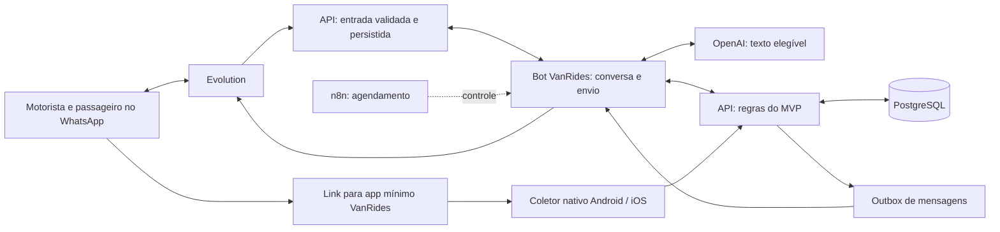

> Registro técnico anterior à centralização. Caminhos pessoais e endereços operacionais foram omitidos. Para executar a versão atual, use os guias em `docs/desenvolvimento/`; este histórico não autoriza deploy nem comprova a nova revisão.

# VanRides pelo WhatsApp — plano de implementação do MVP

Consolidação: 28/10/2026. Revisão: 30/10/2026. Estado: **plano executável documentado; implementação e prova física ainda pendentes**. Android e iPhone são obrigatórios na primeira entrega.

Ajuste de escopo em 02/11/2026: navegação externa retirada do MVP, conforme [ADR-009](../../../program/decisions/ADR-009-whatsapp-mvp-without-navigation.md).

Este plano consolida o pedido do proprietário e a pesquisa da conversa. Não representa funcionalidades implementadas, aprovação de piloto, autorização para publicação nem aprovação do aplicativo pelo Google. O estado executável continua em [program/program.json](../../../program/program.json), conforme o [modelo operacional](../../../program/OPERATING_MODEL.md). Os pacotes P00–P13 abaixo são decomposição da proposta, não uma segunda fila de cards.

Comece pelo [plano executável da primeira entrega](07-plano-executavel.md): 20 cards canônicos, preparação do Mac, instalação no Redmi 8/iPhone, integração, validação e pacote final. A coleta própria é a base técnica deste plano; Play/TestFlight não são pré-requisitos do teste pelo proprietário.

## Leitura do plano

| Documento | Conteúdo |
|---|---|
| [Fluxos e onboarding](01-fluxos-e-onboarding.md) | Conversas, instalação, cadastro, presença, início, avisos, encerramento e recuperação |
| [Arquitetura e contratos](02-arquitetura-e-contratos.md) | Responsabilidades, dados, autenticação, APIs propostas, eventos, n8n, app e integrações |
| [Implementação](03-implementacao.md) | Pacotes de trabalho, dependências, tarefas, critérios de aceite e sequência |
| [Validação e operação](04-validacao-e-operacao.md) | Matriz de testes, prova física, observabilidade, custos, rollout e rollback |
| [Fontes e baseline](05-fontes-e-baseline.md) | Código inspecionado, referências oficiais, limites da evidência e verificação deste plano |
| [Fechamento e prontidão](06-fechamento-e-prontidao.md) | Comparação técnica, recursos e impedimentos com condição de encerramento |
| [Plano executável](07-plano-executavel.md) | Sequência canônica, ambiente, distribuição gratuita e definição da entrega |
| [Contratos, configuração e workflows](08-contratos-configuracao-e-workflows.md) | Bootstrap, atores, DTOs, W01–W08, modelo, GPS, segredos e deploy |
| [Roteiro de validação](09-roteiro-de-validacao.md) | Instalação, provas físicas, testes ponta a ponta e handoff |
| [Registro de decisões](10-registro-de-decisoes.md) | Pedidos, escolhas técnicas, motivos, alternativas, limites e gatilhos de revisão; autorização de 30/10 separada da execução |

## 1. Resultado esperado

Um motorista com passageiros recorrentes administra sua rotina pelo WhatsApp. Cada passageiro cadastra um ponto habitual, responde se vai e recebe um aviso de aproximação. O motorista instala um app mínimo uma vez, inicia cada saída por um link enviado pelo agente e não precisa enviar localização ou confirmar paradas durante o percurso. A recomendação técnica revisada é coletar GPS no próprio app Flutter, com suporte nativo a segundo plano em Android e iPhone; navegação externa está fora do MVP, conforme a ADR-009 de 02/11/2026.

O cadastro não apresenta empresa, conta administrativa ou criação manual de viagem. Internamente haverá uma rotina e uma execução datada para separar ida, volta, presenças e avisos. Essa execução técnica não deve reintroduzir a complexidade da interface antiga.

## 2. Decisões confirmadas pelo proprietário

- WhatsApp será a interface principal de cadastro, presença, comunicação e controle.
- O próprio passageiro conversa com o agente; responsáveis ficam fora do primeiro piloto.
- O cenário inicial tem motorista conhecido, passageiros recorrentes, horários e pontos habituais.
- O motorista aceita uma instalação inicial e abertura do aplicativo VanRides pelo link no WhatsApp para iniciar a coleta; integração de navegação externa foi retirada do MVP em 02/11/2026.
- Não se aceita envio manual de localização ou confirmação em cada parada.
- Aproximação automática é uma capacidade central, condicionada a uma fonte de posição comprovada.
- Reaproveitar a API e os repositórios existentes; n8n e Evolution já estão na VPS.
- Não incluir empresa nem o fluxo completo de viagens do produto anterior na experiência do MVP.
- Android e iPhone entram na primeira entrega; sucesso somente no Android não atende ao pedido.
- Passageiro habitual sem resposta continua previsto, identificado como pendente; não transformar silêncio em confirmação.
- Redmi 8 disponível; Apple ID sem programa pago; número exclusivo do bot de teste e contatos autorizados serão disponibilizados.
- Instalação de Android Studio e ferramentas locais necessárias autorizada; primeiro conferir o estado existente.

## 3. Registro de decisões e propostas

| ID | Proposta recomendada | Quando decidir / efeito |
|---|---|---|
| D01 | Android e iPhone desde a primeira entrega, com a mesma experiência de ativação | Cobertura confirmada; GPS próprio é a base técnica do plano executável. Ver comparação em [fechamento](06-fechamento-e-prontidao.md) |
| D02 | Um motorista ativo por passageiro; um aparelho ativo por motorista | Padrão de engenharia da primeira entrega; unicidade e revogação testadas |
| D03 | Sem resposta mantém o passageiro habitual previsto, identificado como pendente; “não vou” retira antes da saída | Regra de pendentes confirmada pelo proprietário em 29/10/2026; informar no onboarding |
| D04 | Rotinas de ida e volta independentes, com sequência habitual aprovada pelo motorista | Padrão da primeira entrega; não inverter automaticamente a ida |
| D05 | Aviso inicial “a van está se aproximando”; minutos só após ETA individual validado | P01/P10; distância em linha reta não será apresentada como distância rodoviária |
| D06 | Encerramento automático somente após regra validada; comando “finalizar” como contingência | P01/P11; se automático falhar, o proprietário decide se aceita piloto com uma confirmação final |
| D07 | Perfil/banco próprios do contexto WhatsApp dentro do backend existente | P02; preservar contratos e autenticação legados |
| D08 | Coletor próprio no Flutter, apoiado nos serviços nativos; envio HTTPS autenticado direto à API; sem integração de navegação externa | Base técnica adotada no plano de 30/10; funcionamento exige P01 nos dois sistemas |
| D09 | APK direto no Redmi 8 e build Xcode/Personal Team no iPhone | Conta gratuita confirmada; renovar provisionamento em sete dias. Capabilities e fallback de links testados em P00/P05 |
| D10 | Defaults de ensaio em 08; horários/pontos reais e limite financeiro antes do uso externo | Parâmetros versionados; calibração separada de avaliação. Nenhuma contratação presumida |

As preferências confirmadas vêm das respostas do proprietário; os padrões técnicos acima são decisões de engenharia deste plano, sujeitas a teste. Não reabrir perguntas já respondidas. Cards já estão registrados; o DoR de cada sucessor é verificado quando suas dependências terminam. Custos, acessos e alterações externas são resolvidos com preparação concreta no momento necessário.

## 4. Escopo e limites

**Incluído:** cadastro de motorista e passageiro; vínculo aprovado; ponto fixo e referência; configuração de rotinas; presença por data/sentido; instalação e pareamento; início e retomada; ingestão de posição; aproximação; entrega de mensagens; tratamento de interrupções; encerramento; suporte básico; operação e evidências do piloto.

**Adiado:** responsáveis e múltiplos dependentes; cobrança e contratos; empresas; passageiro avulso; escolha entre vários motoristas; GPS contínuo do passageiro; aplicativo do passageiro; otimização dinâmica da rota; prova de embarque; rastreador físico; interface administrativa completa; navegação própria e integração com Maps/Waze; mensagens em grupos como interface operacional.

O agente responde em linguagem natural, mas presença, vínculo, autorização, sequência, alertas e conclusão são regras da API. Os números de latitude/longitude vêm da mensagem ou do provedor, nunca da geração de texto do modelo.

## 5. Arquitetura proposta

A entrada pela API valida o remetente técnico, elimina repetições e grava o mínimo necessário antes de confirmar recebimento. Conforme a RD29, o n8n agenda e aciona o Bot VanRides em Node.js, que processa conversas e envios. Texto e GPS não atravessam as execuções do n8n; somente texto elegível pode ser enviado à OpenAI. As automações estão preparadas e inativas no último ambiente conferido; este desenho não comprova operação em produção.

O Bot VanRides já faz parte da arquitetura adotada na RD29. Não adicionar outro banco, broker genérico ou plataforma própria de mapas para este MVP. O PostgreSQL existente pode hospedar as tabelas novas; a separação é de modelo e permissões. A infraestrutura compartilhada deve ser inspecionada antes de qualquer mudança externa.

## 6. Ordem recomendada

1. **P00:** fechar escolhas do piloto, verificar canal WhatsApp, aparelhos, distribuição e ambiente de teste.
2. **P01:** provar ativação → posições contínuas → cálculo de aproximação em ambiente controlado, separadamente no Android e no iPhone.
3. **P02–P03:** contratos, dados, autorização e entrada/conversa durável.
4. **P04–P06:** motorista/rotinas, instalação/pareamento e passageiro/pontos.
5. **P07–P09:** presenças, execução do percurso, posição e entrega confiável.
6. **P10–P11:** avisos corretos, exceções e encerramento.
7. **P12–P13:** operação, ambiente de teste autorizado, validação conjunta e entrega ao proprietário. Piloto ampliado continua separado.

Um único card vertical ativo continua sendo o limite. Pesquisa pode acontecer em paralelo; implementação e promoção obedecem ao programa. Não há prazo de entrega assumido: estimativa de calendário só depois de P00/P01 e dos recursos disponíveis.

## 7. Condições para aprovar a fonte de GPS

O coletor próprio é a recomendação, não uma capacidade já testada. A evidência precisa confirmar abertura pelo link, permissões, posições sucessivas sem depender de tela Flutter aberta, segundo plano/tela bloqueada, recuperação de rede e aproximação de paradas intermediárias sem interação por parada. O backend compartilha o contrato de posição normalizada entre Android e iOS; o ciclo de vida do GPS exige implementação específica de cada sistema.

O MVP não oferece abertura de rotas em aplicativos externos. Encerrar à força o próprio VanRides, revogar permissões ou perder sinal são condições distintas que precisam ser detectadas e testadas, sem promessa de funcionamento irrestrito. Se a coleta, os avisos ou a retomada exigirem interação por parada, o caminho falha no requisito.

Navigation Connect fica como alternativa avaliada, não segunda implementação simultânea. Sua aprovação depende de acesso/verificação Google e ensaio próprio, incluindo a restrição atual de Waze no iPhone e de um destino por sessão. Ele deixa de ser dependência do caminho principal. A comparação está no [registro de fechamento](06-fechamento-e-prontidao.md).

Critérios mensuráveis e alternativas de decisão estão em [validação](04-validacao-e-operacao.md). A aprovação de um protótipo local não remove o HOLD de piloto/produção.

## 8. Impact Analysis desta entrega documental

- Alteração autorizada: produzir/revisar o plano executável e registrar sua sequência no programa.
- Arquivos de responsabilidade: este diretório, índice, `program/program.json`, 20 cards `VR-WA-*`, trecho do roadmap e riscos correspondentes.
- Nenhuma implementação em app/backend nem alteração de banco, workflows, infraestrutura ou credenciais. Programa: um novo card ready, 19 analyzed; nenhum in_progress/done novo.
- O plano é preparação de sucessores, não execução de funcionalidade. Próximo: `VR-WA-000-PREFLIGHT`; confirmar fontes/dirty paths e DoR antes de código.
- Preservar os dirty paths preexistentes e o dashboard local; não usá-los para encobrir os erros existentes de controle.
- Rollback documental: reverter somente o commit deste plano, preservando os demais arquivos. Nenhuma migration ou rollback externo é necessário.
