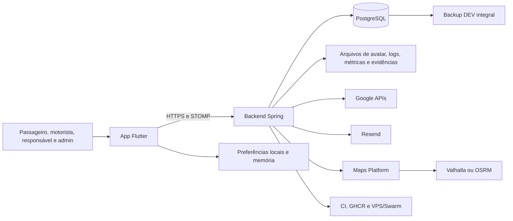

# Inventário de dados e fluxos — VanRides

## Controle do artefato

- Card: `VR-PRIV-001-DATA-INVENTORY-PURPOSE-001`.
- Corte estático: 2026-07-18.
- Coordenação: `737e3a7d479c8085772821f1b928d00441e16743`, tree
  `ae80c418c8dcdfe10224055497a357d1324e444f`.
- Backend: `6efdb61846d0e4dcc59fd5cab921d275ad9eca98`, tree
  `237586b41e991d0ca5d896c8be900c5635f2c0c2`.
- App: `b53296b67dd0dc6ddb4b1125dcc64caadb8c7c6c`, tree
  `38a2ae2be9285443c4d987fe2c838083e6ccf949`.
- Maps Platform: `a0c2a659eee262758191dff83300ef5b1045ef08`,
  tree `95f26792e067a2bbe0b293dea4ae764a8d43b902`.

Este documento registra categorias, nunca valores. Banco, caixa postal,
analytics, ambiente remoto, logs de produção, backup real e GPS real não foram
consultados. Nenhum valor de segredo foi registrado,
validado ou reutilizado; somente sua categoria/path/configuração foi catalogada.
Arquivos de mídia foram inventariados por path, tipo,
manifest e metadado Git, sem abrir seu conteúdo. Um fluxo existir no código não
prova que tenha processado dado real. Uma finalidade técnica observada não é
base legal, consentimento nem aprovação de Produto, Privacidade ou
Jurídico/DPO.

## Taxonomia

| Estado | Uso neste inventário |
|---|---|
| `OBSERVED` | Código, schema ou configuração local prova a superfície ou o fluxo. |
| `DECLARED` | Documento ou configuração descreve intenção/prazo, sem provar execução nem aprovação. |
| `APPROVED` | Decisão humana imutável e aceita para a afirmação específica. |
| `UNVALIDATED` | Finalidade, necessidade, acesso, retenção, exclusão ou execução ainda não foi validada. |
| `NOT_APPLICABLE` | Superfície não implementada ou não aplicável no corte atual; não significa autorização futura. |

Não foi encontrada finalidade humana `APPROVED` aplicável às famílias deste
inventário. ADR-002 e ADR-005 permanecem propostas/worksheets; seus prazos e
alternativas são `DECLARED` ou `UNVALIDATED`, nunca política ativa.

## Cobertura e método

| Superfície | Corte coberto | Resultado |
|---|---|---|
| Coordenação | 132 arquivos rastreados; 36 cards; 23 evidências; 6 arquivos de decisão | cards, riscos, gates, evidências, ADRs e estados do programa |
| Backend | 724 arquivos rastreados; 25 migrations; 28 `CREATE TABLE`; 28 entidades; 28 classes `@RestController`; 1 `@MessageMapping` | schema, modelos, DTOs, controllers, services, integrações, filtros, deploy, backup e CI |
| App | 1.127 arquivos rastreados; 354 Dart em `lib/`; 3 arquivos com `SharedPreferences`; 32 arquivos com construção de URI; 21 MP4 e 12 imagens de marketing no HEAD; worktree de mídia preexistente preservada fora do corte | payloads, sessão/local storage, deep links, localização, mapas, push, suporte, permissões, mídia e CI |
| Maps | 56 arquivos rastreados; 3 fontes JS; 2 endpoints; 3 providers | contrato, memória de processo, engines, stack, ops e CI/CD |

O Graphify existente de backend e app foi usado somente como mapa de cobertura;
cada afirmação abaixo foi reancorada em fonte local. Maps não possuía corpus e
foi lido diretamente. Buscas negativas cobriram os arquivos rastreados dos
quatro repositórios; código remoto, dados gerados e dependências de terceiros
não foram inspecionados internamente.

## Fluxo de alto nível

As setas mostram capacidade observada/configurada, não uso real nem autorização
de produção.

## Inventário canônico por família

Abreviações de atores: `PAX` passageiro; `DRV` motorista; `GUA` responsável;
`ADM` administrador de empresa; `OPS` operador; `EXT` provedor externo.

| ID | Categoria e titular | Produtor → consumidor | Armazenamento e cópias observadas | Finalidade técnica | Retenção física | Aprovação | Fontes |
|---|---|---|---|---|---|---|---|
| D01 | identidade e contato de PAX/DRV/GUA/ADM: nome, e-mail, telefone, papel e IDs | cadastro/perfil/admin → autenticação, conta, vínculo, suporte e operação; backend → internet anônima em `GET /motoristas` com ID/nome de DRV | PostgreSQL; respostas HTTP públicas/autenticadas; sessão local do app; backup DEV | `OBSERVED`: identificar conta e papel; finalidade/necessidade do diretório público sem consumidor Flutter observado `UNVALIDATED` | `UNVALIDATED`: sem prazo geral | `UNVALIDATED` | `src/backend/src/main/resources/db/migration/V1__initial_schema.sql:L1-L28`; `src/backend/src/main/resources/db/migration/V4__guardian_domain_foundation.sql:L4-L19`; `src/backend/src/main/resources/db/migration/V5__company_admin_auth.sql:L1-L17`; `src/backend/src/main/java/com/vanrides/vanrides/filtros/FilterAuthBasic.java:L47-L57`; `src/backend/src/main/java/com/vanrides/vanrides/controller/MotoristaController.java:L39-L44,L75-L79`; `src/aplicativo-motorista/lib/app/session/app_session_store.dart:L42-L147` |
| D02 | credenciais e namespace de login de PAX/DRV/GUA/ADM: hash e senha bruta durante autenticação, e-mail normalizado, papel/ID | cadastro/troca/login → backend; senha bruta → `AppSessionUser`, routers, services e fallback Basic | hash no PostgreSQL e backup DEV; senha bruta em request/memória do app/processo; resíduos legados `session.password`/`senha` em `SharedPreferences` são removidos apenas quando lidos | `OBSERVED`: autenticação e unicidade global; necessidade do fallback Basic/senha na sessão `UNVALIDATED` | `UNVALIDATED`: namespace possui invalidações, não lifecycle geral; resíduo legado depende de leitura | `UNVALIDATED` | `src/backend/src/main/resources/db/migration/V25__global_login_email_namespace.sql:L210-L255`; `src/backend/src/main/java/com/vanrides/vanrides/service/AccountMeService.java:L94-L120,L185-L207`; `src/aplicativo-motorista/lib/app/session/app_session_user.dart:L5-L29,L32-L60`; `src/aplicativo-motorista/lib/app/session/app_session_store.dart:L37-L67,L69-L176`; `src/aplicativo-motorista/lib/services/auth_headers.dart:L3-L14`; `src/aplicativo-motorista/lib/app/experience/experience_home_router.dart:L32-L62` |
| D03 | sessão de PAX/DRV/GUA/ADM: access token, refresh token/hash, papel, empresa, validade e revogação | login/refresh → filtros, REST, STOMP e app; app recebe refresh token, mas consumidor de refresh/rotação/expiração não foi observado | refresh token no PostgreSQL; bearer em trânsito/memória; access e refresh token em `SharedPreferences`; backup DEV | `OBSERVED`: manter sessão autenticada; lifecycle do refresh no app `UNVALIDATED` | `OBSERVED`: janelas lógicas configuradas no backend; `UNVALIDATED`: exclusão física e aplicação de expiração/rotação no app | `UNVALIDATED` | `src/backend/src/main/resources/db/migration/V1__initial_schema.sql:L48-L62`; `src/backend/src/main/resources/application.properties:L43-L47`; `src/aplicativo-motorista/lib/app/session/app_session_store.dart:L42-L67,L69-L147`; `src/aplicativo-motorista/lib/app/session/app_session_user.dart:L5-L29,L49-L60` |
| D04 | verificação/troca de e-mail: e-mail snapshot, hash de token, emissão, expiração, consumo e cooldown | conta/backend → Resend/log gateway → navegador/app | PostgreSQL; payload de e-mail no processo e no provedor quando configurado; backup DEV | `OBSERVED`: confirmar posse do endereço; `DECLARED`: link/cooldown de configuração | `OBSERVED`: validade lógica; `UNVALIDATED`: purge e retenção no provedor | `UNVALIDATED` | `src/backend/src/main/resources/db/migration/V10__email_verification_foundation.sql:L1-L36`; `src/backend/src/main/java/com/vanrides/vanrides/service/EmailVerificationService.java:L49-L107,L141-L152,L273-L296` |
| D05 | empresa/tenant e administração: nome/slug, vínculo, IDs e timestamps | bootstrap/admin → autorização e segregação tenant | PostgreSQL; tokens/respostas; backup DEV | `OBSERVED`: escopo organizacional dos fluxos | `UNVALIDATED` | `UNVALIDATED` | `src/backend/src/main/resources/db/migration/V2__company_base.sql:L1-L41`; `src/backend/src/main/resources/db/migration/V5__company_admin_auth.sql:L1-L17` |
| D06 | perfil de PAX, inclusive contato, endereço, bairro, cidade, estado, CEP, coordenadas, nascimento e indicador de menor | PAX/ADM/Google → backend, operação de rota e perfil; backend → GUA vinculado com e-mail, telefone, endereço e CEP exibidos no app | PostgreSQL; requests/responses; app em memória; Google nos fluxos de busca/geocode; backup DEV | `OBSERVED`: cadastro, perfil, parada, roteamento e detalhe GUA; necessidade campo a campo da projeção GUA `UNVALIDATED` | `UNVALIDATED` | `UNVALIDATED`, especialmente para menores, contato e coordenadas residenciais | `src/backend/src/main/resources/db/migration/V1__initial_schema.sql:L10-L28`; `src/backend/src/main/resources/db/migration/V4__guardian_domain_foundation.sql:L1-L3`; `src/backend/src/main/resources/db/migration/V19__account_profile_platform.sql:L1-L11`; `src/aplicativo-motorista/lib/features/passenger_onboarding/data/passageiro_cadastro_gateway.dart:L53-L97,L124-L224`; `src/aplicativo-motorista/lib/features/guardian/domain/guardian_linked_passageiro_record.dart:L1-L59`; `src/aplicativo-motorista/lib/features/guardian/data/guardian_passageiro_service.dart:L27-L54`; `src/aplicativo-motorista/lib/features/guardian/presentation/guardian_passageiro_detail_screen.dart:L108-L136` |
| D07 | perfil de DRV/GUA/ADM: nascimento, foto/URL e dados de contato | titular/ADM → conta, vínculo e operação | PostgreSQL; app em memória; arquivo de avatar quando upload local; backup DEV | `OBSERVED`: perfil e identificação operacional; necessidade campo a campo `UNVALIDATED` | `UNVALIDATED` | `UNVALIDATED` | `src/backend/src/main/resources/db/migration/V19__account_profile_platform.sql:L1-L11`; `src/backend/src/main/java/com/vanrides/vanrides/service/AccountMeService.java:L123-L182,L235-L310` |
| D08 | relações GUA↔PAX e indicador de menor | ADM/GUA → autorização e acompanhamento | PostgreSQL; responses/app em memória; backup DEV | `OBSERVED`: relacionar responsável ao passageiro | `UNVALIDATED` | `UNVALIDATED` | `src/backend/src/main/resources/db/migration/V4__guardian_domain_foundation.sql:L1-L40` |
| D09 | convites, códigos/tokens, pedidos de vínculo, origem/status, reviewer e observações | PAX/DRV/ADM/deep link → onboarding e revisão; ADM copia URL/código para clipboard | PostgreSQL; request/responses; token pendente em `SharedPreferences`; URI/custom scheme; clipboard; URI completa em log de falha; backup DEV | `OBSERVED`: vincular conta a empresa; transparência/necessidade das notas e cópias `UNVALIDATED` | expiração/status `OBSERVED`; purge, clipboard, URI, log e cópia local `UNVALIDATED` | `UNVALIDATED` | `src/backend/src/main/resources/db/migration/V11__passenger_company_link_onboarding.sql:L1-L64`; `src/backend/src/main/resources/db/migration/V20__driver_company_link_flow.sql:L1-L74`; `src/aplicativo-motorista/lib/app/session/app_session_store.dart:L53-L54,L185-L203`; `src/aplicativo-motorista/lib/features/deep_linking/data/deep_link_parser.dart:L39-L57`; `src/aplicativo-motorista/lib/features/deep_linking/data/deep_link_listener.dart:L70-L99`; `src/aplicativo-motorista/lib/features/admin/presentation/admin_motoristas_screen.dart:L164-L205`; `src/aplicativo-motorista/lib/features/admin/presentation/widgets/admin_passageiro_entry_flow.dart:L173-L205` |
| D10 | serviços recorrentes e elegibilidade de PAX: destino, agenda, dias, capacidade, política, vigência e projeção do motorista padrão | ADM → provisionamento, presença e viagens; backend → PAX com ID/nome/e-mail/telefone de DRV, enquanto a UI de presença usa somente o nome | PostgreSQL; app/responses; backup DEV | `OBSERVED`: planejar serviço/elegibilidade e exibir motorista; necessidade de contato DRV `UNVALIDATED` | `UNVALIDATED`; integridade temporal também pendente | `UNVALIDATED` | `src/backend/src/main/resources/db/migration/V16__servico_recorrente_foundation.sql:L1-L145`; `program/cards/VR-BE-ELIGIBILITY-PERIOD-INTEGRITY-001.md:L1-L169`; `src/aplicativo-motorista/lib/features/service_presence/domain/passenger_available_service_record.dart:L55-L93`; `src/aplicativo-motorista/lib/features/service_presence/presentation/service_presence_decision_list.dart:L120-L126` |
| D11 | rotas, paradas e destinos: nomes/labels, ordem, endereço, lat/lon, recorrência | ADM/backend/Google → viagens, mapas e navegação | PostgreSQL; respostas/app em memória; snapshots; providers; backup DEV | `OBSERVED`: construir trajeto e parada; minimização por papel `UNVALIDATED` | `UNVALIDATED` | `UNVALIDATED` | `src/backend/src/main/resources/db/migration/V7__trip_domain_foundation.sql:L1-L25`; `src/backend/src/main/resources/db/migration/V14__rota_base_destino_final.sql:L1-L5`; `src/backend/src/main/java/com/vanrides/vanrides/service/ViagemRotaGeograficaService.java:L189-L231,L260-L291` |
| D12 | viagens/manifests: data/hora, motorista, passageiro, status, ETA, versão, destino, geometria/navegação snapshot, `snapshotKey` e `routeInputHash` derivados de IDs/coordenadas | serviços/admin/backend → DRV/PAX/GUA/ADM e Maps; payloads PAX também parseiam e-mail/telefone de DRV sem consumidor de UI observado | PostgreSQL; REST/STOMP; app em memória; provider; backup DEV | `OBSERVED`: executar e acompanhar viagem; necessidade dos contatos DRV e hashes no consumidor `UNVALIDATED` | `UNVALIDATED` | `UNVALIDATED` | `src/backend/src/main/resources/db/migration/V7__trip_domain_foundation.sql:L26-L64`; `src/backend/src/main/resources/db/migration/V8__trip_dynamic_route_eta_v1.sql:L1-L11`; `src/backend/src/main/resources/db/migration/V17__viagem_operacional_servico_snapshot.sql:L1-L34`; `src/backend/src/main/resources/db/migration/V18__viagem_rota_geografica_snapshot.sql:L1-L8`; `src/backend/src/main/java/com/vanrides/vanrides/service/ViagemRouteAuditBuilder.java:L20-L85`; `src/aplicativo-motorista/lib/features/tracking/domain/trip_tracking_record.dart:L8-L29,L121-L154` |
| D13 | presença de PAX: data, confirmação, serviço e timestamps | PAX/ADM/backend → lista operacional e viagem | PostgreSQL; app/responses; backup DEV | `OBSERVED`: confirmar participação no serviço/viagem | `UNVALIDATED` | `UNVALIDATED` | `src/backend/src/main/resources/db/migration/V1__initial_schema.sql:L29-L37`; `src/backend/src/main/resources/db/migration/V16__servico_recorrente_foundation.sql:L30-L81` |
| D14 | GPS bruto de DRV: motorista, lat/lon e timestamp; associação indireta a PAX/viagem | sensor/app → STOMP/backend → banco, REST, telas e rota | memória do aparelho/processo; rede; PostgreSQL; respostas; backup DEV integral; potencial provider | `OBSERVED`: localização ao vivo e rota; ADR-005 propõe escopo trip/janela | schema atual sem purge `OBSERVED`; 72h/backup sem GPS apenas `DECLARED` e não implementado | `UNVALIDATED`; G1/G6 em `HOLD` | `src/aplicativo-motorista/lib/services/location_gateway.dart:L34-L49`; `src/aplicativo-motorista/lib/services/websocket_service.dart:L120-L140`; `src/backend/src/main/resources/db/migration/V1__initial_schema.sql:L38-L46`; `program/decisions/ADR-005-trip-scoped-location-access.md:L329-L384` |
| D15 | projeções realtime: GPS, IDs, nomes/próxima parada e estado de viagem | backend → tópico tenant-wide → apps conectados; filtro por motorista/titular ocorre somente no cliente | memória/broker local da JVM; STOMP; app mantém histórico crescente em memória; console em falha | `OBSERVED`: atualização ao vivo; audiência e minimização atuais inadequadas | memória até desconexão/restart; histórico em memória e logs `UNVALIDATED` | `UNVALIDATED` | `src/backend/src/main/java/com/vanrides/vanrides/websocket/LocalizacaoSocketController.java:L31-L72`; `src/backend/src/main/java/com/vanrides/vanrides/service/ViagemRealtimePublisherService.java:L126-L147`; `src/aplicativo-motorista/lib/services/websocket_service.dart:L54-L108`; `src/aplicativo-motorista/lib/features/tracking/presentation/trip_live_map_panel.dart:L187-L240`; `src/aplicativo-motorista/lib/features/guardian/presentation/guardian_localizacao_screen.dart:L482-L535` |
| D16 | geometria/projeção no app: waypoints com IDs, nomes, lat/lon, ordem, `snapshotKey` e `routeInputHash` | backend → PAX/GUA/DRV → mapa/lista | response e memória do app; sem persistência própria observada | `OBSERVED`: renderizar mapa e próxima parada; minimização por titular `UNVALIDATED` | memória da tela; cópias de rede/log `UNVALIDATED` | `UNVALIDATED` para finalidade/acesso geral; `APPROVED` somente a restrição técnica visual de labels/pins do ADR local, sem ampliar acesso | `src/aplicativo-motorista/lib/features/tracking/domain/trip_route_geometry_record.dart:L31-L68,L97-L132,L166-L211`; `src/aplicativo-motorista/lib/features/tracking/presentation/trip_live_map_state.dart:L119-L165`; `src/aplicativo-motorista/lib/features/tracking/presentation/trip_live_map_panel.dart:L507-L563`; `src/aplicativo-motorista/docs/adr/2026-06-18-map-labels-pins-and-density.md:L5-L7,L20-L21,L35-L79`; `src/backend/src/main/java/com/vanrides/vanrides/service/ViagemRouteAuditBuilder.java:L20-L85` |
| D17 | request/response de planejamento Maps de DRV/PAX, inclusive PAX menor quando presente na viagem; fixtures QA sem titular: região, veículo, stops, IDs, labels atualmente derivados de nomes, lat/lon, opções, polyline, legs, instruções e métricas | facade backend ou QA → cliente Maps → Maps → fixture/Valhalla/OSRM → backend/app; adapter backend desabilitado por padrão | request/response em memória; labels chegam ao Maps; Valhalla recebe coordenadas no body; OSRM no path; nenhuma persistência própria observada em `src/` do Maps | `OBSERVED`: calcular rota; execução com dado real `UNVALIDATED` | persistência própria atual `NOT_APPLICABLE`; provider/access logs `UNVALIDATED` | `UNVALIDATED`; manter desligado até prova de boundary/log é `DECLARED`, não aprovação humana | `src/backend/src/main/java/com/vanrides/vanrides/service/MapsPlatformTripRouteFacade.java:L42-L90`; `src/backend/src/main/java/com/vanrides/vanrides/service/maps/MapsPlatformRouteClient.java:L20-L66`; `src/backend/src/main/resources/application.properties:L32-L33`; `vanrides-maps-platform/src/server.js:L25-L89`; `vanrides-maps-platform/src/route-plan-fixture.js:L139-L177`; `vanrides-maps-platform/src/routing/route-planner.js:L67-L89,L139-L155`; `program/cards/VR-MAP-001-LOCATION-S2S-001.md:L1-L55` |
| D18 | device token: token bruto/hash, plataforma, papel/ID/e-mail, empresa, status e timestamps | SO/app → backend → push gateway; registro ocorre após login, sem assinatura observada de `onTokenRefresh` nem desregistro no logout | PostgreSQL; request; backup DEV; provedor externo não implementado no corte | `OBSERVED`: registrar dispositivo; entrega real `NOT_APPLICABLE` com gateway noop | invalidação backend `OBSERVED`; purge, refresh e desvínculo no logout `UNVALIDATED` | `UNVALIDATED` | `src/backend/src/main/resources/db/migration/V22__device_token_registration.sql:L1-L20`; `src/aplicativo-motorista/lib/features/notifications/data/push_notification_registration_service.dart:L25-L93`; `src/aplicativo-motorista/lib/features/notifications/data/push_notification_session_binder.dart:L5-L29`; `src/aplicativo-motorista/lib/features/notifications/data/push_notification_gateway.dart:L3-L10`; `src/aplicativo-motorista/lib/app/session/app_session_store.dart:L205-L210`; `src/backend/src/main/java/com/vanrides/vanrides/config/PushDeliveryConfiguration.java:L14-L54` |
| D19 | notificação/outbox: tipo, destinatário, empresa, título, corpo, `data_json`, tentativas/status/provider | backend → device tokens → push provider futuro | PostgreSQL; backup DEV; provedor externo `NOT_APPLICABLE` hoje | `OBSERVED`: registrar tentativa e conteúdo; entrega real não disponível | `UNVALIDATED` | `UNVALIDATED` | `src/backend/src/main/resources/db/migration/V23__notification_event_outbox.sql:L1-L22`; `src/backend/src/main/java/com/vanrides/vanrides/service/NotificationDispatchService.java:L38-L117` |
| D20 | suporte: criador/papel, nome snapshot, categoria, assunto, mensagem livre, respostas e status | PAX/GUA → suporte; ADM → leitura/resposta/administração | PostgreSQL; responses/app em memória; backup DEV | `OBSERVED`: atendimento | `UNVALIDATED`, inclusive após resolução | `UNVALIDATED` | `src/backend/src/main/resources/db/migration/V21__support_tickets.sql:L1-L42`; `src/backend/src/main/java/com/vanrides/vanrides/controller/SupportTicketController.java:L30-L69`; `src/aplicativo-motorista/lib/features/support/data/support_ticket_service.dart:L14-L113,L116-L213` |
| D21 | foto de perfil binária e URL | galeria/app → backend → filesystem público e perfil | memória/data URI no app; arquivo `uploads/avatars`; URL no PostgreSQL; stack sem volume | `OBSERVED`: avatar de conta | `UNVALIDATED`: substituição/delete/orphan; durabilidade também ausente | `UNVALIDATED` | `src/aplicativo-motorista/lib/features/account/data/account_profile_service.dart:L149-L198,L264-L323`; `src/backend/src/main/java/com/vanrides/vanrides/service/AccountAvatarStorageService.java:L19-L75`; `src/backend/src/main/java/com/vanrides/vanrides/config/UploadedResourceConfig.java:L10-L24`; `src/backend/deploy/swarm/vanrides.traefik.yml:L3-L73` |
| D22 | sessão/preferências locais: IDs, nome, e-mail, papéis, empresa, access/refresh token, senha bruta em memória, resíduos legados de senha, vínculo, e-mail lembrado e convite pendente | login/deep link → app e services Basic/bearer | `SharedPreferences`; memória do app; resíduos `session.password`/`senha` removidos somente após leitura | `OBSERVED`: restaurar sessão/onboarding e autenticar chamadas; necessidade de senha/refresh persistidos `UNVALIDATED` | clear de sessão `OBSERVED`; convite, lembrança, refresh e resíduos têm lifecycle separado; criptografia/TTL `UNVALIDATED` | `UNVALIDATED` | `src/aplicativo-motorista/lib/app/session/app_session_store.dart:L37-L67,L69-L210`; `src/aplicativo-motorista/lib/app/session/app_session_user.dart:L5-L29,L32-L60`; `src/aplicativo-motorista/lib/services/auth_headers.dart:L3-L14`; `src/aplicativo-motorista/pubspec.yaml:L1-L40` |
| D23 | fila local de ações DRV: trip/stop ID, nome da parada/passageiro, tipo e criação | ação offline → `SharedPreferences` → sincronização posterior com a sessão atual sem owner/tenant persistido | JSON em chave global de `SharedPreferences`; memória; logout não remove a fila | `OBSERVED`: retry offline | remove quando vazia/inválida; owner/tenant/TTL/logout `UNVALIDATED` | `UNVALIDATED` | `src/aplicativo-motorista/lib/features/navigation/data/driver_navigation_action_queue_store.dart:L6-L76`; `src/aplicativo-motorista/lib/features/navigation/domain/driver_navigation_action_queue.dart:L5-L49,L63-L171`; `src/aplicativo-motorista/lib/features/driver_trip/presentation/home_motorista_screen.dart:L165-L190,L470-L487`; `src/aplicativo-motorista/lib/features/driver_trip/presentation/home_motorista_navigation_action_queue.dart:L12-L112` |
| D24 | permissões e sinais do aparelho: localização atual/background, push, fotos e deep-link scheme | SO/usuário → app → APIs específicas | estado controlado pelo SO; app em memória | `OBSERVED`: GPS, foto, push e abertura de link | SO; cópias posteriores seguem suas famílias | `UNVALIDATED`: necessidade/transparência de background e custom scheme | `src/aplicativo-motorista/android/app/src/main/AndroidManifest.xml:L1-L58`; `src/aplicativo-motorista/ios/Runner/Info.plist:L50-L77`; `src/aplicativo-motorista/lib/services/location_sharing_use_case.dart:L31-L61` |
| D25 | Google Places/Geocoding/Directions: termos de busca, place ID, endereço, coordenadas, waypoints, resposta e chave operacional | app/backend → Google → app/backend | request/response em memória; URLs; logs de exceção possíveis; provider externo | `OBSERVED`: autocomplete, geocode e cálculo de rota | retenção do provedor e logs `UNVALIDATED` | `UNVALIDATED` | `src/aplicativo-motorista/lib/features/passenger_onboarding/data/passageiro_cadastro_gateway.dart:L130-L224`; `src/backend/src/main/java/com/vanrides/vanrides/service/PlacesProxyService.java:L32-L95`; `src/backend/src/main/java/com/vanrides/vanrides/service/GeocodingService.java:L29-L60`; `src/backend/src/main/java/com/vanrides/vanrides/service/GoogleDirectionsRoutingService.java:L49-L116,L191-L215` |
| D26 | e-mail Resend: destinatário, remetente, assunto, HTML/texto e link/token de verificação | backend → Resend → titular | memória do processo; payload/provedor; resposta de erro pode entrar na exceção | `OBSERVED`: entrega de verificação | provider/log/erro `UNVALIDATED` | `UNVALIDATED` | `src/backend/src/main/java/com/vanrides/vanrides/service/ResendEmailDeliveryGateway.java:L34-L76`; `src/backend/src/main/java/com/vanrides/vanrides/service/ConfiguredEmailDeliveryGateway.java:L28-L71`; `src/backend/src/main/java/com/vanrides/vanrides/service/LoggingEmailDeliveryGateway.java:L7-L14` |
| D27 | origem de request e rate limit: IP direto/forwarded transformado em digest, rota, contadores e métricas agregadas | ingress/request → filtros/backend | IP somente durante resolução; HMAC truncado e contador em memória por processo | `OBSERVED`: abuso e proteção de capacidade | janela/expiração em memória `OBSERVED`; ingress logs `UNVALIDATED` | finalidade operacional `OBSERVED`; aprovação de privacidade `UNVALIDATED` | `src/backend/src/main/java/com/vanrides/vanrides/filtros/TrustedProxyClientAddressResolver.java:L19-L77,L99-L145`; `src/backend/src/main/java/com/vanrides/vanrides/filtros/BoundedRateLimitStore.java:L17-L120`; `src/backend/src/main/resources/application.properties:L36-L66` |
| D28 | logs, métricas e correlação: request ID, classes/status/erros, stack traces, GPS em debug, URI completa de deep link e possíveis corpos/URLs | app/backend/Maps/providers/ingress → console/runtime/operador | console local, runtime/container/Traefik/provider; armazenamento real não inspecionado | `OBSERVED`: diagnóstico; conteúdo sensível em caminhos específicos é risco observado | `UNVALIDATED` | `UNVALIDATED` | `src/aplicativo-motorista/lib/services/websocket_service.dart:L94-L108`; `src/aplicativo-motorista/lib/features/deep_linking/data/deep_link_listener.dart:L70-L99`; `src/backend/src/main/java/com/vanrides/vanrides/websocket/LocalizacaoSocketController.java:L31-L45`; `src/backend/src/main/java/com/vanrides/vanrides/service/PassageiroPersistencePreparer.java:L78-L93`; `src/backend/src/main/java/com/vanrides/vanrides/service/ResendEmailDeliveryGateway.java:L52-L61`; `vanrides-maps-platform/deploy/ops/maps-dev-status:L1-L17` |
| D29 | backup DEV: todas as tabelas, portanto todas as famílias persistidas no banco | PostgreSQL DEV → dump/checksum → filesystem de backup | dump custom integral com permissão restrita e checksum | `OBSERVED`: recuperação DEV | `UNVALIDATED`: nenhum prune/prazo/criptografia/restore-purge observado no script | `UNVALIDATED` | `src/backend/deploy/ops/vanrides-dev-backup-db:L13-L44`; `src/backend/docs/ops/vanrides-dev-staging-ops.md:L93-L131` |
| D30 | evidências/CI: manifests, XML, logs sanitizados, checksums, SHAs, metadados de run e imagens GHCR | gates/repos → filesystem/GitHub/Git/GHCR | Git para índices pequenos; `output/qa-evidence`; artifact CI; imagem de container | `OBSERVED`: prova de qualidade/proveniência | local 30 dias e mínimo 20 por suíte `OBSERVED`; CI 14/90 dias `DECLARED`; demais `UNVALIDATED` | política de não conter PII `DECLARED`, enforcement parcial `UNVALIDATED` | `program/evidence/README.md:L1-L16`; `src/backend/scripts/qa_evidence_retention.py:L19-L34,L84-L216`; `src/backend/.github/workflows/swarm-ghcr-cicd.yml:L21-L50` |
| D31 | segredos/credenciais operacionais: banco, JWT, Google, Resend, GHCR, SSH/Tailscale e variáveis de deploy; não são dados de usuário por si | OPS/GitHub/Swarm/config local → runtime/providers/VPS | secret store GitHub/Swarm, arquivos montados e `ios/Flutter/Secrets.xcconfig` local ignorado presente; nenhum valor é registrado neste inventário | `OBSERVED`: autenticar infraestrutura e providers | `UNVALIDATED`: escopo/restrições/owner/última rotação/retenção por categoria | decisão de segurança fora deste inventário; `UNVALIDATED` | `src/aplicativo-motorista/.gitignore:L54-L59`; `src/backend/deploy/swarm/vanrides.traefik.yml:L8-L44,L65-L73`; `src/backend/.github/workflows/swarm-ghcr-cicd.yml:L111-L158,L164-L193`; `vanrides-maps-platform/.github/workflows/swarm-ghcr-cicd.yml:L67-L87,L96-L131` |
| D32 | exportação de dados pessoais, analytics de produto, crash reporting externo, tile/offline pack e telemetria de campo | não há produtor/consumidor implementado comprovado no corte | nenhuma store aplicável observada | `NOT_APPLICABLE` no corte; intenção futura não autoriza coleta | `NOT_APPLICABLE` agora; deve ser decidida antes de implementação | `UNVALIDATED` para qualquer futuro uso | buscas read-only sobre fontes rastreadas; `vanrides-maps-platform/README.md:L5-L19`; `program/QUALITY_GATES.md:L61-L72,L103-L115` |
| D33 | capturas e mídia de demo/marketing: telas, nomes, papéis, viagens, mapas e qualquer dado visível/embutido; titular e caráter sintético/real `UNVALIDATED` | portal/app/simulador → scripts de captura → MP4/screenshots → Remotion/render/apresentação ou publicação futura | 21 MP4 e 12 imagens rastreados no HEAD do app; alterações/untracked de mídia preexistentes no worktree foram preservados fora do corte; manifests/Git history; renders/exports e destino publicado não comprovados | `OBSERVED`: demonstração acadêmica/marketing; proveniência, autorização e conteúdo real/sintético `UNVALIDATED` | Git history persiste; retenção de fonte/render/publicação `UNVALIDATED` | `UNVALIDATED`; manifest `real` não prova dado sintético nem autorização | `src/aplicativo-motorista/marketing/vanrides-product-video-remotion/public/recording-first-takes.json:L1-L28,L120-L153,L332-L350`; `src/aplicativo-motorista/marketing/vanrides-product-video-remotion/src/captureManifest.ts:L10-L105`; `src/aplicativo-motorista/marketing/vanrides-product-video-remotion/README.md:L20-L25,L34-L40,L103-L109`; `src/aplicativo-motorista/marketing/vanrides-product-video-remotion/public/captures/trimmed/passenger-map-real.mp4` |
| D34 | superfície de serialização direta de entidades JPA: DRV, PAX, presença e histórico GPS com relações aninhadas | controllers REST → qualquer papel permitido no tenant; alguns endpoints recebem/devolvem a própria entidade | PostgreSQL/JPA → resposta HTTP/app; cópias seguem D01/D06/D13/D14/D29 | `OBSERVED`: CRUD e consulta; necessidade de todos os campos/relacionamentos e estabilidade contratual `UNVALIDATED` | segue retenção das entidades subjacentes; resposta/rede `UNVALIDATED` | `UNVALIDATED` | `src/backend/src/main/java/com/vanrides/vanrides/controller/LocalizacaoMotoristaController.java:L51-L79,L105-L115`; `src/backend/src/main/java/com/vanrides/vanrides/model/LocalizacaoMotorista.java:L6-L20,L63-L69`; `src/backend/src/main/java/com/vanrides/vanrides/controller/MotoristaController.java:L47-L51`; `src/backend/src/main/java/com/vanrides/vanrides/controller/PassageiroController.java:L52-L110`; `src/backend/src/main/java/com/vanrides/vanrides/model/Passageiro.java:L18-L80,L226-L231`; `src/backend/src/main/java/com/vanrides/vanrides/controller/PresencaController.java:L30-L127`; `src/backend/src/main/java/com/vanrides/vanrides/model/Presenca.java:L7-L23,L44-L49` |

## Matriz de cópias e destinos

| Destino/cópia | Famílias | Estado e limite conhecido |
|---|---|---|
| PostgreSQL | D01–D14, D18–D20, URL de D21, D29 | `OBSERVED`; 28 tabelas; lifecycle geral `UNVALIDATED` |
| App `SharedPreferences` | D03, D09, D22, D23 | `OBSERVED`; sem secure storage; owner/TTL incompletos |
| Memória do app/processo | quase todos os payloads ativos | `OBSERVED`; normalmente termina com tela/processo, mas logs e providers podem criar cópia |
| Filesystem de uploads | D21 | `OBSERVED`; público por `/uploads/**`, sem volume/lifecycle comprovado |
| Backup DEV | cópia integral do PostgreSQL | `OBSERVED`; prazo/delete/criptografia `UNVALIDATED` |
| Google | D06, D11, D12, D25 | `OBSERVED` em adapters; retenção e uso real `UNVALIDATED` |
| Resend | D04, D26 | `OBSERVED` quando configurado; retenção externa `UNVALIDATED` |
| Maps/Valhalla/OSRM | D11, D12, D14, D17 | capacidade `OBSERVED`; dado real e finalidade `UNVALIDATED` |
| Console/ingress/runtime | D15, D25–D28 | capacidade `OBSERVED`; redaction e retenção incompletas |
| Git/GitHub artifacts/GHCR | D30, metadados de D31 | `OBSERVED`/`DECLARED`; PII deve ser ausente, enforcement ainda parcial |
| Git/mídia/render/publicação | D33 | fontes rastreadas `OBSERVED`; conteúdo, proveniência, autorização, export e destino `UNVALIDATED` |
| REST/JPA | D01, D06, D13, D14, D34 | entidades/projeções amplas `OBSERVED`; contrato mínimo e audiência campo a campo `UNVALIDATED` |

## Retenção, exclusão e ausência de política

Validade de token não equivale a exclusão física. Status `consumed`, `revoked`,
`inactive` ou `resolved` também não prova purge.

| Família | Controle existente | Lacuna |
|---|---|---|
| Access/refresh/e-mail/invite/device tokens | expiração, consumo, revogação ou invalidação em partes do domínio | purge físico e propagação a backup/provider `UNVALIDATED` |
| GPS | schema histórico e leitura; proposta ADR-005 de janela/purge | proposta não aceita nem implementada; dump DEV ainda é integral |
| Contas, vínculos, viagens, presença e suporte | deletes pontuais/atômicos em alguns agregados | lifecycle por finalidade, exportação e referências ainda `UNVALIDATED` |
| Avatar | novo arquivo + atualização de URL | substituição não remove anterior; delete/privacidade/durabilidade ausentes |
| Sessão local | `clear()` remove chaves de sessão | storage não seguro; convite/lembrança/fila possuem lifecycles separados |
| Fila local | remove quando vazia ou inválida | sem owner/tenant/TTL/logout/migração segura |
| QA Maven | local 30 dias com mínimo por suíte; CI 14/90 dias | classes protegidas/release e outros outputs precisam decisão operacional |
| Backup DEV | dump restrito + checksum | sem prazo/prune/criptografia e sem prova de restore sanitizado |
| Provedores/logs | falhas e respostas existem | termos, access logs, redaction, prazo e delete `UNVALIDATED` |
| Mídia de demo | Git preserva fontes e histórico; manifest classifica takes | conteúdo/proveniência sintética, redaction, autorização, prazo e publicação `UNVALIDATED` |

## Achados acionáveis e roteamento

Nenhum item abaixo autoriza correção neste card. `P1/P2` mede prioridade de
tratamento no programa, não incidente confirmado. Uso real de dado/ambiente não
foi consultado.

| Finding | Prioridade | Fato observado | Origem | Roteamento canônico |
|---|---|---|---|---|
| F-PRIV-001 | P1 | senha bruta permanece em `AppSessionUser`/fallback Basic; resíduos legados só são removidos ao ler; access/refresh token e PII persistem sem storage seguro; refresh não tem consumidor/rotação/expiração observados no app | D02/D03/D22 | `VR-SES-003-APP-CREDENTIAL-AND-SECURE-STORAGE-001` + `VR-SES-001-REFRESH-ROTATION-001` |
| F-PRIV-002 | P1 | fila offline contém viagem/parada/nome e pode ser reaplicada sob outra sessão, sem owner/tenant/TTL/logout | D23 | `VR-APP-002-OFFLINE-QUEUE-SESSION-BOUNDARY-001` |
| F-PRIV-003 | P1 | broadcast STOMP tenant-wide, GPS/nome/IDs, histórico amplo e entidades GPS aninhadas excedem projeção mínima por usuário/viagem | D14–D16/D34 | `VR-SEC-001-LOCATION-DOMAIN-001`, `VR-SEC-003-LOCATION-REALTIME-001` e `VR-SEC-002-REST-MINIMUM-PROJECTIONS-001` |
| F-PRIV-004 | P1 | GPS em debug e mensagens de exceção de geocoding podem carregar URL/endereço/chave para logs | D25/D28 | `VR-OPS-001-SENSITIVE-LOG-REDACTION-001` + `VR-SEC-001-LOCATION-DOMAIN-001` |
| F-PRIV-005 | P1 | app pode renderizar waypoint/nome/coordenada de passageiro além do titular | D16 | `VR-SEC-001-LOCATION-DOMAIN-001`, `VR-SEC-003-LOCATION-REALTIME-001` e `VR-APP-001-LOCATION-ADOPTION-001` |
| F-PRIV-006 | P1 | convite via custom scheme não verificado, token no path/storage e URI completa em log de falha | D09/D22/D24/D28 | `VR-SEC-004-INVITE-REDEMPTION-001` + `VR-SES-003-VERIFIED-DEEP-LINK-LIFECYCLE-001` |
| F-PRIV-007 | P2 | avatar público contém role/user ID no nome, não remove arquivo anterior, não possui volume durável e não comprova remoção de metadados/EXIF | D21 | `VR-BE-004-AVATAR-PRIVACY-LIFECYCLE-001` |
| F-PRIV-008 | P2 | tokens, suporte, contas, viagem e backup integral não possuem política física completa | D01–D14/D18–D20/D29 | `VR-PRIV-003-CROSS-FAMILY-RETENTION-DECISION-001` + `VR-OPS-002-BACKUP-RETENTION-RESTORE-PURGE-001` |
| F-PRIV-009 | P2 | adapter backend é desabilitado por padrão, mas, quando habilitado, monta GPS do motorista e nomes/coordenadas de passageiros, inclusive menor; route planner não autentica, stack declara publicação e engines podem receber coordenadas em body/path | D17 | `VR-MAP-001-LOCATION-S2S-001` |
| F-PRIV-010 | P2 | contrato de evidência exige retenção/sanitização, mas o ratchet de conclusão não prova todas as declarações | D30 | `VR-PGM-004-EVIDENCE-SEMANTIC-RATCHET-001` |
| F-PRIV-011 | P2 | localização background, custom scheme, consulta residencial direta ao Places e configuração Google local ignorada precisam necessidade, transparência, separação de chaves, escopo/restrições/owner e rotação verificáveis sem expor valor | D24/D25/D31 | `VR-UX-002-MOBILE-PRIVACY-PERMISSIONS-001` + `VR-SES-003-VERIFIED-DEEP-LINK-LIFECYCLE-001` |
| F-PRIV-012 | P1 latente | qualquer distribuição Android está bloqueada: signing usa chave debug, manifest main não declara rede e default remoto/separação de ambientes não estão provados | D24; `src/aplicativo-motorista/android/app/build.gradle.kts:L41-L58`; `src/aplicativo-motorista/lib/services/api_constants.dart:L1-L4` | `VR-REL-001-ANDROID-RELEASE-BOUNDARY-001` |
| F-PRIV-013 | P1 latente | push real está noop, mas o contrato futuro não assina refresh nem desregistra token no logout; ativá-lo assim pode entregar à conta anterior em aparelho compartilhado | D18/D22 | `VR-SES-002-PUSH-TOKEN-SESSION-LIFECYCLE-001`; provider real depende dele |
| F-PRIV-014 | P2 | fixtures Maps dependem de autoatestação sintética e o gate não prova scan repo-wide de GPS/PII/segredos | D17/D30 | `VR-MAP-001-EVIDENCE-DATA-GUARD-001` |
| F-PRIV-015 | P1 | `GET /motoristas` anônimo publica ID/nome de todos os motoristas sem consumidor Flutter observado | D01 | `VR-SEC-002-PUBLIC-DRIVER-DIRECTORY-001` |
| F-PRIV-016 | P1 | controllers REST recebem/devolvem entidades JPA de DRV/PAX/presença/GPS com contato, endereço, coordenadas e relações aninhadas | D01/D06/D13/D14/D34 | `VR-SEC-002-REST-MINIMUM-PROJECTIONS-001` |
| F-PRIV-017 | P2 | projeção GUA do PAX vinculado entrega e exibe e-mail, telefone, endereço e CEP sem necessidade campo a campo aprovada | D06/D08 | `VR-SEC-002-GUARDIAN-PASSENGER-MINIMUM-PROJECTION-001` |
| F-PRIV-018 | P2 | payloads de serviço/tracking destinados a PAX carregam e-mail/telefone de DRV sem consumidor observado | D01/D10/D12 | `VR-SEC-002-DRIVER-PASSENGER-MINIMUM-PROJECTION-001` |
| F-PRIV-019 | P1 conservador | 21 MP4 e 12 screenshots versionados, mais mídia preexistente adicional no worktree, não possuem corpus final/digest/proveniência/autorização/retenção/publicação comprovados; manifests classificam capturas como reais | D33 | `VR-REL-001-DEMO-MEDIA-DATA-PROVENANCE-001`; só pode ser reclassificado após prova |

`VR-PRIV-002` não poderá ser concluído apenas com uma matriz: os 19 findings
devem permanecer ligados a seus cards verticais, e cada card precisa congelar
owner, repositório, compatibilidade, testes, smoke, rollout e rollback antes de
`ready`. Findings cobertos por cards existentes aparecem como entrada, sem
duplicação.

## Decisões humanas pendentes

Por família, ainda precisam ser preenchidos por Produto, Privacidade e, quando
aplicável, Jurídico/DPO:

1. finalidade humana e necessidade campo a campo;
2. titular, audiência mínima e transparência;
3. base/consentimento quando aplicável, sem inferência técnica;
4. retenção, marco inicial, delete/anonimização e exceções;
5. propagação a logs, backups, restore, cache, app e providers;
6. tratamento de menores e coordenadas residenciais/ao vivo;
7. exportação, incidente, auditoria minimizada e atendimento ao titular;
8. owners e aceite imutável da política resultante.

Até essas decisões e controles serem implementados e provados, G6/G7 permanecem
`HOLD`. Este inventário reduz desconhecimento; não reduz sozinho R-007/R-021,
não aceita ADR-002/ADR-005 e não autoriza piloto, produção, deploy ou dado real.

## Limitações e reprodução

- O corte é estático nos SHAs acima; alterações posteriores exigem novo digest.
- As 49 alterações preexistentes observadas no worktree do app, especialmente
  mídia/captura, não pertencem ao HEAD congelado, não foram modificadas nem
  abertas por este card e exigem inventário/digest isolado em `F-PRIV-019`.
- Dependências externas foram tratadas como caixas-pretas pelos contratos locais.
- Não foi feita avaliação jurídica nem confirmação de ambientes publicados.
- Ausência em busca estática não prova ausência em infraestrutura não versionada.
- Os comandos, hashes, contagens, scans e revisão independente ficam na
  evidência canônica do card, sem valores pessoais ou segredos.
